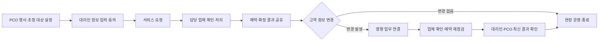

# MICE INVI

## VIP 초청 운영을 하나의 흐름으로

MICE 행사의 해외 VIP 초청은 이름과 여정을 모으는 데서 끝나지 않습니다. 항공편이 바뀌면 공항 이동과 숙박, 현장 의전까지 다시 확인해야 합니다. 정보가 이메일과 엑셀, 담당자 개인의 기억에 흩어져 있으면 누가 변경을 확인했고 실제 예약에 반영했는지 파악하기 어렵습니다.

**MICE INVI는 PCO·협력 업체·VIP 측 대리인이 행사 데이터를 함께 관리하고, 변경의 전달부터 후속 조치 완료까지 추적하도록 설계한 초청 운영 서비스입니다.**

> PCO 담당자는 반복 확인과 전달 업무를 줄이고, 업체는 필요한 최신 요청을 즉시 확인하며, VIP 측은 자기 대표단의 예약과 일정을 빠르게 확인합니다.

## 해결하려는 문제

| 현장의 어려움 | 제품 설계 |
|---|---|
| 요청이 이메일·전화·엑셀로 분산됨 | 행사 → 대표단 → 참가자 → 서비스로 정보를 연결 |
| 변경이 다른 서비스에 미치는 영향을 사람이 판단 | 변경 이슈에 후속 조정 업무를 연결해 진행 상태를 추적 |
| 요청사항과 실제 예약 결과가 뒤섞임 | 고객이 원하는 **요청 정보**와 업체의 **확정 정보**를 분리 |
| 업체에 전달했는지, 확인했는지, 반영했는지 모호함 | 개인 확인·업체 확인·실제 처리 상태를 구분 |
| 여권·건강정보가 필요 이상으로 공유될 수 있음 | 역할·행사·대표단·서비스 범위에 따라 필요한 필드만 공개하고 민감정보 열람을 기록 |
| 행사 종료 후에도 업체 접근이 남을 수 있음 | 정산과 접근 종료를 연결하고 민감정보 파기 흐름을 고려 |

## 역할별 경험

| 사용자 | 필요한 경험 |
|---|---|
| **PCO 관리자** | 행사를 설정하고 내부 팀과 협력 업체의 역할·담당 범위를 관리 |
| **PCO 담당자** | 우선 대응 건, 미종결 변경, 기한 초과 조정, 명단 확인 필요 항목을 한 화면에서 파악 |
| **현장 직원** | 허용된 행사 범위에서 최신 명단과 서비스 정보를 조회 |
| **협력 업체** | 자기에게 배정된 업무와 고객 입력 내용을 확인하고 예약·확정·취소 결과를 등록 |
| **VIP 측 대리인** | 자신이 담당하는 대표단만 확인하고 참가 정보를 입력하며 동의·요청·예약·일정에 회신 |

업체는 맡은 분야의 업무만 봅니다. 예를 들어 항공 업체는 배정된 항공 업무에서 동의가 유효한 발권 정보를 필요할 때 열람합니다. 대리인은 자기 대표단 국가·행사 범위 밖의 정보를 확인할 수 없습니다.

## 업무 흐름

## 핵심 기획 원칙

### 요청과 확정을 분리합니다

대리인이 입력한 희망 여정과 업체가 확보한 항공편은 다른 정보입니다. 요청이 수정되어도 이미 발권된 결과를 덮어쓰지 않고, 업체가 변경 사항을 확인해 새 결과를 등록할 때까지 기존 확정 내역을 보존합니다.

### 변경은 업무 단위로 끝까지 추적합니다

변경 사실을 알린 것과 업체가 실제 예약에 반영한 것은 다릅니다. 변경 전후, 담당 업체 확인, 후속 조정 상태를 연결해 담당자가 미처리 항목을 빠르게 찾도록 합니다. 자동으로 판단하기 어려운 의전·비용·예외 사항은 PCO의 결정으로 남깁니다.

### 각 사용자는 자기 업무에 필요한 정보만 봅니다

접근 범위를 역할, 행사, 대표단, 업무 상태, 필드 기준으로 제한합니다. 권한 밖 정보는 화면에서 숨기는 것에 그치지 않고 데이터 조회 단계에서도 막습니다. 여권 등 민감정보는 별도 동의와 명시적 열람을 적용하고 조회 이력을 남깁니다.

### 누락과 불확실성을 드러냅니다

확정 정보가 없는 상태를 예약 완료처럼 표시하지 않습니다. 필수 정보 누락, 업체 미확인, 확인 기한 초과, 대표단·서비스 간 불일치를 운영자가 발견할 수 있게 합니다.

## 주요 기능

- 행사·대표단·참가자·담당 팀·업체 관리
- 항공·숙박·수송·공항 의전·식음 서비스 요청과 처리 결과 관리
- 업체 배정과 고객 입력 내용의 상세 확인
- 예약 확정·변경·취소 이력 및 처리 내역
- 변경 전후 비교, 업체 확인, 후속 조정 업무와 미종결 현황
- 동의서 버전과 민감정보 열람·파기 기록
- 대표단별 일정·하위 행사와 참석 회신
- 역할별 화면과 대시보드, 한글·영문 중심의 VIP 측 포털

## 성과를 판단하는 지표

제품의 목적은 입력 화면의 수가 아니라 운영 누락과 반복 확인을 줄이는 것입니다. 다음 지표로 효과를 평가하도록 기획했습니다.

- 변경 이슈가 처음 등록된 시점부터 모든 후속 조치가 끝날 때까지 걸린 시간
- 행사 시작 시점의 미종결 변경·조정 건수
- 항공·숙박·식이·현장 이동 등 필수 정보 완결률
- PCO 담당자의 수작업 전달·확인 건수와 1인당 관리 인원
- PCO가 다음 행사에도 서비스를 사용하는 비율

실제 행사 전후의 기준값을 측정해 목표치를 설정해야 합니다. 공개 데모만으로 운영 성과를 입증하지는 않습니다.

## 서비스 범위와 현황

현재 서비스는 역할별 화면, 기본 행사·서비스 흐름, 변경 추적과 범위별 조회를 갖춘 데모로 운영됩니다. 데모에서는 행사 3개, 대표단 6개, 참가자 18명, 서비스 31건의 가상 데이터를 사용합니다. 체험자는 같은 데이터에 접속하므로 변경사항이 공유됩니다. 실제 고객 정보나 진짜 여권을 데모에 입력하지 마세요.

항공·호텔 등 외부 예약 시스템 연동, 이메일·문자 재알림, 모든 변경 영향 규칙의 자동화, 운영사 실제 인증, 백업·보관 정책의 운영 검증은 후속 과제입니다. 현재 제공 범위와 상세 제한은 [구현 현황 및 우선 과제](docs/current-status.md)에 정리했습니다.

## 기획 산출물

문제 정의부터 업무·데이터 분석, 역할별 정보 구조, 시스템 명세, 릴리스 계획, UI 원칙까지 서비스 기획 과정을 문서화했습니다. 최초 설계의 목표와 현재 구현 상태를 분리해 관리합니다.

| 산출물 | 다루는 질문 |
|---|---|
| [문제 정의](docs/00_problem_definition.md) | 누구의 어떤 운영 문제를 해결하며, 성과를 어떻게 판단하는가? |
| [업무·데이터 분석](docs/01_business_data_analysis.md) | 행사 생명주기와 변경·취소·정산 업무는 어떻게 연결되는가? |
| [UX·정보 구조](docs/02_ux_ia_design.md) | PCO·업체·대리인별로 무엇을 보고 어떤 행동을 하는가? |
| [시스템 명세](docs/03_system_spec.md) | 데이터·권한·행동·연계는 어떤 원칙으로 설계하는가? |
| [MVP 로드맵](docs/04_mvp_roadmap.md) | 무엇을 먼저 제공하고 어떤 기능을 후속으로 둘 것인가? |
| [UI 결정·테마](docs/06_ui_decisions.md) · [디자인 토큰](docs/07_theme.md) | 읽기 쉬운 운영 화면과 상태 표현을 어떻게 일관되게 유지하는가? |
| [결정 로그](docs/decisions/DECISION_LOG.md) | 사용자 피드백과 근거가 제품 선택에 어떻게 반영되었는가? |
| [문서 지도·검증 기록](docs/README.md) | 산출물과 실제 구현·검수 결과를 어떻게 대조하는가? |

## 데모

[역할별 데모 체험하기](https://miceinvi.vercel.app/login)

공유 데모에서 PCO의 우선 대응 현황, 업체의 배정 업무·예약 처리, 대리인의 대표단별 확인 흐름을 살펴볼 수 있습니다. 자세한 기능별 확인 방법과 현재 한계는 [데모 데이터 안내](docs/demo-data.md)와 [검토 기록](docs/reviews/REVIEW_LOG.md)을 참고하세요.
