# MICE 해외 VIP 초청자 관리 솔루션 — 업무·데이터 분석서 v0.4

> 문제 정의 v1.0을 바탕으로 작성한 초안입니다. 비개발자도 읽을 수 있도록 설명을 붙였고, 개발팀에 그대로 넘길 수 있도록 ID와 필드 키를 함께 적었습니다.

**변경 이력**

| 버전 | 내용 |
|---|---|
| v0.1 | 최초 작성 |
| v0.4 | 인터뷰 3차 반영: 주최측 관계자 포함(Q11), **대표단 자체 일정** 신설 — PCO 검토 없이 대리인이 등록하고 차량 등 지원 요청(Q12), 하위 행사 수송 자동 생성 MVP 포함(Q13), 상대 대표단 공개 범위(Q14) |
| v0.3 | 인터뷰 2차 반영: **선결제 후 환급** 지원 방식 추가(Q8), 한도 단위 정리(Q9), 예외 보관 대상 확정(Q10), **하위 행사(Program) 구조 신설**, 참가자 간 관계 신설 |
| v0.2 | 인터뷰 1차 반영: 서비스별 제출(Q1), **비용 지원 정책 신설**(Q2), 대리인 다대다·대리인 추가(Q5), **의전 등급 행사별 정의**(Q6), **개인정보 기본 전체 파기 + 예외 보관**(Q7) |

**표기 규칙**

| 표기 | 의미 |
|---|---|
| `[MVP]` | 1차 출시 범위 |
| `[고도화]` | 이후 확장. 지금은 데이터 구조에 자리만 만들어 둠 |
| `[확인 필요]` | 인터뷰로 결정해야 하는 항목 (문서 끝 인터뷰 목록 참고) |
| 🔒 | 민감정보 또는 고유식별정보. 분리 저장·암호화·접근 기록 대상 |

---

# 0. 용어 정의

같은 단어를 다르게 쓰면 개발 과정에서 오해가 생기므로, 이 문서 전체에서 아래 용어로 통일합니다.

| 용어 | 영문 키 | 정의 |
|---|---|---|
| 테넌트 | Tenant | 이 제품을 구독하는 PCO 회사 하나. 데이터가 완전히 분리되는 단위 |
| 행사 | Event | 테넌트가 운영하는 MICE 행사 하나 |
| 대표단 | Delegation | 초청의 기본 단위. VIP 1명과 그 동반자·수행원 묶음. 대리인이 관리하는 범위 |
| 참가자 | Participant | 대표단에 속한 개인. 유형은 VIP / 동반자 / 수행원 |
| 대리인 | Proxy | 대표단 정보를 대신 입력하는 비서·보좌관·대사관 담당자 |
| 업체 | Vendor | 항공·호텔·수송 등 진행 업체. 플랫폼 레벨 계정 |
| 서비스 | Service | 참가자에게 제공되는 항공·숙박·수송·공항의전·식음 등 개별 제공 항목 |
| 요청 데이터 | Request | 참가자 측(대리인)이 원하는 조건. 예: 출발 도시, 체크인 희망일 |
| 확정 데이터 | Fulfillment | 업체가 실제로 확정한 결과. 예: 편명, 객실 번호 |
| 변경 이슈 | Change Issue | 하나의 최초 변경과 그로 인해 연쇄된 모든 조정 작업의 묶음 |
| 조정 항목 | Adjustment Item | 변경 이슈 안에서 누군가 처리해야 하는 개별 작업 하나 |
| 영향 규칙 | Impact Rule | "무엇이 바뀌면 무엇을 조정해야 하는가"를 정의한 규칙 |

---

# 1부. 업무 흐름 정의

## 1.1 전체 업무 지도 (행사 생명주기)

행사 하나는 아래 흐름을 따릅니다. 가운데 "변경 관리"는 특정 단계가 아니라 **초청 발송 이후 정산 전까지 상시 돌아가는 업무**입니다.

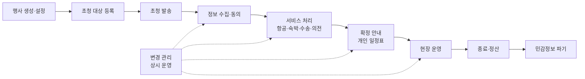

## 1.2 프로세스 목록

| ID | 프로세스 | 주 담당 | 범위 |
|---|---|---|---|
| P01 | 테넌트·사용자·업체 즐겨찾기 관리 | PCO 관리자 | [MVP] |
| P02 | 행사 생성 및 설정 | PCO 관리자·초청 담당자 | [MVP] |
| P02-A | 비용 지원 정책 설정·자동 판정 | PCO + 시스템 | [MVP] (v0.2 신설) |
| P02-B | 의전 등급 체계 정의 | PCO | [MVP] (v0.2 신설) |
| P02-C | 하위 행사(Program) 관리 | PCO | [MVP] (v0.3 신설) |
| P03 | 초청 대상(대표단) 등록 | PCO 초청 담당자 | [MVP] (엑셀 일괄 등록은 [고도화]) |
| P04 | 초청 발송 및 대리인 온보딩 | PCO → 대리인 | [MVP] |
| P05 | 참가 정보 입력 및 동의 | 대리인 | [MVP] |
| P06 | 항공 처리 | 대리인 → 항공 업체 | [MVP] |
| P07 | 숙박 처리 | 대리인 → 호텔 | [MVP] |
| P08 | 수송(배차) 처리 | 수송 업체 | [MVP] |
| P09 | 공항 의전 처리 | 공항 의전 업체 | [MVP] |
| P10 | 식음·기타 요구사항 처리 | 케이터링 등 | [MVP] 식이 요구 전달 / 통역·동반자 프로그램·비자는 [고도화] |
| P11 | 변경 이슈 관리 | 시스템 + PCO + 업체 | [MVP] ⭐ 핵심 |
| P12 | 주최측 요청 처리 | 주최측 → PCO | [MVP] |
| P13 | 개인 일정표 발행·안내 | PCO → 대리인 | [MVP] |
| P14 | 현장 조회 | 현장 스태프 | [MVP] 조회 / 쓰기 기능은 [고도화] |
| P15 | 종료·정산·접근 차단·파기 | PCO + 시스템 | [MVP] |

아래는 프로세스별 상세입니다. 각 프로세스는 **시작 조건 → 단계 → 결과물 → 업무 규칙** 순서로 적었습니다.

---

## P01. 테넌트·사용자·업체 즐겨찾기 관리

**시작 조건**: PCO가 제품을 구독함

| 단계 | 담당 | 내용 |
|---|---|---|
| 1 | PCO 관리자 | 회사 정보 등록, 내부 직원 초대 및 역할 부여 (관리자 / 초청 담당자 / 현장 스태프) |
| 2 | PCO 관리자 | 자주 쓰는 업체를 검색해 즐겨찾기 등록. 플랫폼에 없는 업체는 이메일로 가입 초대 |
| 3 | 업체 | 초대 이메일로 가입. 이미 계정이 있으면 해당 PCO 즐겨찾기에 연결만 됨 |
| 4 | PCO 관리자 | 테넌트 공통 템플릿 관리: 의전 등급 템플릿, 지원 정책 템플릿, 동의서 기본 템플릿, 알림 템플릿, 영향 규칙 기본값 |

**업무 규칙**
- BR-01-1: 업체 계정은 플랫폼에 하나만 존재한다. 여러 PCO가 같은 업체를 즐겨찾기할 수 있다.
- BR-01-2: 업체는 즐겨찾기만으로는 어떤 행사 데이터도 볼 수 없다. 행사에 추가되어야 볼 수 있다.
- BR-01-3: 테넌트 공통 설정은 행사 생성 시 복사되어 기본값이 되고, 행사별로 수정할 수 있다.

---

## P02. 행사 생성 및 설정

| 단계 | 담당 | 내용 |
|---|---|---|
| 1 | PCO | 기본 정보 입력: 행사명(다국어), 기간, 장소, 주최 기관, 기준 시간대, 지원 언어 |
| 2 | PCO | 주최측 사용자 초대 (조회 권한) |
| 3 | PCO | 즐겨찾기에서 업체를 골라 행사에 추가하고 **담당 서비스 유형** 지정 (예: A여행사 = 항공, B호텔 = 숙박) |
| 4 | PCO | **하위 행사 등록**: 본회의, 만찬, 양자 면담, 대표단 주관 부대행사, 동반자 프로그램 등 (P02-C) |
| 5 | PCO | 이 행사에서 운영할 서비스 선택 (항공, 숙박, 수송, 공항 의전, 식음) |
| 5-1 | PCO | **의전 등급 체계 정의**: 템플릿을 불러오거나 새로 만들고, 등급별 기본값 설정 (P02-B) |
| 5-2 | PCO | **비용 지원 정책 정의**: 누구에게 어떤 서비스를 몇 명까지 지원하는지 설정 (P02-A) |
| 6 | PCO | 동의서·공지사항 확정, 입력 마감일 설정, 초청 코드 사용 여부 설정 |
| 7 | PCO | 영향 규칙 검토 (기본값 사용 또는 행사별 조정) |

**결과물**: 상태가 `준비중`인 행사

**업무 규칙**
- BR-02-1: 한 업체가 한 행사에서 여러 서비스 유형을 맡을 수 있다 (예: 여행사가 항공과 수송을 모두 담당).
- BR-02-2: 한 서비스 유형을 여러 업체가 나눠 맡을 수 있다 (예: 호텔 2곳). 이 경우 대표단 단위로 담당 업체를 지정한다.
- BR-02-3: 동의서는 초청 발송 이후 수정 시 새 버전으로 저장되며, 기존 동의자에게 재동의를 요청한다.

---

## P02-A. 비용 지원 정책 (v0.2 신설)

행사마다 "누구의 어떤 비용을 주최측이 부담하는가"가 다릅니다. 예를 들어 VIP 항공은 지원하지만 동반자는 1인까지만 지원하고, 그 이상은 자비로 오는 식입니다. 이를 담당자가 사람마다 기억해서 처리하지 않도록 **정책으로 정의하고 시스템이 자동 판정**합니다.

### 정책 구성

정책은 **서비스 유형 × 참가자 유형** 조합마다 한 줄씩 정의합니다.

| 서비스 | 참가자 유형 | 지원 방식 | 지원 인원 한도 (대표단당) | 한도 초과 시 |
|---|---|---|---|---|
| 항공 | VIP | 지원 | - | - |
| 항공 | 동반자 | 지원 | 1명 | 자비 |
| 항공 | 수행원 | 자비 | - | - |
| 숙박 | VIP | 지원 | - | - |
| 숙박 | 동반자 | 지원 (VIP 객실 동숙) | 1명 | 자비 |
| 숙박 | 수행원 | 지원 | 2명 | 자비 |
| 수송 (공항·공식 하위 행사) | 전체 | 지원 | - | - |
| 수송 (대표단 자체 일정) | VIP·동반자 | 지원 | - | - |
| 공항 의전 | VIP·동반자 | 지원 | - | - |

위 표는 예시입니다. 필요하면 **의전 등급별로 다른 정책**을 둘 수 있게 합니다 (예: 장관급 대표단은 수행원 항공 2명까지 지원).

### 지원 방식 코드

| 코드 | 의미 | 예약 주체 | 확정 정보 입력 |
|---|---|---|---|
| 지원 (SUPPORTED) | 주최측이 비용 부담 | 업체 | 업체 |
| 자비·직접 예약 (SELF_BOOKED) | 참가자가 직접 예약·결제 | 참가자 | 대리인 |
| 선결제 후 환급 (PREPAID_REIMBURSE) | 지원 대상이지만 참가자가 먼저 결제하고, 증빙 제출 후 정산받음 | 참가자 | 대리인 |
| 자비·예약 대행 (SELF_PAID_ARRANGED) | 업체가 예약하고 비용은 참가자가 부담 | 업체 | 업체 |
| 제공 안 함 (NOT_PROVIDED) | 이 서비스를 제공하지 않음 | - | - |

> `자비·예약 대행`은 코드만 정의하고 **고도화**에서 운영합니다 (결제·정산 연동 필요, Q8 결정). `선결제 후 환급`은 **MVP**에서 청구·증빙·승인 상태 관리까지 지원하고, 실제 송금은 시스템 밖에서 처리한 뒤 결과만 기록합니다.

### 한도 단위 (Q9 반영)

지원 한도는 **대표단 단위**로 정의합니다. 현업에서 자주 쓰이는 세 가지 형태를 템플릿으로 제공합니다.

| 템플릿 | 설정 방법 |
|---|---|
| VIP만 지원 | VIP = 지원 / 동반자·수행원 = 자비 |
| VIP + 동반 1인 지원 | VIP = 지원 / 동반자 = 지원(한도 1명, 초과 자비) / 수행원 = 자비 |
| 대표단 전체 지원 | 참가자 유형 "전체" = 지원, 한도 없음 |

행사 전체 단위 한도(예: 전체 동반자 항공 30석)는 고도화에서 `support_policy`에 행사 단위 한도 필드를 추가하는 방식으로 확장합니다.

### 업무 규칙
- BR-02A-1: 참가자가 추가되거나 유형이 바뀌면 시스템이 정책에 따라 서비스별 **지원 여부를 자동 판정**한다.
- BR-02A-2: 한도를 넘는 인원이 있을 때 **누가 지원 대상인지는 대리인이 지정**한다. 지정하지 않으면 먼저 등록된 순서로 판정한다. PCO는 언제든 변경할 수 있다.
- BR-02A-3: PCO는 정책과 다르게 개별 **예외 지정**을 할 수 있다 (예: 주최측 지시로 특정 수행원 항공 지원). 예외는 사유와 함께 기록되고, 대시보드에서 "정책 예외" 로 구분 표시된다.
- BR-02A-4: 지원 여부가 바뀌면(예: 동반자가 2명에서 1명으로 줄어 자비였던 사람이 지원 대상이 됨) 변경 이슈를 만든다 (IR-12).
- BR-02A-5: 대리인 화면에는 참가자별·서비스별로 **"지원" / "자비"** 가 명확히 표시되고, 자비 항목은 입력 방식이 달라진다 (P06 참고).
- BR-02A-6: 자비 참가자도 수송·공항 의전 등 다른 서비스는 정책에 따라 지원받을 수 있다. 서비스마다 독립적으로 판정한다.
- BR-02A-7: **선결제 후 환급**은 PCO가 참가자·서비스 단위로 지정한다 (정책 기본값으로 두지 않음). 지정 시 환급 한도 금액을 함께 정할 수 있다 (예: 비즈니스석 기준 금액까지).
- BR-02A-8: 선결제 후 환급 참가자의 확정 정보(편명 등)는 자비·직접 예약과 동일하게 대리인이 입력하며, 연쇄 흐름도 같다. 여기에 **환급 청구**(증빙 제출 → 검토 → 승인 → 지급 기록)가 추가된다.
- BR-02A-9: 환급 청구 증빙은 🔒 수준으로 관리한다 (결제 카드·계좌 정보가 포함될 수 있음). 지급 계좌 정보는 MVP에서 수집하지 않고, 지급 방식은 PCO가 시스템 밖에서 안내한다.

---

## P02-B. 의전 등급 체계 (v0.2 신설)

의전 등급은 업계 표준이 없고 행사마다 다르므로 **행사 단위로 정의**합니다.

| 단계 | 내용 |
|---|---|
| 1 | 테넌트 템플릿 중 하나를 불러오거나 빈 상태에서 시작 (플랫폼이 4단계 예시 템플릿 제공) |
| 2 | 등급 이름, 순서, 등급별 기본값(객실 타입, 차종, 공항 의전 범위, 좌석 등급) 설정 |
| 3 | 필요 시 등급별 지원 정책 연결 |
| 4 | 이 행사에서 만든 체계를 테넌트 템플릿으로 저장 가능 (다음 행사 재사용) |

- BR-02B-1: 행사가 `초청 진행` 상태가 된 뒤 등급 기본값을 바꾸면, 해당 등급의 모든 대표단에 대해 IR-11(PCO 판단)이 전개된다.

---

## P02-C. 하위 행사(Program) 관리 (v0.3 신설)

정상회의급 행사에는 본회의 외에도 성격이 전혀 다른 일정이 많이 붙습니다. 예를 들어 한-아프리카 정상회의라면, 본회의와 공식 만찬 외에 특정국 대통령이 주관하는 재한 교민 간담회, 정상 간 개별 양자 면담 등이 따로 열립니다. 이들은 **참석자, 주관자, 공개 범위, 필요한 서비스가 각각 다르기 때문에** 단순한 "일정 목록"이 아니라 독립된 관리 대상인 **하위 행사**로 다룹니다.

### 하위 행사 유형

| 유형 | 예시 | 주관 | 참석 범위 | 기본 공개 범위 |
|---|---|---|---|---|
| 본회의·세션 | 정상회의 본회의, 분과 세션 | 주최측 | 전체 또는 다수 대표단 | 전체 공개 |
| 공식 연회 | 환영 만찬, 오찬, 리셉션 | 주최측 | 전체 또는 초청 대상 | 전체 공개 |
| 양자·다자 면담 | 정상 간 개별 면담 | 주최측 또는 대표단 | 2개 이상 대표단 | 관계자 한정 |
| 대표단 주관 행사 | 교민 간담회, 투자 설명회, 문화 행사 | 특정 대표단 | 주관 대표단 + 외부 참석자 | 관계자 한정 |
| 동반자 프로그램 | 배우자 문화 탐방 | 주최측 | 동반자 | 전체 공개 |
| 의전 행사 | MOU 서명식, 공동 기자회견, 기념 식수 | 주최측 또는 대표단 | 지정 대표단 | 관계자 한정 |
| **대표단 자체 일정** (v0.4) | 대사관 주최 교민 간담회, 자국 기업 방문, 개별 만찬 | 대표단 (PCO 관여 없음) | 자기 대표단 + 외부 | 관계자 한정 |

### 흐름

| 단계 | 담당 | 내용 |
|---|---|---|
| 1 | PCO | 하위 행사 생성: 유형, 명칭, 주관 주체, 일시, 장소, 공개 범위. 확정 전이면 **가안**으로 등록 |
| 2 | PCO | 참석 대상 지정: 대표단 단위 또는 참가자 단위. 참가자별 역할(주관, 발표자, 참석, 수행) 지정 |
| 3 | PCO | 필요 서비스 지정: 수송, 통역, 케이터링 등과 담당 업체 |
| 4 | 대리인 | 공개된 하위 행사의 참석 여부 회신, 대표단 주관 행사는 참석 명단 입력. **자체 일정은 대리인이 직접 등록** (아래 참고) |
| 5 | PCO | 확정 처리 → 참석 확정자 기준으로 수송 요청 등 자동 생성, 일정표 반영 |
| 6 | 시스템 | 확정 후 일시·장소·참석자 변경 시 변경 이슈 생성 (IR-13~16) |

### 업무 규칙
- BR-02C-1: 하위 행사는 **2단계까지 계층**을 가질 수 있다 (예: 본회의 > 세션 1, 세션 2).
- BR-02C-2: **주관 주체**는 주최측, 특정 대표단, PCO 중 하나다. 대표단 주관 행사는 그 대표단이 "주관 대표단"으로 연결된다.
- BR-02C-3: **공개 범위**는 전체 공개 / 관계자 한정 / 비공개(PCO만) 중 하나다. 관계자는 참석 대표단의 대리인, 담당 업체, PCO다. 공개 범위 밖의 사용자에게는 하위 행사가 존재한다는 사실 자체가 보이지 않는다. 주최측 공개 여부는 인터뷰 Q11.
- BR-02C-4: **가안 상태**의 하위 행사는 업체에 전파되지 않고 변경 이슈도 만들지 않는다. 양자 면담처럼 여러 번 바뀌다 확정되는 일정 때문에 불필요한 연쇄 알림이 쏟아지는 것을 막는다.
- BR-02C-5: **참석은 참가자 단위**로 기록하고 역할을 가진다. 한 참가자가 하위 행사마다 다른 역할을 가질 수 있다 (본회의 = 참석, 교민 간담회 = 주관, 세션 2 = 발표자).
- BR-02C-6: **외부 참석자**(교민 등 초청 대상이 아닌 인원)는 MVP에서 예상 인원 수만 기록한다. 케이터링·장소 규모 판단에 쓰인다. 명단 관리는 고도화.
- BR-02C-7: **일정 충돌 경고.** 같은 참가자가 시간이 겹치는 하위 행사에 참석 확정되면 경고한다. 또 입국 도착 전이나 귀국 출발 후의 하위 행사에 배정되면 경고한다 (항공 확정 정보 연동).
- BR-02C-8: 하위 행사가 확정되면 참석 확정자를 기준으로 **수송 요청(숙소 ↔ 장소)이 자동 생성**된다. 같은 대표단 참석자는 한 수송 요청으로 묶는다.

### 대표단 자체 일정 (v0.4, Q12 반영)

공식 하위 행사와 달리 **PCO가 기획·검토하지 않는** 대표단의 개별 일정입니다. 예를 들어 대사관이 준비한 교민 간담회에 대통령이 참석하는 경우, PCO는 행사 내용에는 관여하지 않지만 **이동 차량은 지원해야** 할 수 있습니다. 이 일정을 시스템 밖에 두면 공식 일정과의 충돌이나 차량 배차 누락을 잡을 수 없으므로, 대리인이 가볍게 등록할 수 있는 별도 유형으로 둡니다.

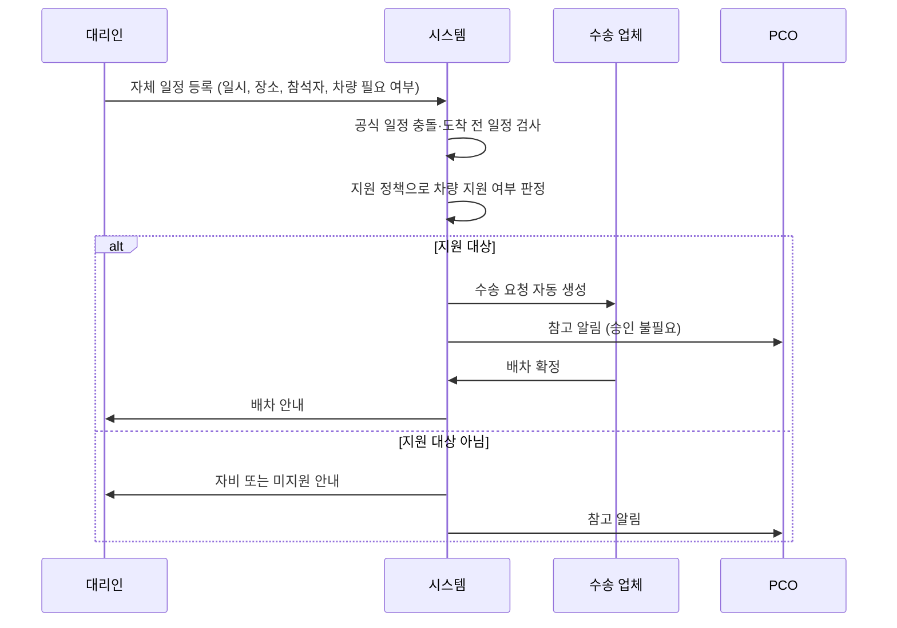

- BR-02C-9: 자체 일정은 **대리인이 직접 등록**하며 PCO 승인 없이 곧바로 `확정` 상태가 된다. PCO는 참고 알림을 받고, 대시보드에서 전체 자체 일정을 볼 수 있다.
- BR-02C-10: 자체 일정에서 대리인이 요청할 수 있는 서비스는 MVP에서 **수송(차량)** 이다. 통역 등은 고도화. 그 외 필요한 도움은 메모로 PCO에 전달한다.
- BR-02C-11: 차량 지원 여부는 지원 정책의 "수송(대표단 자체 일정)" 항목으로 판정한다. 공항·공식 일정 수송과 별도로 정책을 둘 수 있다.
- BR-02C-12: 등록은 일정 시작 **24시간 전까지** 권장한다. 그보다 늦게 등록하면 대리인에게 "배차가 불가능할 수 있음"을 안내하고, 수송 요청에 긴급 표시를 붙이며 PCO에게도 알린다 (기준 시간은 행사별 설정).
- BR-02C-13: 자체 일정도 확정 후 일시·장소·참석자가 바뀌면 공식 하위 행사와 똑같이 변경 이슈가 생성된다 (IR-13~16).
- BR-02C-14: PCO는 자체 일정을 수정할 수는 없지만, 충돌이나 보안상 문제가 있으면 **조정 요청**을 보낼 수 있다. 조정 요청은 대리인에게 알림으로 전달된다.
- BR-02C-15: 자체 일정의 공개 범위는 관계자 한정으로 고정된다. 관계자는 해당 대표단 대리인, PCO, 주최측(Q11), 그리고 배차를 맡은 수송 업체다. 수송 업체는 일정 내용이 아니라 **출발지·목적지·시각·탑승자**만 본다.

---

## P03. 초청 대상(대표단) 등록

| 단계 | 담당 | 내용 |
|---|---|---|
| 1 | PCO | 대표단 생성: 국가, 소속 기관, 대표 VIP의 이름·직함·호칭(H.E. 등) |
| 2 | PCO | 의전 등급 지정 |
| 3 | PCO | 대리인 이메일 등록 (1명 이상) |
| 4 | PCO | 담당 업체 지정 (서비스 유형별 업체가 2곳 이상일 때) |
| 5 | PCO | 동반자·수행원 예상 인원 입력 (선택. 실제 명단은 대리인이 입력) |

**업무 규칙**
- BR-03-1: 대표단은 반드시 VIP 1명을 가진다. 동반자·수행원은 0명 이상.
- BR-03-2: 대리인 1명이 여러 대표단을 맡을 수 있고, 한 대표단에 여러 대리인이 있을 수 있다 (다대다). 여러 대표단을 맡은 대리인은 로그인 후 대표단을 전환하며 작업한다.
- BR-03-3: [고도화] 엑셀 템플릿 다운로드·업로드로 일괄 등록, 과거 행사 대표단 불러오기.

---

## P04. 초청 발송 및 대리인 온보딩

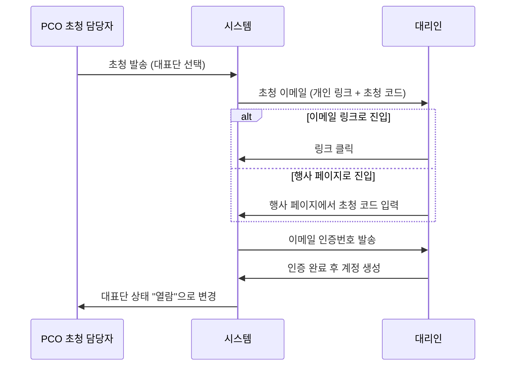

**업무 규칙**
- BR-04-1: 초청 코드만으로는 접속할 수 없고, 반드시 등록된 대리인 이메일 인증을 거친다. 사칭 방지를 위한 규칙.
- BR-04-2: 대리인은 다른 대리인을 추가 요청할 수 있고, PCO 승인 후 활성화된다. 대리인이 인수인계 등으로 바뀌는 경우도 같은 방식으로 처리한다.
- BR-04-3: 초청 이메일이 반송되면 PCO에게 즉시 알린다.
- BR-04-4: 입력 마감일 기준 D-7, D-3, D-1에 미제출 대표단의 대리인에게 자동 독촉 메일을 보낸다 (시점은 행사별 설정).

---

## P05. 참가 정보 입력 및 동의

대리인이 보는 입력 화면은 아래 순서로 진행됩니다. 중간 저장이 가능하고, 마지막에 "제출"합니다.

| 단계 | 입력 내용 | 비고 |
|---|---|---|
| 1 | 동의서 확인 및 체크 | 필수 / 선택 / 민감정보 / 고유식별정보 동의를 따로 체크 |
| 2 | 참석 여부 회신 | 불참 시 여기서 종료 |
| 3 | VIP 정보 | 여권상 영문 성명, 직함, 국적, 연락처 등 |
| 4 | 동반자·수행원 추가 | 인원 추가 후 각자 정보 입력 |
| 5 | 🔒 여권 정보 | 여권번호, 만료일, 사본 업로드 |
| 6 | 🔒 건강·종교·접근성 | 의료 사항, 알레르기, 이동 보조, 종교 |
| 7 | 서비스 요청 | 항공 여정 요청, 숙박 희망, 식이 요구 |
| 8 | 검토 및 제출 | 누락 항목 자동 표시 |

**업무 규칙**
- BR-05-1: 민감정보 동의를 하지 않으면 해당 항목(5, 6단계)은 입력할 수 없다. 대신 "현장에서 직접 제공" 선택지를 둔다.
- BR-05-2: 여권 만료일이 행사 종료일로부터 6개월 이내면 경고를 표시한다.
- BR-05-3: 제출 후에도 대리인은 수정할 수 있다. 단, **해당 서비스가 이미 처리중이거나 확정된 뒤의 수정은 변경 이슈를 생성한다** (P11).
- BR-05-4: 동반자·수행원 추가·삭제도 변경 이슈를 생성한다 (숙박·수송·식음 인원에 영향).
- BR-05-5: 종교 정보는 케이터링 업체에 전달되지 않는다. 대신 대리인이 선택한 **식이 코드**(할랄, 코셔, 채식 등)만 전달된다. 최소 정보 제공 원칙.
- BR-05-6: **서비스별 제출.** 대표단 전체 제출을 기다리지 않고, 서비스 요청은 해당 서비스 단위로 제출할 수 있다. 예를 들어 항공 요청만 먼저 제출하면 항공 업체가 바로 착수한다. 대표단 "제출 완료"는 모든 필수 항목이 채워졌다는 의미로 쓴다.

---

## P06. 항공 처리 (요청 → 이행 패턴의 기준 모델)

항공은 문제 정의에서 확인한 "요청 → 이행" 흐름의 대표 사례입니다. 숙박·공항 의전도 같은 패턴을 따릅니다.

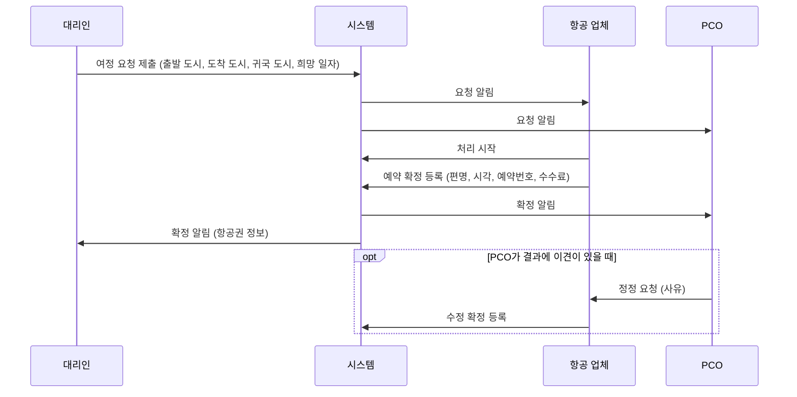

**항공 요청 데이터 (대리인 입력)**: 입국 출발 도시, 입국 도착 공항, 희망 입국일, 귀국 출발일, 귀국 도착 도시, 특이 요청(메모)

**항공 확정 데이터 (업체 입력)**: 구간별 편명, 출발·도착 공항, 출발·도착 일시, 좌석 등급, 예약번호, 항공권 번호, 변경 수수료, 발권 상태

**업무 규칙**
- BR-06-1: PCO 승인 없이 업체가 바로 처리한다. PCO는 결과를 보고 정정 요청을 보낼 수 있다.
- BR-06-2: 항공편은 **구간(segment)** 단위로 저장한다. 경유가 있으면 입국 여정이 2개 이상의 구간을 가진다. 다른 서비스에 영향을 주는 값은 **입국 최종 도착 구간**과 **귀국 첫 출발 구간**이다.
- BR-06-3: 업체가 확정 정보를 수정하면 이전 확정값은 이력으로 남고, 영향 규칙에 따라 변경 이슈가 생성된다.
- BR-06-4: **자비·직접 예약** 참가자는 항공 요청 단계 없이 대리인이 확정 정보(편명, 시각, 예약번호)를 직접 입력한다. 항공 업체에는 넘어가지 않지만, 입력된 도착·출발 정보로 수송·공항 의전·숙박 연쇄는 동일하게 작동한다.
- BR-06-6: 자비 참가자의 항공 정보가 입국 D-7까지 입력되지 않으면 대리인에게 독촉, D-3에 PCO에 경고한다 (수송 배차가 불가능해지므로).
- BR-06-5: 변경 수수료는 승인 조건이 아니라 기록 항목이다. PCO 대시보드에 행사별 누적 수수료를 보여준다.

---

## P07. 숙박 처리

| 단계 | 담당 | 내용 |
|---|---|---|
| 1 | 대리인 | 숙박 요청: 체크인·체크아웃 희망일, 객실 구성(누가 같은 방을 쓰는지), 특이 요청 |
| 2 | 시스템 | 항공 확정 시 체크인 시각 참고값 자동 표시 (도착 시각 + 이동 시간) |
| 3 | 호텔 | 객실 배정 확정: 객실 타입, 예약번호, 체크인·아웃 일시 (객실 번호는 [고도화] 현장에서 입력) |
| 4 | 시스템 | PCO·대리인에게 확정 알림 |

**업무 규칙**
- BR-07-1: 숙박은 **객실 단위**로 관리하고, 한 객실에 참가자 여러 명을 연결한다 (VIP와 배우자 동숙).
- BR-07-2: 객실 타입 등급은 의전 등급별 기본값을 둘 수 있다 (예: 장관급 = 스위트). `[고도화]`

---

## P08. 수송(배차) 처리

수송은 대리인이 요청하지 않습니다. **다른 서비스의 확정 데이터로부터 시스템이 수송 요청을 자동 생성**합니다.

| 수송 요청 발생 원인 | 자동 생성되는 수송 구간 |
|---|---|
| 입국 항공편 확정 | 도착 공항 → 숙소 |
| 귀국 항공편 확정 | 숙소 → 출발 공항 |
| 하위 행사 참석 확정 | 숙소 ↔ 하위 행사 장소 (BR-02C-8) |

| 단계 | 담당 | 내용 |
|---|---|---|
| 1 | 시스템 | 수송 요청 자동 생성 (구간, 희망 시각, 탑승 인원, 짐 규모) |
| 2 | 수송 업체 | 배차 확정: 차량, 차종, 기사 이름·연락처, 출발 시각 |
| 3 | 시스템 | PCO·대리인에게 확정 알림. 현장 앱에 표시 |

**업무 규칙**
- BR-08-1: 배차는 **차량 단위**로 관리하고, 한 차량에 참가자 여러 명을 연결한다. 한 대표단이 여러 차량을 쓸 수 있다 (VIP 차량 + 수행원 차량).
- BR-08-2: 차종 기본값은 의전 등급에서 가져온다.

---

## P09. 공항 의전 처리

| 단계 | 담당 | 내용 |
|---|---|---|
| 1 | 시스템 | 항공 확정 시 입국·출국 의전 요청 자동 생성 |
| 2 | PCO | 의전 범위 지정: 영접 인사, 패스트트랙, 라운지, 수하물 대행 등 (등급별 기본값) |
| 3 | 공항 의전 업체 | 배정 확정: 담당 요원, 만남 장소, 시각 |

---

## P10. 식음·기타 요구사항 처리

| 서비스 | MVP 처리 방식 |
|---|---|
| 식이 요구 | 대리인 입력 식이 코드 → 케이터링 업체가 "반영 확인" |
| 통역 | [고도화] |
| 동반자 프로그램 | [고도화] 동반자별 프로그램 신청과 인원 집계 |
| 비자·초청장 | [고도화] 초청장 발급 요청과 발급 상태 추적 |

모든 서비스는 동일한 **서비스 항목** 구조(요청 → 이행)를 쓰기 때문에, 새 서비스 유형을 추가할 때 데이터 구조를 새로 만들 필요 없이 서비스 유형 코드와 세부 필드만 추가하면 됩니다.

---

## P11. 변경 이슈 관리 ⭐

### 흐름

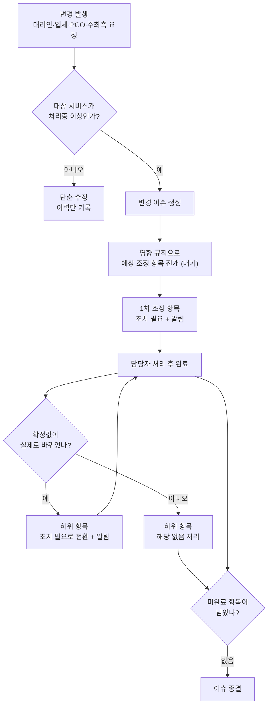

### 단계별 설명

| 단계 | 내용 |
|---|---|
| 1. 감지 | 서비스 항목의 요청값 또는 확정값이 바뀌면 시스템이 감지한다. 참가자 추가·삭제, 참석 취소도 감지 대상이다 |
| 2. 이슈 생성 | 대상 서비스가 `처리중` 이상이면 변경 이슈를 만든다. 아직 `요청됨` 상태면 이슈 없이 이력만 남긴다 (업체가 착수 전이라 연쇄가 없음) |
| 3. 예상 전개 | 영향 규칙을 따라 2차, 3차… 조정 항목을 미리 `대기` 상태로 펼친다. 담당자는 앞으로 생길 일을 미리 본다 |
| 4. 1차 알림 | 첫 조정 항목을 `조치 필요`로 바꾸고 담당 업체와 PCO에 알린다 |
| 5. 처리 | 업체가 확인(`처리중`) → 반영(`완료`) |
| 6. 연쇄 | 완료 시 확정값이 실제로 바뀌었으면 하위 항목을 `조치 필요`로 전환, 안 바뀌었으면 하위를 `해당 없음`으로 자동 종료 |
| 7. 판단 노드 | 사람이 결정해야 하는 항목(예: 만찬 참석 가능 여부)은 PCO에게 배정되고, 결정 결과에 따라 하위 전개가 달라진다 |
| 8. 종결 | 모든 항목이 `완료`·`해당 없음`·`무효`면 이슈 자동 종결 |

### 업무 규칙
- BR-11-1: **재변경 시 무효화.** 이슈가 진행 중인데 같은 원천 값이 다시 바뀌면, 기존 이슈의 미완료 항목은 `무효`가 되고 새 이슈가 생성된다. 기존 이슈는 `대체됨`으로 종료되며 새 이슈와 연결된다.
- BR-11-2: **완료 항목의 무효화.** 이미 `완료`된 항목도 재변경으로 다시 바뀌어야 하면 새 이슈에서 새 조정 항목으로 다시 생긴다 (완료 기록은 지우지 않는다).
- BR-11-3: **긴급도 자동 계산.** 조정 항목의 긴급도는 영향받는 서비스의 실행 시각까지 남은 시간으로 계산한다. 기본값: 24시간 이내 = 긴급, 72시간 이내 = 주의, 그 외 = 일반. 기준은 행사별 설정 가능.
- BR-11-4: **미확인 재알림.** `조치 필요` 상태로 일정 시간(기본 2시간, 긴급은 30분)이 지나면 업체에 재알림, 한 번 더 지나면 PCO에 에스컬레이션.
- BR-11-5: **순환 방지.** 영향 규칙은 같은 서비스로 되돌아오는 경로를 만들 수 없다. 전개 최대 깊이는 기본 6단계.
- BR-11-6: **PCO 강제 종결.** PCO는 사유를 남기고 이슈를 강제 종결할 수 있다.
- BR-11-7: **변경 출처 기록.** 모든 이슈는 출처(대리인 / 업체 / PCO / 주최측 요청)를 가진다. 주최측 요청에서 나온 이슈는 해당 요청과 연결된다.

### 영향 규칙 기본값 (플랫폼 제공)

| 규칙 ID | 변경 트리거 | 영향 대상 | 조치 내용 | 처리 방식 |
|---|---|---|---|---|
| IR-01 | 항공 요청값 변경 (도시·일자) | 항공 | 재예약 | 자동 |
| IR-02 | 입국 최종 도착 일시·공항 변경 | 수송 (공항→숙소) | 재배차 | 자동 |
| IR-03 | 입국 최종 도착 일시·공항 변경 | 공항 의전 (입국) | 재배정 | 자동 |
| IR-04 | 입국 최종 도착 일시 변경 | 숙박 | 체크인 시각 조정 | 자동 |
| IR-05 | 입국 최종 도착 일시 변경 | 하위 행사 참석 | 도착 전 하위 행사 참석 가능 여부 | PCO 판단 |
| IR-06 | 귀국 출발 일시·공항 변경 | 수송 (숙소→공항), 공항 의전 (출국), 숙박 (체크아웃) | 각각 재조정 | 자동 |
| IR-07 | 하위 행사 불참 확정 | 식음, 수송, 좌석 배치 [고도화] | 인원 조정 | 자동 |
| IR-08 | 참가자 추가·삭제 | 항공, 숙박, 수송, 식음, 공항 의전 | 인원 반영 | 자동 |
| IR-09 | 참석 취소 (대표단 전체) | 전체 서비스 | 취소 처리 | 자동 |
| IR-10 | 식이 코드 변경 | 식음 | 반영 확인 | 자동 |
| IR-11 | 의전 등급 변경 | 숙박, 수송, 공항 의전 | 등급 재검토 | PCO 판단 |
| IR-13 | 하위 행사 일시 변경 (확정 후) | 수송, 통역, 식음, 참석자 일정표 | 재배차, 재배정, 일정표 재발행 | 자동 |
| IR-14 | 하위 행사 장소 변경 (확정 후) | 수송, 식음 | 재배차, 장소 변경 반영 | 자동 |
| IR-15 | 하위 행사 참석자 추가·삭제 | 수송, 식음, 통역 | 인원 반영 | 자동 |
| IR-16 | 하위 행사 취소 | 연결된 모든 서비스, 참석자 일정표 | 취소 처리 | 자동 |
| IR-12 | 지원 여부 변경 (지원↔자비) | 해당 서비스 | 자비→지원: 업체 예약 요청 생성 / 지원→자비: 업체 예약 취소 여부 | 자비→지원 자동 / 지원→자비 PCO 판단 |

---

## P12. 주최측 요청 처리

| 단계 | 담당 | 내용 |
|---|---|---|
| 1 | 주최측 | 요청 등록: 제목, 내용, 관련 대표단(선택), 희망 기한 |
| 2 | PCO | 검토 후 수락 또는 반려(사유) |
| 3 | PCO | 수락 시 직접 데이터 수정. 수정이 변경 이슈를 만들면 요청과 자동 연결 |
| 4 | 시스템 | 연결된 이슈가 모두 종결되면 요청을 "완료 대기"로 표시, PCO가 완료 처리 |
| 5 | 시스템 | 주최측에 결과 알림 |

**업무 규칙**
- BR-12-1: 주최측은 어떤 데이터도 직접 수정할 수 없다. 모든 수정은 PCO를 거친다.

---

## P13. 개인 일정표 발행·안내

| 단계 | 담당 | 내용 |
|---|---|---|
| 1 | 시스템 | 대표단별 일정표 자동 생성: 항공, 픽업, 숙박, 공항 의전, 참석 확정된 하위 행사(공개 범위 적용), 담당자 연락처 |
| 2 | PCO | 미리보기 확인 후 발행 |
| 3 | 시스템 | 대리인에게 이메일 발송. 대리인 화면에서 항상 최신본 조회 가능 |
| 4 | 시스템 | 발행 후 내용이 바뀌면 "재발행 필요" 표시. 변경 이슈 종결 시 PCO에게 재발행 제안 |

**업무 규칙**
- BR-13-1: 일정표는 발행 시점의 스냅샷을 이력으로 보관한다. 대리인이 어떤 버전을 받았는지 추적하기 위함.
- BR-13-2: 일정표 언어는 대표단의 선호 언어를 따른다. [MVP]는 영문·국문. 기타 언어는 [고도화].

---

## P14. 현장 조회 (현장 스태프 앱)

| 조회 화면 | 내용 |
|---|---|
| 오늘의 도착·출국 | 시각순 VIP 목록, 편명, 픽업 차량, 의전 요원 |
| 대표단 카드 | 구성원, 호칭, 의전 등급, 숙소, 차량 |
| 긴급 이슈 | 오늘 실행 예정인데 미종결인 변경 이슈 |

**업무 규칙**
- BR-14-1: 🔒 민감정보는 마스킹한다. 단, 의료 사항 중 PCO가 "현장 공유"로 지정한 항목만 표시한다.
- BR-14-2: [고도화] 도착 확인, 탑승 확인, 체크인 확인 등 상태 입력.

---

## P15. 종료·정산·접근 차단·파기

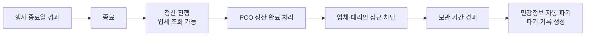

**업무 규칙**
- BR-15-1: 정산 완료 처리 시점에 업체, 대리인, 주최측의 해당 행사 접근이 모두 차단된다. PCO만 파기 전까지 조회할 수 있다.
- BR-15-2: 행사 종료 후 30일이 지나도 정산 완료 처리가 안 되면 PCO에게 매주 리마인더. 90일이 지나면 자동으로 정산 완료 처리된다 (기간은 설정 가능).
- BR-15-3: 개인정보(민감정보 포함)는 정산 완료 후 보관 기간(기본 30일)이 지나면 자동 파기된다. 파기 대상, 일시, 방식을 기록으로 남긴다.
- BR-15-4: **기본은 전체 파기.** 민감정보뿐 아니라 이름, 연락처 등 개인을 알아볼 수 있는 모든 정보를 파기한다. 행사 기록에는 국가, 참가자 유형, 인원 수 같은 통계용 비식별 정보만 남는다.
- BR-15-5: **예외 보관.** PCO가 특정 참가자에 대해 보관이 필요하다고 지정하고(사유 필수), 정보주체의 **별도 보관 동의**를 받은 경우에만 지정된 항목을 보관한다. 보관 기간을 반드시 정하고, 기간이 끝나면 자동 파기한다. 보관 가능 항목은 아래로 한정한다 (Q10 결정).

| 보관 가능 항목 | 예시 | 비고 |
|---|---|---|
| 식별 기본 정보 | 성명, 직함, 소속, 국적 | 재초청 시 매칭용 |
| 의전 선호 | 호칭 방식, 좌석 선호, 선호 음료, 동선 선호 | `protocol_preference` |
| 식이 코드 | 할랄, 채식 등 | 종교를 추정할 수 있어 동의 문구에 명시 |
| 참가자 간 관계 | 배우자, 동일 기관, 동석 회피 필요 등 | `participant_relation` |
| 행사 내 역할 이력 | 발표자, 대표단 주관 행사 개최, 특별 이벤트 진행 | `program_attendance.role` 에서 추출 |

- 여권·건강·종교 원본, 연락처, 환급 증빙은 **예외 보관 대상이 아니다.**
- BR-15-7: 미처리 환급 청구(검토중·승인 후 미지급)가 있으면 정산 완료 처리 시 경고한다. 환급 증빙의 회계상 보관 의무는 고도화 규정 논의 때 확인한다.
- BR-15-6: 예외 보관 동의는 행사 동의서에 선택 항목으로 넣거나, 행사 후 대리인에게 별도로 요청할 수 있다. 동의가 없으면 예외 지정은 효력이 없다.

---

# 2부. 데이터 정의

## 2.1 데이터 설계 원칙

이 원칙들은 "나중에 기능을 붙여도 뜯어고치지 않는 구조"를 위한 약속입니다.

| 원칙 | 내용 | 이유 |
|---|---|---|
| D1. 테넌트 격리 | 모든 행사 데이터는 테넌트 ID를 가진다. 업체만 예외적으로 플랫폼 레벨 | SaaS에서 PCO 간 데이터가 섞이면 치명적 |
| D2. 요청·확정 분리 | 모든 서비스는 요청 데이터와 확정 데이터를 다른 곳에 저장한다 | 누가 무엇을 원했고 무엇이 확정됐는지 항상 구분 |
| D3. 서비스 일반화 | 항공·숙박·수송 등을 공통 "서비스 항목" 틀에 담고, 유형별 세부 정보만 따로 둔다 | 새 서비스(통역, 비자 등) 추가 시 구조 변경 최소화 |
| D4. 이력 불변 | 데이터를 덮어쓰기 전 이전 값을 변경 이력에 남긴다. 이력은 수정·삭제 불가 | 사고 원인 추적, 인수인계, 분쟁 대응 |
| D5. 민감정보 분리 | 🔒 정보는 별도 저장소에 암호화하고, 조회할 때마다 접근 기록을 남긴다 | 유출 범위 최소화, 파기 용이 |
| D6. 다국어 필드 | 행사명, 일정명, 안내 문구 등 외부 노출 텍스트는 언어별 값을 가진다 | 해외 VIP 대상 |
| D7. 시간대 명시 | 모든 일시는 표준시(UTC)로 저장하고, 표시할 때 현지 시간으로 변환한다. 항공 시각은 현지 시각과 공항 시간대를 함께 저장 | 해외 출발 항공편의 시각 혼동 방지 |
| D8. 코드 테이블 | 참가자 유형, 서비스 유형, 식이 코드 등 선택지는 코드로 관리한다 | 선택지 추가를 개발 없이 설정으로 |

## 2.2 데이터 영역과 엔티티 목록

"엔티티"는 시스템이 관리하는 정보 덩어리 하나(엑셀로 치면 시트 하나)입니다.

| 영역 | 엔티티 | 영문 키 | 설명 | 범위 |
|---|---|---|---|---|
| **A. 플랫폼·조직** | 테넌트 | `tenant` | PCO 회사 | MVP |
| | 사용자 | `user` | 로그인하는 모든 사람 (PCO 직원, 주최측, 업체 직원, 대리인) | MVP |
| | 테넌트 멤버 | `tenant_member` | PCO 직원의 테넌트 내 역할 | MVP |
| | 업체 | `vendor` | 플랫폼 레벨 업체 | MVP |
| | 업체 멤버 | `vendor_member` | 업체 소속 직원 | MVP |
| | 업체 즐겨찾기 | `tenant_vendor_favorite` | PCO의 업체 즐겨찾기 | MVP |
| **B. 행사** | 행사 | `event` | 행사 기본 정보 | MVP |
| | 행사 멤버 | `event_member` | 행사별 사용자 역할 (주최측, PCO 담당자, 현장 스태프) | MVP |
| | 행사 참여 업체 | `event_vendor` | 행사에 추가된 업체와 담당 서비스 유형 | MVP |
| | 하위 행사 | `program` | 본회의, 연회, 양자 면담, 대표단 주관 행사 등 (v0.3) | MVP |
| | 하위 행사 서비스 | `program_service` | 하위 행사에 필요한 수송·통역·식음과 담당 업체 | MVP |
| | 행사 설정 | `event_setting` | 마감일, 알림 시점, 긴급도 기준 등 | MVP |
| **C. 초청·참가자** | 대표단 | `delegation` | 초청 단위 | MVP |
| | 대리인 배정 | `delegation_proxy` | 대표단과 대리인 연결 (다대다) | MVP |
| | 참가자 | `participant` | VIP, 동반자, 수행원 | MVP |
| | 🔒 참가자 민감정보 | `participant_sensitive` | 여권, 건강, 종교, 접근성 | MVP |
| | 하위 행사 참석 | `program_attendance` | 참가자별 하위 행사 참석과 역할 (v0.3) | MVP |
| | 참가자 간 관계 | `participant_relation` | 참가자끼리의 관계 (대표단을 넘나들 수 있음) (v0.3) | MVP |
| **D. 동의** | 동의서 | `consent_policy` | 행사별 동의서 (버전 관리) | MVP |
| | 동의 항목 | `consent_item` | 동의서 안의 개별 항목 | MVP |
| | 동의 기록 | `consent_record` | 누가 누구를 대신해 무엇에 동의했나 | MVP |
| **E. 서비스** | 서비스 항목 | `service_item` | 모든 서비스의 공통 틀 (유형, 담당 업체, 상태) | MVP |
| | 항공 요청 | `flight_request` | 여정 요청 | MVP |
| | 항공 구간 | `flight_segment` | 확정된 항공편 구간 | MVP |
| | 숙박 요청 | `lodging_request` | 숙박 희망 | MVP |
| | 객실 배정 | `room_assignment` | 확정 객실 (참가자 여러 명 연결) | MVP |
| | 수송 요청 | `transfer_request` | 자동 생성된 이동 구간 | MVP |
| | 배차 | `vehicle_dispatch` | 확정 차량 (참가자 여러 명 연결) | MVP |
| | 공항 의전 | `airport_service` | 의전 요청과 배정 | MVP |
| | 식이 요구 | `dietary_requirement` | 식이 코드와 반영 확인 | MVP |
| | 환급 청구 | `reimbursement_claim` | 선결제 후 환급 청구·증빙·승인 (v0.3) | MVP |
| | 기타 서비스 | `generic_service_detail` | 통역, 동반자 프로그램, 비자 등 | 고도화 |
| **F. 변경 관리** | 영향 규칙 | `impact_rule` | 무엇이 바뀌면 무엇을 조정하나 | MVP |
| | 변경 이슈 | `change_issue` | 최초 변경 단위 | MVP |
| | 조정 항목 | `adjustment_item` | 이슈 안의 개별 작업 (트리 구조) | MVP |
| | 변경 이력 | `change_log` | 필드 단위 변경 기록 | MVP |
| **G. 커뮤니케이션** | 주최측 요청 | `host_request` | 주최측 → PCO 요청 | MVP |
| | 알림 | `notification` | 발송된 모든 알림 | MVP |
| | 알림 템플릿 | `notification_template` | 다국어 메일 양식 | MVP |
| | 일정표 발행 | `itinerary_issue` | 대표단별 일정표 발행 스냅샷 | MVP |
| **H. 보안·운영** | 접근 기록 | `access_log` | 민감정보 조회·다운로드 기록 | MVP |
| | 파기 기록 | `purge_log` | 파기 실행 기록 | MVP |
| | 첨부 파일 | `file_attachment` | 여권 사본 등 파일 | MVP |
| | 엑셀 가져오기 작업 | `import_job` | 업체·PCO의 엑셀 업로드 처리 기록 | 고도화 |
| **I. 공통 코드** | 코드 그룹 / 코드 | `code_group` / `code` | 선택지 목록 | MVP |
| | 의전 등급 | `protocol_level` | **행사별** 의전 등급과 기본값 (테넌트 템플릿에서 복사) | MVP |
| | 지원 정책 | `support_policy` | 행사별 서비스×참가자 유형 비용 지원 규칙 | MVP |
| | 예외 보관 | `retention_exception` | 파기 예외 보관 지정과 근거 동의 | MVP |

## 2.3 전체 관계도

선으로 연결된 두 엔티티는 서로 관계가 있다는 뜻입니다. `||--o{`는 "하나에 여러 개가 딸린다"는 뜻입니다.

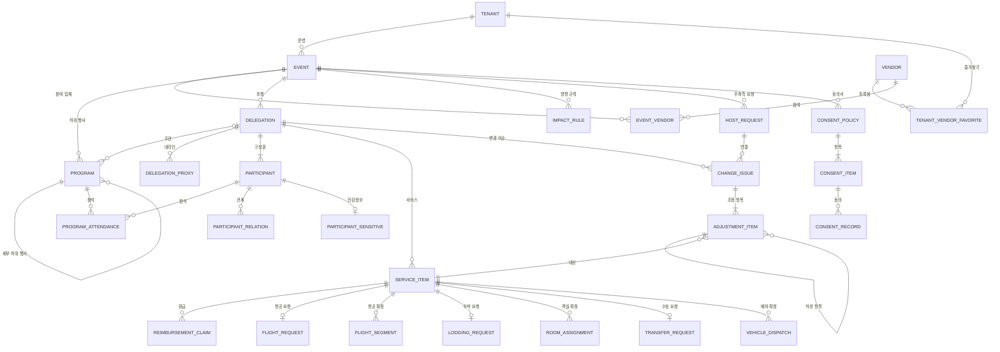

## 2.4 핵심 엔티티 상세

각 표의 **입력 주체**는 그 값을 입력·수정할 수 있는 역할입니다. 모든 엔티티에 공통으로 들어가는 관리 필드(ID, 테넌트 ID, 생성자, 생성일시, 수정자, 수정일시)는 표에서 생략했습니다.

### event (행사)

| 필드 | 키 | 타입 | 필수 | 입력 주체 | 비고 |
|---|---|---|---|---|---|
| 행사명 | `name` | 다국어 텍스트 | ✓ | PCO | |
| 행사 유형 | `event_type` | 코드 | ✓ | PCO | 국제회의, 학회, 전시, 기업행사 등 |
| 시작일 / 종료일 | `start_date` / `end_date` | 날짜 | ✓ | PCO | |
| 개최 도시·장소 | `venue` | 텍스트 | ✓ | PCO | |
| 기준 시간대 | `timezone` | 코드 | ✓ | PCO | 예: Asia/Seoul |
| 주최 기관명 | `host_org_name` | 다국어 텍스트 | ✓ | PCO | |
| 지원 언어 | `languages` | 코드 목록 | ✓ | PCO | MVP: ko, en |
| 제공 서비스 | `enabled_services` | 코드 목록 | ✓ | PCO | 항공, 숙박, 수송, 공항 의전, 식음 |
| 정보 입력 마감일 | `input_deadline` | 일시 | ✓ | PCO | |
| 초청 코드 사용 | `use_invite_code` | 예/아니오 | ✓ | PCO | 행사 페이지 유입용 |
| 상태 | `status` | 코드 | ✓ | 시스템·PCO | 3부 S01 참고 |
| 정산 완료 일시 | `settled_at` | 일시 | | PCO | 접근 차단 기준 |
| 민감정보 파기 예정일 | `purge_due_at` | 일시 | | 시스템 | 정산 완료 + 보관 기간 |

### event_vendor (행사 참여 업체)

| 필드 | 키 | 타입 | 필수 | 입력 주체 | 비고 |
|---|---|---|---|---|---|
| 행사 | `event_id` | 참조 | ✓ | PCO | |
| 업체 | `vendor_id` | 참조 | ✓ | PCO | 즐겨찾기에서 선택 |
| 담당 서비스 유형 | `service_types` | 코드 목록 | ✓ | PCO | 예: [항공, 수송] |
| 담당 대표단 범위 | `delegation_scope` | 전체 / 지정 | ✓ | PCO | 같은 서비스를 여러 업체가 나눌 때 |
| 업체 측 행사 담당자 | `vendor_contacts` | 사용자 목록 | | 업체 | 알림 수신자 |
| 상태 | `status` | 코드 | ✓ | 시스템·PCO | 3부 S09 참고 |

### delegation (대표단)

| 필드 | 키 | 타입 | 필수 | 입력 주체 | 비고 |
|---|---|---|---|---|---|
| 대표단명 | `name` | 텍스트 | ✓ | PCO | 예: "베트남 산업통상부 장관 대표단" |
| 국가 | `country` | 코드 | ✓ | PCO | |
| 소속 기관 | `organization` | 텍스트 | ✓ | PCO | |
| 의전 등급 | `protocol_level_id` | 참조 | ✓ | PCO | 대표단 기본값, 참가자별 재지정 가능 |
| 초청 코드 | `invite_code` | 텍스트 | | 시스템 | 자동 생성, 추측 불가능한 값 |
| 담당 PCO 직원 | `owner_user_id` | 참조 | ✓ | PCO | |
| 선호 언어 | `preferred_language` | 코드 | ✓ | PCO·대리인 | 알림·일정표 언어 |
| 참석 회신 | `rsvp` | 코드 | | 대리인 | 참석 / 불참 / 미정 |
| 초청 상태 | `invite_status` | 코드 | ✓ | 시스템 | 3부 S02 참고 |
| 제출 일시 | `submitted_at` | 일시 | | 시스템 | |
| 정보 완결률 | `completeness` | 숫자(%) | | 시스템 | 필수 항목 입력 비율, KPI용 |
| PCO 내부 메모 | `internal_note` | 텍스트 | | PCO | 대리인·업체에게 안 보임 |

### participant (참가자)

| 필드 | 키 | 타입 | 필수 | 입력 주체 | 비고 |
|---|---|---|---|---|---|
| 대표단 | `delegation_id` | 참조 | ✓ | 시스템 | |
| 참가자 유형 | `participant_type` | 코드 | ✓ | PCO·대리인 | VIP / 동반자 / 수행원 |
| 수행원 세부 유형 | `staff_role` | 코드 | | 대리인 | 비서, 경호, 통역, 보좌관 등 |
| 동반 관계 | `relation_to_vip` | 코드 | | 대리인 | 배우자, 자녀 등 (동반자만) |
| 여권상 성 / 이름 | `last_name` / `first_name` | 텍스트 | ✓ | 대리인 | 항공권 발권 기준, 영문 |
| 호칭 | `honorific` | 코드 | | PCO·대리인 | H.E., Dr., Mr., Ms. 등 |
| 표시 이름 | `display_name` | 텍스트 | | 대리인 | 명찰·안내용 |
| 직함 | `title` | 텍스트 | | 대리인 | |
| 성별 | `gender` | 코드 | | 대리인 | 객실 배정 참고 |
| 국적 | `nationality` | 코드 | ✓ | 대리인 | |
| 생년월일 | `birth_date` | 날짜 | | 대리인 | 항공권 발권 시 필요 |
| 이메일 / 휴대전화 | `email` / `mobile` | 텍스트 | | 대리인 | 현장 연락용, 없을 수 있음 |
| 개인 의전 등급 | `protocol_level_id` | 참조 | | PCO | 비어 있으면 대표단 등급 적용 |
| 참가 상태 | `status` | 코드 | ✓ | 시스템·PCO | 3부 S03 참고 |
| 정렬 순서 | `sort_order` | 숫자 | | PCO | 의전 서열 표시용 |
| 의전 선호 메모 | `protocol_preference` | 텍스트 | | PCO·대리인 | 호칭 방식, 좌석·동선 선호, 선호 음료 등. 예외 보관 가능 항목 |

### participant_sensitive 🔒 (참가자 민감정보)

별도 저장소, 필드 단위 암호화, 모든 조회 기록.

| 필드 | 키 | 분류 | 입력 주체 | 조회 가능 역할 |
|---|---|---|---|---|
| 여권번호 | `passport_no` | 고유식별 | 대리인 | PCO 초청 담당자, 항공 업체 |
| 여권 발급국 | `passport_country` | 고유식별 | 대리인 | 상동 |
| 여권 만료일 | `passport_expiry` | 고유식별 | 대리인 | 상동 |
| 여권 사본 | `passport_file_id` | 고유식별 | 대리인 | PCO 초청 담당자, 항공 업체 |
| 의료 사항 | `medical_note` | 민감 | 대리인 | PCO 초청 담당자 (현장 공유 지정 시 현장 스태프) |
| 알레르기 | `allergy` | 민감 | 대리인 | PCO 초청 담당자, 식음 업체 (알레르기 코드만) |
| 이동 보조 필요 | `mobility_need` | 민감 | 대리인 | PCO, 수송·공항 의전 업체 (필요 여부만) |
| 종교 | `religion` | 민감 | 대리인 | PCO 초청 담당자만 |
| 동의 여부 스냅샷 | `consent_ref` | - | 시스템 | 이 정보를 저장할 근거가 된 동의 기록 |
| 파기 상태 | `purge_status` | - | 시스템 | 3부 S10 참고 |

> 설계 포인트: 업체에게는 원본이 아니라 **업무에 필요한 최소 파생값**만 보여줍니다. 예를 들어 식음 업체는 "종교: 이슬람"이 아니라 "식이 코드: 할랄"만 봅니다.

### service_item (서비스 항목 — 공통 틀)

모든 서비스(항공, 숙박, 수송, 공항 의전, 식음, 그리고 앞으로 추가될 서비스)가 이 틀을 공유합니다.

| 필드 | 키 | 타입 | 필수 | 입력 주체 | 비고 |
|---|---|---|---|---|---|
| 대표단 | `delegation_id` | 참조 | ✓ | 시스템 | |
| 대상 참가자 | `participant_ids` | 참조 목록 | ✓ | 시스템·대리인 | 한 서비스에 여러 명 가능 |
| 서비스 유형 | `service_type` | 코드 | ✓ | 시스템 | FLIGHT, LODGING, TRANSFER, AIRPORT, DIETARY, (고도화) INTERP, PROGRAM, VISA |
| 방향·구분 | `direction` | 코드 | | 시스템 | 입국 / 출국 / 행사 중 |
| 담당 업체 | `event_vendor_id` | 참조 | | 시스템·PCO | 행사 참여 업체에서 자동 매칭 |
| 발생 원천 | `origin` | 코드 | ✓ | 시스템 | 대리인 요청 / 자동 생성 / PCO 생성 |
| 원천 서비스 | `source_service_id` | 참조 | | 시스템 | 자동 생성된 경우 원인 서비스 (예: 수송 ← 항공) |
| 실행 예정 시각 | `scheduled_at` | 일시 | | 시스템 | 긴급도 계산 기준 (예: 픽업 시각) |
| 지원 방식 | `support_type` | 코드 | ✓ | 시스템 | 지원 / 선결제 후 환급 / 자비·직접 예약 / 자비·예약 대행 / 제공 안 함. 참가자별로 판정되므로 서비스 항목이 여러 참가자를 묶을 때는 지원 방식이 같은 참가자끼리만 묶는다 |
| 판정 근거 | `support_basis` | 코드 | ✓ | 시스템·PCO | 정책 자동 / 대리인 지정 / PCO 예외 |
| 예외 사유 | `support_exception_reason` | 텍스트 | | PCO | PCO 예외일 때 필수 |
| 상태 | `status` | 코드 | ✓ | 시스템·업체 | 3부 S04 참고 |
| 확정 일시 | `confirmed_at` | 일시 | | 시스템 | |
| 안내 완료 일시 | `notified_at` | 일시 | | 시스템 | |

### flight_request (항공 요청) / flight_segment (항공 구간)

**flight_request** — 대리인 입력

| 필드 | 키 | 타입 | 필수 | 비고 |
|---|---|---|---|---|
| 입국 출발 도시 | `inbound_origin_city` | 코드(도시/공항) | ✓ | |
| 입국 도착 공항 | `inbound_dest_airport` | 코드(공항) | ✓ | 예: ICN, GMP |
| 희망 입국일 | `inbound_preferred_date` | 날짜 | ✓ | |
| 귀국 출발일 | `outbound_preferred_date` | 날짜 | ✓ | |
| 귀국 출발 공항 | `outbound_origin_airport` | 코드(공항) | ✓ | |
| 귀국 도착 도시 | `outbound_dest_city` | 코드(도시/공항) | ✓ | 입국 출발지와 다를 수 있음 |
| 요청 메모 | `note` | 텍스트 | | 선호 항공사, 시간대 등 |

**flight_segment** — 항공 업체 입력 (구간 하나당 1행)

| 필드 | 키 | 타입 | 필수 | 비고 |
|---|---|---|---|---|
| 방향 | `direction` | 코드 | ✓ | 입국 / 귀국 |
| 구간 순서 | `seq` | 숫자 | ✓ | 경유 시 1, 2, 3… |
| 편명 | `flight_no` | 텍스트 | ✓ | 예: KE642 |
| 출발 공항 / 도착 공항 | `dep_airport` / `arr_airport` | 코드 | ✓ | |
| 출발 일시 / 도착 일시 | `dep_at` / `arr_at` | 일시(현지+시간대) | ✓ | |
| 좌석 등급 | `cabin_class` | 코드 | ✓ | |
| 예약번호 | `pnr` | 텍스트 | ✓ | |
| 항공권 번호 | `ticket_no` | 텍스트 | | 참가자별 |
| 발권 상태 | `ticket_status` | 코드 | ✓ | 예약 / 발권 / 취소 |
| 변경 수수료 | `change_fee` | 금액+통화 | | 변경 시 입력 |
| 최종 도착 구간 여부 | `is_final_arrival` | 예/아니오 | | 시스템 계산. 영향 규칙의 기준 |

### room_assignment (객실 배정)

| 필드 | 키 | 타입 | 필수 | 입력 주체 | 비고 |
|---|---|---|---|---|---|
| 호텔 | `hotel_name` | 텍스트 | ✓ | 호텔 | |
| 객실 타입 | `room_type` | 코드/텍스트 | ✓ | 호텔 | |
| 투숙 참가자 | `participant_ids` | 참조 목록 | ✓ | 호텔·PCO | 동숙 |
| 체크인 / 체크아웃 | `check_in_at` / `check_out_at` | 일시 | ✓ | 호텔 | |
| 예약번호 | `confirmation_no` | 텍스트 | ✓ | 호텔 | |
| 객실 번호 | `room_no` | 텍스트 | | 호텔 | [고도화] 현장 입력 |
| 요청 반영 메모 | `note` | 텍스트 | | 호텔 | 얼리 체크인 등 |

### vehicle_dispatch (배차)

| 필드 | 키 | 타입 | 필수 | 입력 주체 | 비고 |
|---|---|---|---|---|---|
| 출발지 / 도착지 | `from` / `to` | 텍스트 | ✓ | 시스템(초안)·수송 업체 | |
| 출발 시각 | `depart_at` | 일시 | ✓ | 수송 업체 | |
| 차종 | `vehicle_class` | 코드 | ✓ | 수송 업체 | 의전 등급 기본값 참고 |
| 차량 번호 | `plate_no` | 텍스트 | | 수송 업체 | |
| 기사 이름 / 연락처 | `driver_name` / `driver_phone` | 텍스트 | | 수송 업체 | |
| 탑승 참가자 | `participant_ids` | 참조 목록 | ✓ | 수송 업체·PCO | |
| 짐 규모 | `luggage_note` | 텍스트 | | 대리인 | |

### program (하위 행사) — v0.3 신설

| 필드 | 키 | 타입 | 필수 | 입력 주체 | 비고 |
|---|---|---|---|---|---|
| 명칭 | `name` | 다국어 텍스트 | ✓ | PCO | |
| 유형 | `program_type` | 코드 | ✓ | PCO·대리인 | 본회의·세션 / 공식 연회 / 면담 / 대표단 주관 / 동반자 프로그램 / 의전 행사 / 대표단 자체 일정 |
| 상위 하위 행사 | `parent_program_id` | 참조 | | PCO | 최대 2단계 |
| 주관 주체 | `organizer_type` | 코드 | ✓ | PCO | 주최측 / 대표단 / PCO |
| 등록 주체 | `registered_by_type` | 코드 | ✓ | 시스템 | PCO / 대리인. 대리인 등록 = 자체 일정 |
| 차량 필요 여부 | `transfer_needed` | 예/아니오 | | 대리인 | 자체 일정용. 공식 일정은 참석 확정으로 자동 판단 |
| 늦은 등록 여부 | `late_registration` | 예/아니오 | | 시스템 | BR-02C-12 기준 초과 시 |
| PCO 조정 요청 | `pco_adjust_note` | 텍스트 | | PCO | BR-02C-14 |
| 주관 대표단 | `organizer_delegation_id` | 참조 | | PCO | 대표단 주관일 때 |
| 시작·종료 일시 | `start_at` / `end_at` | 일시 | ✓ | PCO | 가안 단계에서는 미정 가능 |
| 장소 | `venue` / `venue_address` | 텍스트 | | PCO | |
| 공개 범위 | `visibility` | 코드 | ✓ | PCO | 전체 공개 / 관계자 한정 / 비공개 |
| 참석 대상 방식 | `audience_mode` | 코드 | ✓ | PCO | 전체 대표단 / 지정 대표단 / 지정 참가자 |
| 예상 외부 참석 인원 | `external_headcount` | 숫자 | | PCO·주관 대표단 대리인 | 교민 등 비초청 인원 |
| 드레스 코드 | `dress_code` | 다국어 텍스트 | | PCO | 일정표에 표시 |
| 상태 | `status` | 코드 | ✓ | PCO·시스템 | 3부 S12 참고 |
| 내부 메모 | `internal_note` | 텍스트 | | PCO | |

### program_attendance (하위 행사 참석) — v0.3 신설

| 필드 | 키 | 타입 | 필수 | 비고 |
|---|---|---|---|---|
| 하위 행사 | `program_id` | 참조 | ✓ | |
| 참가자 | `participant_id` | 참조 | ✓ | |
| 역할 | `role` | 코드 | ✓ | 주관 / 발표자 / 참석 / 수행 / 특별 이벤트 |
| 역할 상세 | `role_note` | 텍스트 | | 예: "기조연설 15분", "기념 식수" |
| 참석 상태 | `status` | 코드 | ✓ | 3부 S13 참고 |
| 좌석·순서 | `seat` | 텍스트 | | [고도화] 좌석 배치 |

### participant_relation (참가자 간 관계) — v0.3 신설

| 필드 | 키 | 비고 |
|---|---|---|
| 참가자 A / B | `participant_a_id` / `participant_b_id` | 서로 다른 대표단도 가능 |
| 관계 유형 | `relation_type` | 가족 / 동일 기관 / 친분 / 동석 회피 / 기타 |
| 메모 | `note` | |
| 조회 범위 | - | **PCO만.** 외교적으로 민감할 수 있어 업체·대리인·주최측에 노출하지 않음 |

### reimbursement_claim (환급 청구) — v0.3 신설

| 필드 | 키 | 타입 | 필수 | 비고 |
|---|---|---|---|---|
| 서비스 항목 / 참가자 | `service_item_id` / `participant_id` | 참조 | ✓ | |
| 청구 금액·통화 | `claim_amount` / `currency` | 금액 | ✓ | 대리인 입력 |
| 환급 한도 | `limit_amount` | 금액 | | PCO 지정 |
| 🔒 증빙 파일 | `receipt_file_ids` | 파일 목록 | ✓ | 영수증, 전자항공권 |
| 승인 금액 | `approved_amount` | 금액 | | PCO. 한도 초과분 차감 |
| 지급 일시·방법 메모 | `paid_at` / `payment_note` | 일시 / 텍스트 | | 시스템 밖 지급 결과 기록 |
| 반려 사유 | `reject_reason` | 텍스트 | | |
| 상태 | `status` | 코드 | ✓ | 3부 S14 참고 |

### support_policy (지원 정책) — v0.2 신설

| 필드 | 키 | 타입 | 필수 | 비고 |
|---|---|---|---|---|
| 행사 | `event_id` | 참조 | ✓ | |
| 서비스 유형 | `service_type` | 코드 | ✓ | |
| 참가자 유형 | `participant_type` | 코드 | ✓ | VIP / 동반자 / 수행원 / 전체 |
| 적용 의전 등급 | `protocol_level_ids` | 참조 목록 | | 비어 있으면 모든 등급 |
| 지원 방식 | `support_type` | 코드 | ✓ | 한도 이내 인원에게 적용 |
| 대표단당 지원 한도 | `max_count` | 숫자 | | 비어 있으면 무제한 |
| 한도 초과 시 지원 방식 | `overflow_support_type` | 코드 | | 보통 자비·직접 예약 |
| 대리인 안내 문구 | `guide_text` | 다국어 텍스트 | | 예: "동반자 1인까지 항공권이 제공됩니다" |
| 적용 범위 | `applies_to` | 코드 | | 수송 정책 전용: 공항 / 공식 하위 행사 / 대표단 자체 일정 (v0.4) |
| 행사 전체 한도 | `event_max_count` | 숫자 | | [고도화] 행사 전체 좌석·객실 한도 |

> 정책이 여러 줄 겹치면 **의전 등급이 지정된 줄이 우선**합니다.

### retention_exception (예외 보관) — v0.2 신설

| 필드 | 키 | 비고 |
|---|---|---|
| 참가자 | `participant_id` | |
| 보관 항목 | `fields` | 보관할 필드 목록 (최소한으로) |
| 보관 사유 | `reason` | 필수 |
| 근거 동의 기록 | `consent_record_id` | 없으면 효력 없음 |
| 보관 만료일 | `expires_at` | 필수. 만료 시 자동 파기 |
| 지정자 / 지정 일시 | `designated_by` / `designated_at` | |

### impact_rule (영향 규칙)

| 필드 | 키 | 타입 | 비고 |
|---|---|---|---|
| 규칙 ID | `code` | 텍스트 | 예: IR-02 |
| 트리거 서비스 유형 | `trigger_service_type` | 코드 | 예: FLIGHT |
| 트리거 필드 | `trigger_fields` | 필드 목록 | 예: 최종 도착 구간의 `arr_at`, `arr_airport` |
| 트리거 조건 | `trigger_condition` | 조건식 | 예: 값이 변경됨, 30분 이상 변경됨 |
| 영향 서비스 유형 | `target_service_type` | 코드 | 예: TRANSFER |
| 영향 대상 선택 | `target_selector` | 조건 | 예: 같은 대표단, 방향 = 입국, 원천 서비스 = 트리거 서비스 |
| 조치 내용 템플릿 | `action_template` | 다국어 텍스트 | 예: "도착 시각 {이전}→{이후} 변경, 재배차 필요" |
| 처리 방식 | `handling` | 코드 | 자동 전개 / PCO 판단 |
| 담당 | `assignee_type` | 코드 | 해당 서비스 담당 업체 / PCO |
| 기본 처리 기한 | `sla_minutes` | 숫자 | 재알림 기준 |
| 사용 여부 | `enabled` | 예/아니오 | 행사별 켜고 끄기 |
| 출처 | `scope` | 코드 | 플랫폼 기본 / 테넌트 / 행사 |

> 설계 포인트: 트리거 조건에 "30분 이상 변경됨" 같은 임계값을 둘 수 있게 하면, 5분 지연 같은 사소한 변경으로 연쇄 알림이 쏟아지는 것을 막을 수 있습니다. 기본값은 **30분**이며 (Q4 결정), 30분 미만 변경은 이력만 남기고 해당 업체에 참고 알림만 보냅니다.

### change_issue (변경 이슈)

| 필드 | 키 | 타입 | 필수 | 비고 |
|---|---|---|---|---|
| 이슈 번호 | `issue_no` | 텍스트 | ✓ | 예: CHG-0042, 행사 내 순번 |
| 대표단 | `delegation_id` | 참조 | ✓ | |
| 대상 참가자 | `participant_ids` | 참조 목록 | | |
| 발생 출처 | `source` | 코드 | ✓ | 대리인 / 업체 / PCO / 주최측 요청 / 시스템 |
| 출처 사용자 | `source_user_id` | 참조 | ✓ | |
| 최초 변경 서비스 | `origin_service_id` | 참조 | | |
| 변경 요약 | `summary` | 텍스트 | ✓ | 시스템 자동 생성, 예: "입국 도착 공항 ICN→GMP" |
| 변경 전 / 후 값 | `before` / `after` | 구조화 데이터 | ✓ | |
| 연결 주최측 요청 | `host_request_id` | 참조 | | |
| 대체한 이슈 / 대체된 이슈 | `supersedes_id` / `superseded_by_id` | 참조 | | 재변경 시 연결 |
| 최고 긴급도 | `max_urgency` | 코드 | ✓ | 하위 항목 중 가장 높은 긴급도 (자동) |
| 진행률 | `progress` | 숫자 | ✓ | 종료된 항목 / 전체 항목 (자동) |
| 상태 | `status` | 코드 | ✓ | 3부 S05 참고 |
| 종결 일시 | `closed_at` | 일시 | | KPI: 종결 리드타임 |
| 강제 종결 사유 | `force_close_reason` | 텍스트 | | |

### adjustment_item (조정 항목)

| 필드 | 키 | 타입 | 필수 | 비고 |
|---|---|---|---|---|
| 변경 이슈 | `issue_id` | 참조 | ✓ | |
| 상위 항목 | `parent_id` | 참조 | | 비어 있으면 1차 |
| 차수 | `depth` | 숫자 | ✓ | 1, 2, 3… |
| 적용 규칙 | `impact_rule_id` | 참조 | | 수동 추가·정정 요청이면 비어 있음 |
| 항목 종류 | `kind` | 코드 | ✓ | 자동 전개 / PCO 판단 / PCO 정정 요청 / 수동 추가 |
| 대상 서비스 | `service_item_id` | 참조 | | |
| 담당 | `assignee_vendor_id` / `assignee_user_id` | 참조 | ✓ | 업체 또는 PCO |
| 조치 내용 | `instruction` | 텍스트 | ✓ | 규칙 템플릿으로 자동 작성, PCO 수정 가능 |
| 긴급도 | `urgency` | 코드 | ✓ | 긴급 / 주의 / 일반 (자동) |
| 처리 기한 | `due_at` | 일시 | | |
| 상태 | `status` | 코드 | ✓ | 3부 S06 참고 |
| 판단 결과 | `decision` | 코드 | | PCO 판단 항목만. 예: 참석 가능 / 불참 |
| 처리 결과 메모 | `resolution_note` | 텍스트 | | |
| 확정값 변경 여부 | `value_changed` | 예/아니오 | | 하위 전개 여부 결정 |
| 종료 사유 | `close_reason` | 텍스트 | | 해당 없음·무효 시 |
| 처리자 / 처리 일시 | `resolved_by` / `resolved_at` | 참조 / 일시 | | |
| 재알림 횟수 | `reminder_count` | 숫자 | | |

### change_log (변경 이력)

| 필드 | 키 | 비고 |
|---|---|---|
| 대상 엔티티 / 레코드 | `entity` / `record_id` | 예: flight_segment / 1234 |
| 필드 | `field` | 예: arr_at |
| 이전 값 / 새 값 | `old_value` / `new_value` | 🔒 필드는 값 대신 "변경됨"만 기록 |
| 변경자 / 변경자 역할 | `actor_id` / `actor_role` | |
| 변경 일시 | `changed_at` | |
| 연결 변경 이슈 | `issue_id` | 있을 때만 |
| 변경 경로 | `channel` | 화면 / 엑셀 업로드 [고도화] / 시스템 자동 |

### host_request (주최측 요청)

| 필드 | 키 | 타입 | 필수 | 비고 |
|---|---|---|---|---|
| 요청 번호 | `request_no` | 텍스트 | ✓ | 예: REQ-0007 |
| 제목 / 내용 | `title` / `body` | 텍스트 | ✓ | |
| 관련 대표단 | `delegation_ids` | 참조 목록 | | |
| 희망 기한 | `desired_due_at` | 일시 | | |
| 요청자 | `requester_id` | 참조 | ✓ | |
| 상태 | `status` | 코드 | ✓ | 3부 S07 참고 |
| PCO 답변 | `response` | 텍스트 | | 반려 사유 포함 |

### consent_policy / consent_item / consent_record (동의)

| 엔티티 | 주요 필드 |
|---|---|
| consent_policy | 행사, 버전 번호, 공지사항 본문(다국어), 게시 일시, 현재 버전 여부 |
| consent_item | 동의서, 항목 구분(필수 / 선택 / 민감정보 / 고유식별정보 / 국외 이전 / 재사용 보관), 문구(다국어), 필수 여부 |
| consent_record | 동의 항목, 정보주체(참가자), 동의자(대리인), 동의 여부, 동의 일시, 접속 IP, 동의서 버전, 철회 일시 |

### notification (알림)

| 필드 | 키 | 비고 |
|---|---|---|
| 수신자 | `recipient_user_id` / `recipient_email` | |
| 채널 | `channel` | [MVP] 이메일, 인앱 / [고도화] 앱 푸시, 메신저 |
| 템플릿 / 언어 | `template_code` / `language` | |
| 연결 대상 | `ref_type` / `ref_id` | 예: adjustment_item / 88 |
| 확인 필요 여부 | `requires_ack` | 조정 항목 알림은 "확인" 버튼 필수 |
| 상태 | `status` | 3부 S08 참고 |
| 발송·열람·확인 일시 | `sent_at` / `opened_at` / `acked_at` | |

## 2.5 권한 매트릭스

**C** 생성 · **R** 조회 · **U** 수정 · **D** 삭제 · **R\*** 마스킹 조회 · **범위** 자신에게 배정된 것만 · **-** 접근 불가

| 데이터 | PCO 관리자 | PCO 초청 담당자 | 현장 스태프 | 주최측 | 업체 | 대리인 |
|---|---|---|---|---|---|---|
| 행사 기본 정보 | CRUD | RU | R | R | R | R |
| 행사 참여 업체 | CRUD | CRU | R | R | R (자신) | - |
| 대표단 | CRUD | CRUD | R | R | R (범위) | RU (범위) |
| 참가자 기본 정보 | CRUD | CRUD | R | R | R (범위, 업무 필드) | CRUD (범위) |
| 🔒 여권 정보 | R (기록) | RU (기록) | - | - | R (항공만, 기록) | CRU (범위) |
| 🔒 건강·종교 | R (기록) | RU (기록) | R\* (현장 공유 지정만) | - | 파생값만 | CRU (범위) |
| 서비스 요청 데이터 | CRUD | CRUD | R | R | R (담당 유형) | CRU (범위) |
| 서비스 확정 데이터 | RU | RU | R | R | CRU (담당 유형) | R (범위) |
| 변경 이슈·조정 항목 | CRUD | CRUD | R | R | RU (배정 항목) | R (결과만, Q3 결정) |
| 영향 규칙 | CRUD | RU | - | - | - | - |
| 하위 행사 (공개 범위 적용) | CRUD | CRUD | R | R (관계자 포함, 비공개 제외) | R (담당 서비스) | R (관계자일 때), 주관 행사는 일부 U |
| 대표단 자체 일정 | R + 조정 요청 | R + 조정 요청 | R | R | R (수송 업체, 이동 정보만) | CRUD (자기 대표단) |
| 면담 상대 대표단 정보 | - | - | - | - | - | R (VIP 이름·직함만, Q14) |
| 하위 행사 참석 | CRUD | CRUD | R | R | R (담당 서비스) | RU (자기 대표단) |
| 참가자 간 관계 | CRUD | CRUD | - | - | - | - |
| 환급 청구 | RU | RU | - | - | - | CRU (범위) |
| 🔒 환급 증빙 | R (기록) | R (기록) | - | - | - | CR (범위) |
| 주최측 요청 | RU | RU | - | CR | - | - |
| 동의 기록 | R | R | - | - | - | C (범위) |
| 접근·변경 이력 | R | R | - | - | - | - |
| PCO 내부 메모 | CRUD | CRUD | R | - | - | - |

> 주최측의 R은 "대시보드와 목록 조회"를 뜻하며, 🔒 정보는 볼 수 없습니다.

## 2.6 공통 코드 (주요)

| 코드 그룹 | 값 | 확장 방식 |
|---|---|---|
| 참가자 유형 | VIP, 동반자(COMPANION), 수행원(STAFF) | 고정 |
| 하위 행사 유형 | 본회의·세션, 공식 연회, 면담, 대표단 주관, 동반자 프로그램, 의전 행사, 대표단 자체 일정 | 테넌트 추가 가능 (자체 일정은 고정) |
| 하위 행사 참석 역할 | 주관, 발표자, 참석, 수행, 특별 이벤트 | 테넌트 추가 가능 |
| 참가자 관계 유형 | 가족, 동일 기관, 친분, 동석 회피, 기타 | 테넌트 추가 가능 |
| 수행원 세부 유형 | 비서, 보좌관, 경호, 통역, 의료, 기타 | 테넌트 추가 가능 |
| 서비스 유형 | FLIGHT, LODGING, TRANSFER, AIRPORT, DIETARY / [고도화] INTERP, PROGRAM, VISA | 플랫폼 추가 |
| 식이 코드 | 일반, 할랄, 코셔, 채식(락토오보), 비건, 글루텐 프리, 알레르기 있음 | 테넌트 추가 가능 |
| 호칭 | H.E., Hon., Dr., Prof., Mr., Ms., Mrs. | 테넌트 추가 가능 |
| 의전 등급 | 행사별 정의 (예시 템플릿: A 국가원수급 / B 장관급 / C 차관급 / D 일반) | 행사별 정의, 테넌트 템플릿 저장 |
| 긴급도 | 긴급, 주의, 일반 | 기준 시간만 설정 |
| 변경 출처 | 대리인, 업체, PCO, 주최측 요청, 시스템 | 고정 |

### 의전 등급(protocol_level)이 갖는 기본값

의전 등급은 행사별로 정의하며, 등급 하나를 정하면 아래 기본값이 따라오도록 설계해, 등급이 바뀌었을 때 IR-11 규칙으로 영향을 전개할 수 있게 합니다.

| 항목 | 예시 (장관급) |
|---|---|
| 기본 객실 타입 | 스위트 |
| 기본 차종 | 의전 세단 단독 |
| 공항 의전 범위 | 영접 인사 + 패스트트랙 + 라운지 |
| 좌석 등급 | 비즈니스 |
| 표시 순서 가중치 | 20 |

---

# 3부. 상태 정의

상태는 "지금 이 데이터가 어느 단계에 있는가"입니다. 화면의 필터, 대시보드 숫자, 알림 발송, 권한 변화가 모두 상태를 기준으로 움직이기 때문에, 상태를 먼저 정확히 정해두면 이후 화면 설계가 쉬워집니다.

| ID | 대상 | 목적 |
|---|---|---|
| S01 | 행사 | 행사 전체 생명주기, 접근 차단·파기의 기준 |
| S02 | 대표단 초청 | 초청 진행 현황 파악, 독촉 대상 선정 |
| S03 | 참가자 | 개인별 참가 여부 |
| S04 | 서비스 항목 | 요청 → 이행 진행 추적 |
| S05 | 변경 이슈 | 변경 관리 보드의 기준 |
| S06 | 조정 항목 | 연쇄 작업 하나하나의 처리 추적 |
| S07 | 주최측 요청 | 요청 처리 현황 |
| S08 | 알림 | 전달·확인 여부 |
| S09 | 행사 참여 업체 | 업체 접근 권한 |
| S10 | 민감정보 | 수집부터 파기까지 |
| S11 | 동의 | 동의 유효성 |
| S12 | 하위 행사 | 가안과 확정의 구분, 연쇄 알림 시작 시점 |
| S13 | 하위 행사 참석 | 참석 회신과 수송 요청 생성 기준 |
| S14 | 환급 청구 | 선결제 후 환급 처리 |

---

## S01. 행사 상태

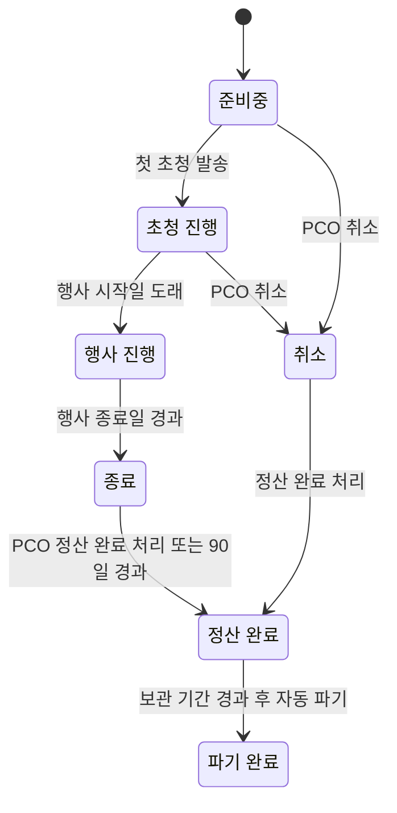

| 상태 | 의미 | 바뀌는 것 |
|---|---|---|
| 준비중 | 설정 중. 외부에 아무것도 나가지 않음 | 업체·주최측 초대만 가능 |
| 초청 진행 | 초청 발송 이후 | 대리인 입력, 서비스 처리, 변경 관리 작동 |
| 행사 진행 | 행사 기간 중 | 현장 앱 "오늘" 화면 활성화, 긴급도 기준 강화 |
| 종료 | 행사 종료 후 정산 기간 | 대리인 신규 입력 차단, 업체는 정산용 조회·수정 가능 |
| 정산 완료 | PCO가 정산 완료 처리 | 업체·대리인 접근 차단, 파기 예정일 계산 |
| 파기 완료 | 민감정보 파기 완료 | 비식별 기록만 남음, 행사는 읽기 전용 보관 |
| 취소 | 행사 취소 | 모든 서비스에 취소 이슈 생성 (IR-09) 후 정산 흐름으로 |

---

## S02. 대표단 초청 상태

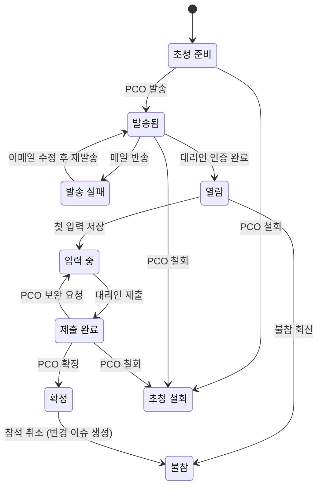

| 상태 | 의미 | 자동 동작 |
|---|---|---|
| 초청 준비 | 등록만 됨 | - |
| 발송됨 | 초청 메일 발송 | 마감일 기준 독촉 대상 |
| 발송 실패 | 메일 반송 | PCO에 즉시 알림 |
| 열람 | 대리인이 인증하고 들어옴 | 독촉 대상 |
| 입력 중 | 일부 저장됨 | 독촉 대상, 정보 완결률 표시 |
| 제출 완료 | 대리인이 제출 | PCO 검토 대기 목록에 표시 |
| 확정 | PCO가 내용 확인 완료 | 이후 수정은 변경 이슈로 관리 |
| 불참 | 참석하지 않음 | 확정 후 불참이면 IR-09로 전 서비스 취소 이슈 |
| 초청 철회 | PCO가 초청을 거둠 | 대리인 접근 차단 |

> 서비스 요청은 대표단 제출 상태와 무관하게 **서비스별로 먼저 업체에 넘어갑니다** (BR-05-6). 따라서 대표단이 `입력 중`이어도 항공은 `처리중`일 수 있습니다.

---

## S03. 참가자 상태

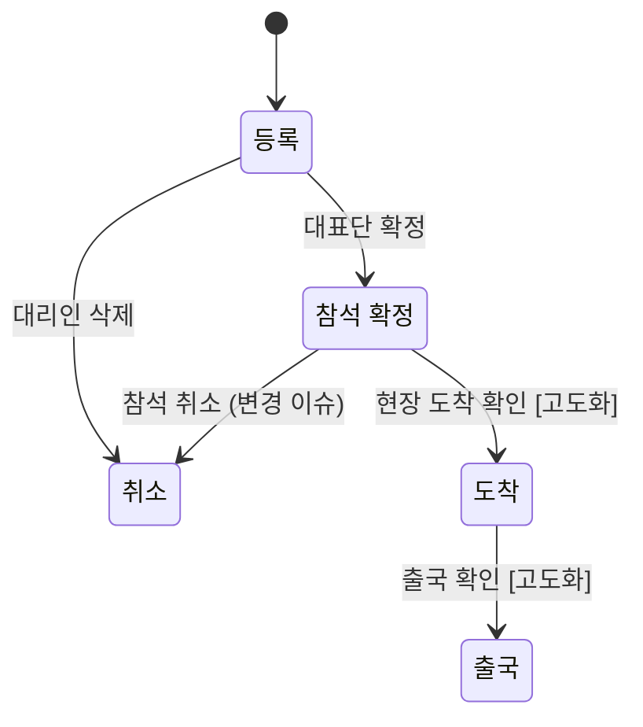

MVP는 등록 / 참석 확정 / 취소 세 가지만 쓰고, 도착·출국은 현장 앱 고도화 때 켭니다. 상태 값 자체는 지금 정의해 둡니다.

---

## S04. 서비스 항목 상태

모든 서비스 유형(항공, 숙박, 수송, 공항 의전, 식음, 향후 추가 서비스)이 같은 상태 체계를 씁니다.

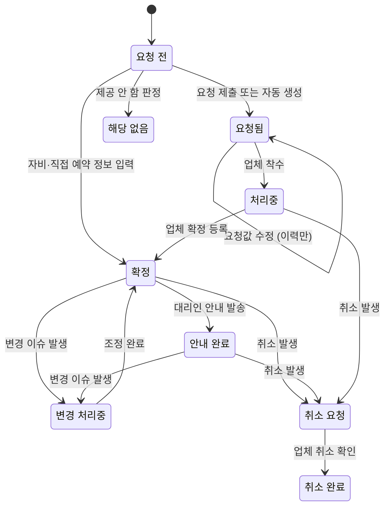

| 상태 | 의미 | 누가 바꾸나 |
|---|---|---|
| 요청 전 | 대리인이 아직 입력 안 함 | - |
| 요청됨 | 요청이 업체에 넘어감, 업체 착수 전 | 시스템 |
| 처리중 | 업체가 확인하고 작업 중 | 업체 |
| 확정 | 업체가 확정 정보 등록 | 업체 |
| 안내 완료 | 대리인에게 확정 안내가 나감 (알림 또는 일정표) | 시스템 |
| 변경 처리중 | 연결된 변경 이슈의 조정 항목이 미종결 | 시스템 |
| 취소 요청 / 취소 완료 | 취소가 발생해 업체 처리 대기 / 완료 | 시스템 / 업체 |
| 해당 없음 | 이 참가자에게 필요 없거나 제공하지 않는 서비스 | 시스템(정책)·PCO |

> **자비·직접 예약**은 `요청됨`·`처리중`을 건너뛰고 대리인이 확정 정보를 입력하는 순간 바로 `확정`이 됩니다. 이후 변경은 지원 항목과 똑같이 변경 이슈로 관리됩니다.

> PCO 정정 요청은 별도 상태를 두지 않고, **"PCO 정정 요청" 종류의 조정 항목**을 가진 변경 이슈로 처리합니다. 그래야 정정 요청도 변경 관리 보드에서 한꺼번에 보이고, 정정 결과가 다른 서비스에 미치는 연쇄도 같은 방식으로 관리됩니다.

---

## S05. 변경 이슈 상태

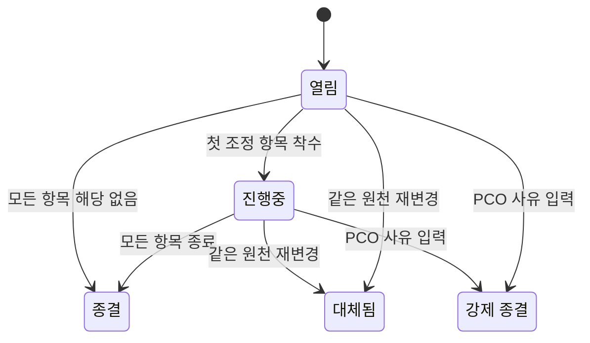

| 상태 | 의미 | 변경 관리 보드 표시 |
|---|---|---|
| 열림 | 생성됨, 아무도 착수 안 함 | 표시 (미착수 강조) |
| 진행중 | 일부 항목 처리 중 | 표시 (진행률) |
| 종결 | 모든 항목이 완료 / 해당 없음 / 무효 | 기본 숨김, 필터로 조회 |
| 대체됨 | 재변경으로 새 이슈가 이어받음 | 숨김, 새 이슈에서 링크 |
| 강제 종결 | PCO가 사유를 남기고 닫음 | 숨김, 감사용 조회 |

**종결 판정 규칙**: 하위 조정 항목이 모두 `완료`, `해당 없음`, `무효` 중 하나면 자동 종결합니다.

---

## S06. 조정 항목 상태

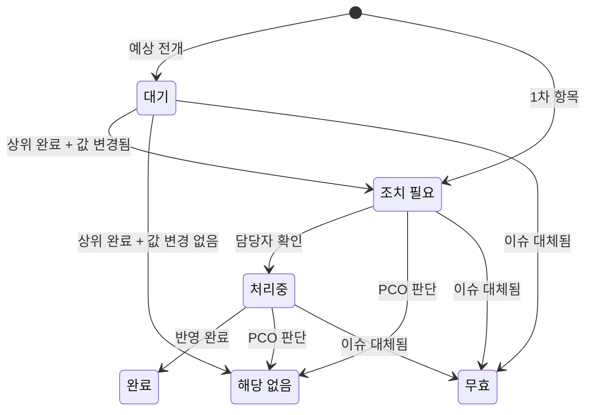

| 상태 | 의미 | 알림·표시 |
|---|---|---|
| 대기 | 상위가 확정되지 않아 착수 불가 | 담당 업체에 "예정" 으로만 표시, 알림 없음 |
| 조치 필요 | 담당자가 처리해야 함 | 알림 발송, 기한 초과 시 재알림 → 에스컬레이션 |
| 처리중 | 담당자가 확인함 | 담당자의 확인 = 알림 수신 확인 |
| 완료 | 반영 완료 | 하위 항목 전개 판정 실행 |
| 해당 없음 | 조치 불필요 | 하위 항목도 연쇄적으로 해당 없음 |
| 무효 | 이슈가 대체되어 의미 없어짐 | 진행 중이던 업체에 "작업 중지" 알림 |

**PCO 판단 항목의 특수 규칙**: `완료` 처리 시 판단 결과(`decision`)를 반드시 입력해야 하며, 결과값에 따라 하위 전개가 달라집니다. 예: "만찬 참석 가능" → 하위 해당 없음 / "불참" → 좌석·식수 조정 항목 조치 필요.

---

## S07. 주최측 요청 상태

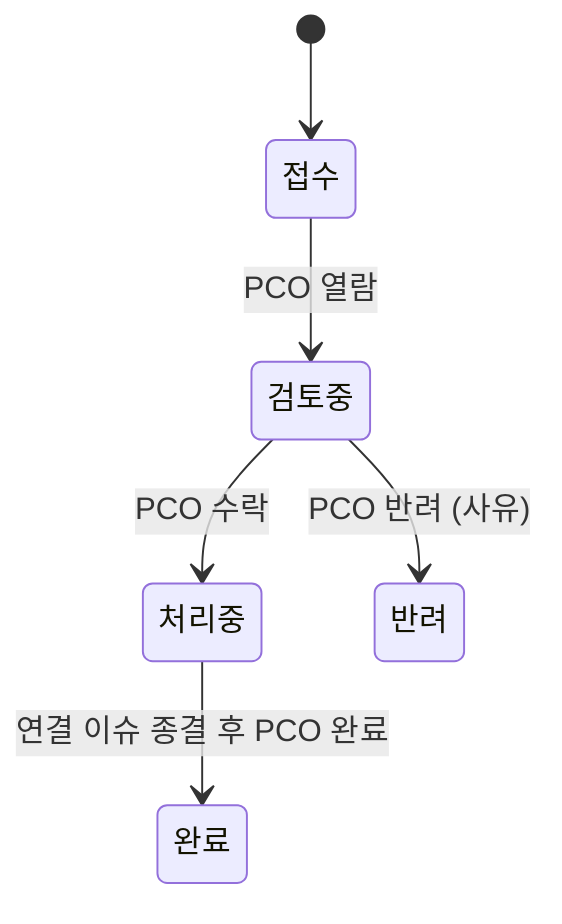

---

## S08. 알림 상태

| 상태 | 의미 |
|---|---|
| 대기 | 발송 예약됨 (독촉 메일 등) |
| 발송 | 메일 서버로 전송됨 |
| 실패 | 반송·전송 오류. PCO에 표시 |
| 열람 | 수신자가 열어봄 (이메일 열람 추적 또는 인앱 확인) |
| 확인 | 수신자가 "확인" 버튼을 누름. `확인 필요` 알림만 해당 |

> 핵심: 변경 관리에서 "알림을 보냈다"는 성공이 아닙니다. **조정 항목 알림은 확인 상태까지 가야** 전파가 끝난 것으로 봅니다.

---

## S09. 행사 참여 업체 상태

| 상태 | 의미 | 접근 |
|---|---|---|
| 초대됨 | PCO가 행사에 추가, 업체 미가입 또는 미수락 | 없음 |
| 활성 | 업무 수행 중 | 담당 범위 조회·입력 |
| 제외됨 | PCO가 행사에서 뺌 | 즉시 차단. 담당 서비스는 PCO에게 재배정 알림 |
| 정산 완료 | 행사 정산 완료 | 차단 |

---

## S10. 민감정보 상태

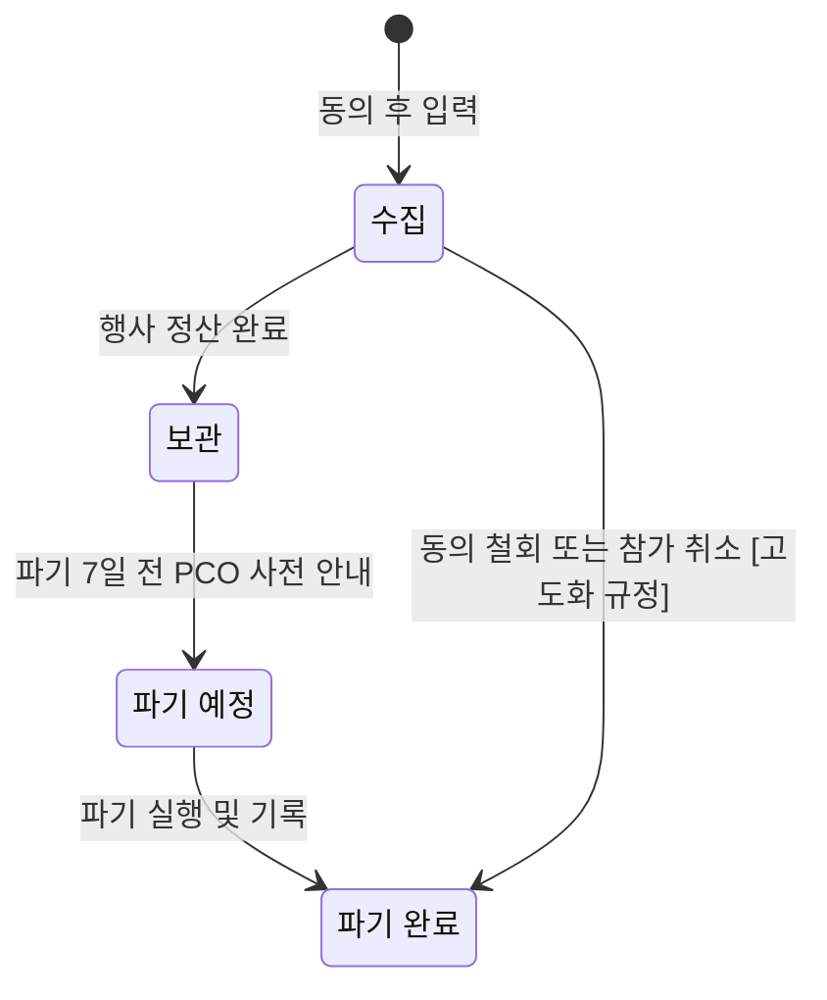

---

## S11. 동의 상태

| 상태 | 의미 | 영향 |
|---|---|---|
| 유효 | 현재 버전에 동의 | 해당 정보 입력·보관 가능 |
| 재동의 필요 | 동의서 새 버전 게시 | 대리인 접속 시 재동의 화면 우선 표시 |
| 철회 | 동의 철회 | 해당 항목 입력 차단, 기존 정보 파기 대상 |

---

## S12. 하위 행사 상태

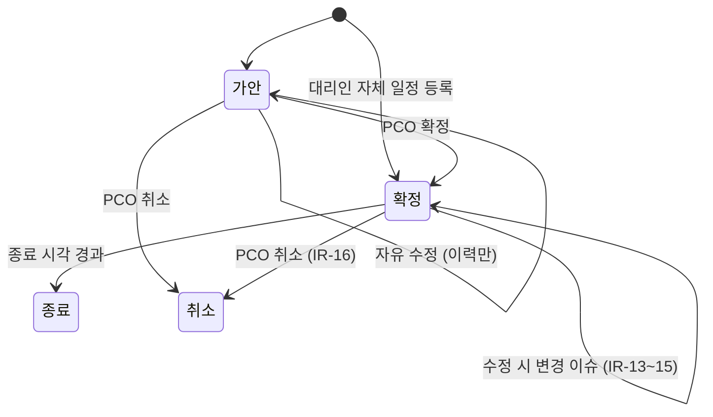

| 상태 | 의미 | 업체 전파 |
|---|---|---|
| 가안 | 일시·참석자가 아직 유동적 (PCO 등록 일정만 해당) | 안 함. 공개 범위 내 대리인에게는 "예정"으로 표시 가능 |
| 확정 | 운영 확정 | 수송 요청 등 자동 생성, 이후 변경은 변경 이슈 |
| 종료 | 진행 완료 | - |
| 취소 | 취소됨 | 확정 후 취소면 연결 서비스 전부 취소 이슈 |

---

## S13. 하위 행사 참석 상태

| 상태 | 의미 | 자동 동작 |
|---|---|---|
| 초청됨 | 참석 대상으로 지정됨 | 대리인 화면에 회신 요청 표시 |
| 참석 확정 | 대리인 회신 또는 PCO 지정 | 하위 행사가 확정 상태면 수송 요청 생성 |
| 불참 | 참석하지 않음 | 확정 후 불참이면 IR-07 |
| 참석 완료 | [고도화] 현장 확인 | - |

---

## S14. 환급 청구 상태

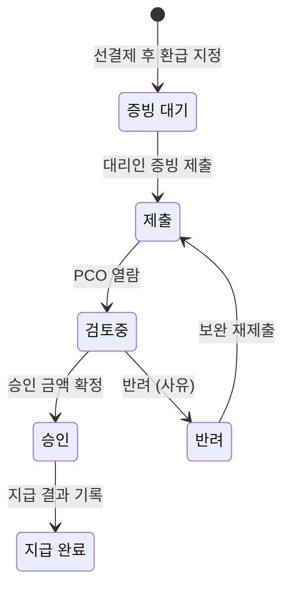

---

# 4부. 확장 고려 요약

지금 구조에서 고도화 기능이 어디에 붙는지 정리했습니다. 대부분 **새 코드나 새 세부 테이블 추가**로 해결되고, 기존 구조를 바꾸지 않습니다.

| 고도화 기능 | 붙는 위치 | 구조 변경 |
|---|---|---|
| 엑셀 템플릿 다운로드·업로드 | `import_job` + 서비스 확정 데이터. 업로드도 화면 입력과 똑같이 변경 이력·변경 이슈를 만든다 | 없음 |
| 통역·동반자 프로그램·비자 | 서비스 유형 코드 추가 + 세부 테이블 추가 + 영향 규칙 추가 | 없음 |
| 현장 앱 쓰기 기능 | 참가자 상태 ARRIVED/DEPARTED 활성화, 배차에 탑승 확인 필드 | 없음 |
| 좌석 배치 | `program_attendance.seat` 활용 + 좌석 배치도 테이블, 의전 등급 가중치·참가자 관계(동석 회피) 활용 | 없음 |
| 하위 행사 외부 참석자 명단 | `program`에 외부 참석자 테이블 연결 (일반 등록 솔루션 연동 가능) | 없음 |
| 자비·예약 대행 결제 | 결제 연동 + `support_type` 이미 정의됨 | 없음 |
| 행사 전체 지원 한도 | `support_policy.event_max_count` | 없음 |
| 이동 시간 고려한 일정 충돌 감지 | `program.venue` 좌표 + 지도 API | 필드 추가 |
| 메신저·앱 푸시 알림 | `notification.channel` 코드 추가 | 없음 |
| 과거 초청자 재사용 | 예외 보관(`retention_exception`)된 참가자만 대상. 테넌트 레벨 인물 마스터(`person`) 추가, `participant`가 참조 | 참조 필드 1개 추가 |
| 국가별 개인정보 규정 | `consent_item` 구분 추가, 파기 정책을 국가·항목별로 세분화 | 없음 |
| 다국어 확대 | 다국어 필드에 언어 추가 | 없음 |

---

# 5부. 인터뷰

## 5.1 결정 완료 (1차 인터뷰)

| No | 주제 | 결정 | 반영 위치 |
|---|---|---|---|
| Q1 | 서비스별 제출 | 서비스 단위로 먼저 업체에 넘김 | BR-05-6, S02, S04 |
| Q2 | 자비 참가자 | 존재함. 참가자 유형·인원 한도 기반 **지원 정책** 신설 | P02-A, `support_policy`, IR-12, S04 |
| Q3 | 대리인 공개 범위 | 결과만 공개 | 권한 매트릭스 |
| Q4 | 연쇄 임계값 | 30분 이상 변경 시 연쇄 | 영향 규칙 기본값 |
| Q5 | 대리인 다대다·추가 | 둘 다 허용, 대리인 추가는 PCO 승인 | BR-03-2, BR-04-2 |
| Q6 | 의전 등급 | 행사별 정의, 테넌트 템플릿으로 재사용 | P02-B, `protocol_level` |
| Q7 | 보관·파기 | 기본 전체 파기, 예외는 사유 + 별도 동의 시에만 | BR-15-4~6, `retention_exception` |

| Q8 | 예약 대행 | 코드만 정의, 운영은 고도화. **선결제 후 환급** 방식 추가 (MVP) | P02-A, `reimbursement_claim`, S14 |
| Q9 | 한도 단위 | 대표단 단위. VIP만 / VIP+동반 1인 / 대표단 전체 템플릿 제공 | P02-A |
| Q10 | 예외 보관 항목 | 의전 선호, 식이 코드, 참가자 간 관계, 행사 내 역할 이력으로 한정 | BR-15-5 |
| 추가 | 하위 행사 | 하위 행사(Program) 구조 신설 | P02-C, `program`, S12, S13, IR-13~16 |

| Q11 | 주최측 공개 범위 | 관계자 한정 일정도 조회 가능, PCO 지정 비공개만 제외 | BR-02C-3, 권한 매트릭스 |
| Q12 | 대표단 발 일정 | PCO 검토 없이 대리인이 **자체 일정**을 등록하고 차량 지원 요청 | P02-C 자체 일정, BR-02C-9~15 |
| Q13 | 하위 행사 수송 자동 생성 | MVP 포함 | BR-02C-8, P08 |
| Q14 | 상대 대표단 공개 | VIP 이름·직함만 공개 | 권한 매트릭스 |

## 5.2 남은 확인 사항

업무·데이터·상태 정의 단계에서 결정이 필요한 항목은 모두 정리되었습니다. 아래는 **다음 단계(화면 설계)로 넘어가기 전에 참고할 기본값**으로, 별도 의견이 없으면 그대로 진행합니다.

| 항목 | 적용된 기본값 | 조정 위치 |
|---|---|---|
| 자체 일정 등록 권장 시한 | 일정 시작 24시간 전 | 행사 설정 |
| 연쇄 임계값 | 30분 이상 변경 | 영향 규칙 |
| 조정 항목 재알림 | 2시간 (긴급 30분) | 영향 규칙 |
| 긴급도 기준 | 24시간 이내 긴급, 72시간 이내 주의 | 행사 설정 |
| 민감정보 보관 기간 | 정산 완료 후 30일 | 행사 설정 (규정 논의 후 확정) |
| 자동 정산 완료 | 행사 종료 후 90일 | 테넌트 설정 |
