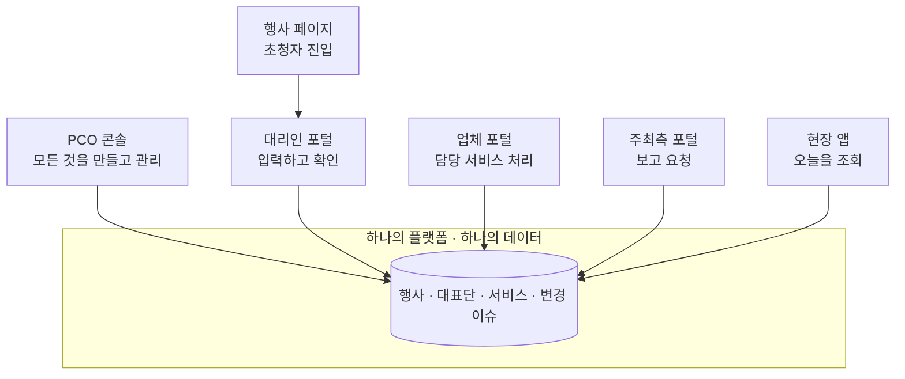

# MICE 해외 VIP 초청자 관리 솔루션 — UX/IA 설계서 v0.3

> 업무·데이터 분석서 v0.4를 기준으로 작성했습니다. 문서 속 P(프로세스), BR(업무 규칙), S(상태), IR(영향 규칙) 번호는 분석서의 번호를 그대로 참조합니다.

**변경 이력**

| 버전 | 내용 |
|---|---|
| v0.1 | 최초 작성 |
| v0.3 | 2차 결정 반영: 현장 앱 모바일 웹 + 제한적 오프라인(Q8), **MVP 언어 한국어·영어·일본어** 및 언어 로드맵(Q9), 입력 항목 필수 설정 + 시스템 필수 고정(Q10) |
| v0.2 | 1차 결정 반영: 주최측 별도 포털(Q1), **전 접점 반응형 필수**(Q2·Q6) → 1.12 반응형 설계 신설, 대리인 OTP 로그인(Q3), 담당자별 필터(Q4), **필수 항목 표시 체크리스트 허브**(Q5) → 3.7.1 신설, **다국어 구조**(Q7) → 1.13 신설 |

**진행 순서**: 1부 정보 구조 설계 → 2부 화면별 핵심 목표 → 3부 상태별 화면 설계 → 4부 결정 필요 사항

**표기 규칙**

| 표기 | 의미 |
|---|---|
| `P0` | MVP 출시에 반드시 필요한 화면 |
| `P1` | MVP에 포함하되 단순한 형태로 시작 가능 |
| `P2` | 고도화 |
| `[결정 필요]` | 4부 인터뷰 참고 |
| 🔒 | 민감정보가 노출되는 영역 |

---

# 1부. 정보 구조 설계

## 1.1 UX 설계 원칙

분석 단계에서 확인한 핵심 문제("잦은 변경이 한 사람과 엑셀을 거쳐 수동 전파된다")를 화면에서 해결하기 위한 약속입니다. 모든 화면 설계는 이 원칙으로 검증합니다.

| No | 원칙 | 의미 | 적용 예 |
|---|---|---|---|
| U1 | **할 일이 먼저 보인다** | 로그인하면 데이터가 아니라 "지금 내가 처리해야 할 것"이 먼저 보인다 | PCO 행사 홈, 업체 통합 인박스, 대리인 체크리스트 |
| U2 | **대표단 하나를 한 화면에서** | 한 VIP 대표단의 모든 정보(참가자, 서비스, 일정, 이슈, 이력)를 한 화면에서 볼 수 있다. 엑셀의 여러 시트를 오가던 일을 없앤다 | PCO 대표단 360 화면 |
| U3 | **변경은 항상 "이전 → 이후"로** | 무엇이 바뀌었는지 사람이 비교하지 않게, 모든 변경은 이전 값과 새 값을 나란히 보여준다 | 조정 항목, 업체 처리 화면, 알림 메일 |
| U4 | **상태는 색과 글자로 함께** | 색만으로 상태를 전달하지 않는다. 항상 상태 이름을 같이 쓴다 | 모든 상태 배지 |
| U5 | **역할에 필요한 만큼만** | 사용자는 자기 업무에 필요한 정보만 본다. 보이지 않는 정보는 존재 자체를 드러내지 않는다 | 업체 화면, 비공개 하위 행사 |
| U6 | **민감정보는 "열어보는 행동"으로** | 🔒 정보는 기본 가림 처리, 클릭해서 열고, 연 기록이 남는다는 것을 사용자에게 알린다 | 여권번호, 건강 정보 |
| U7 | **시간은 항상 시간대와 함께** | 해외 출발 항공편, 한국 현지 일정이 섞이므로 모든 시각에 기준 시간대를 표시한다 | 항공편, 픽업 시각 |
| U8 | **대량 작업이 기본** | 담당자 1명이 200명 이상을 다루므로, 목록 화면은 다중 선택과 일괄 작업을 기본 제공한다 | 대표단 목록, 초청 발송 |
| U9 | **끝났음을 확실히** | "보냈다"가 아니라 "상대가 확인했다", "반영됐다"까지 보여준다 | 조정 항목, 알림 상태 |

## 1.2 제품 구성 (사용자 접점)

이 솔루션은 사용자 그룹별로 **6개의 접점**을 가집니다. 하나의 시스템, 하나의 데이터지만 사용자마다 들어오는 문이 다릅니다.

| 접점 | 코드 | 사용자 | 기기 | 언어 | 진입 방식 |
|---|---|---|---|---|---|
| PCO 콘솔 | `PCO` | PCO 관리자, 초청 담당자 | 반응형 (데스크톱 우선 설계) | 국문 (다국어 확장 대비) | 계정 로그인 |
| 대리인 포털 | `PX` | 대리인 | 반응형 (모바일 우선 설계) | **다국어 필수** (1.13) | 초대 링크 또는 행사 페이지 → 이메일 인증번호 |
| 업체 포털 | `VD` | 업체 직원 | 반응형 (데스크톱 우선 설계) | 국문 (다국어 확장 대비) | 계정 로그인 |
| 주최측 포털 | `HO` | 주최측 | 반응형 | 국문 (다국어 확장 대비) | 계정 로그인 (별도 포털 확정) |
| 현장 스태프 앱 | `FS` | PCO 현장 스태프 | **모바일 전용 설계** (태블릿·데스크톱에서도 깨지지 않게) | 국문 | 계정 로그인. **모바일 웹** (홈 화면 추가 가능) |
| 행사 페이지 진입점 | `PB` | 대리인 (예비) | 반응형 | **다국어 필수** | 공개 URL |
| 플랫폼 관리 | `PA` | 솔루션 운영사 | 반응형 | 국문 | 내부 계정 |



## 1.3 화면 ID 체계

| 접두어 | 접점 | 예시 |
|---|---|---|
| `PCO-T` | PCO 콘솔 · 테넌트(회사) 레벨 | PCO-T01 행사 목록 |
| `PCO-E` | PCO 콘솔 · 행사 레벨 | PCO-E02 변경 이슈 보드 |
| `PX` | 대리인 포털 | PX-03 대표단 홈 |
| `VD` | 업체 포털 | VD-03 통합 할 일 |
| `HO` | 주최측 포털 | HO-01 대시보드 |
| `FS` | 현장 앱 | FS-01 오늘 |
| `PB` | 공개 페이지 | PB-01 초청자 진입 |
| `CM` | 공통 컴포넌트 | CM-01 상태 배지 |

## 1.4 PCO 콘솔 정보 구조

PCO 콘솔은 **두 층**으로 나뉩니다. 로그인하면 먼저 회사(테넌트) 레벨에서 행사를 고르고, 행사에 들어가면 행사 레벨 메뉴로 바뀝니다. 담당자는 대부분의 시간을 행사 레벨에서 보냅니다.

### 1.4.1 테넌트 레벨

```
PCO 콘솔 (테넌트)
├── 행사 목록 ........................ PCO-T01  (로그인 후 첫 화면)
├── 업체 ............................. PCO-T02
│   ├── 즐겨찾기 업체
│   └── 업체 찾기·초대
├── 템플릿 ........................... PCO-T03
│   ├── 의전 등급 템플릿
│   ├── 지원 정책 템플릿
│   ├── 동의서 템플릿
│   ├── 알림 메일 템플릿
│   └── 영향 규칙 기본값
├── 팀 ............................... PCO-T04
│   └── 직원 초대·역할
└── 회사 설정 ......................... PCO-T05
    └── 회사 정보, 자동 정산 기한, 보안 설정
```

### 1.4.2 행사 레벨 (좌측 고정 메뉴)

메뉴 순서는 **담당자가 하루에 들르는 빈도** 순서입니다. 가장 자주 쓰는 "홈"과 "변경 이슈"가 맨 위에 있습니다.

```
[행사명 ▾]  ← 다른 행사로 전환
│
├── 🏠 홈 (오늘 할 일) .................. PCO-E01
├── ⚡ 변경 이슈 [미종결 수] ............. PCO-E02
│   └── 이슈 상세 ....................... PCO-E03
│
├── 👥 대표단 ........................... PCO-E04
│   └── 대표단 상세 (360) ............... PCO-E05
│       ├── 개요
│       ├── 참가자 ...................... PCO-E06 (참가자 상세 패널)
│       ├── 서비스
│       ├── 일정
│       ├── 변경 이슈
│       ├── 동의·문서
│       └── 이력
│
├── 🧳 서비스 현황 ....................... PCO-E07
│   ├── 항공
│   ├── 숙박
│   ├── 수송
│   ├── 공항 의전
│   └── 식음
│
├── 📅 일정 (하위 행사) .................. PCO-E08
│   └── 하위 행사 상세 .................. PCO-E09
│
├── ✉️ 커뮤니케이션
│   ├── 초청 발송 ....................... PCO-E10
│   ├── 일정표 발행 ..................... PCO-E13
│   └── 발송 이력
│
├── 📨 주최측 요청 [미처리 수] ........... PCO-E11
├── 💳 환급 청구 [검토 대기 수] ........... PCO-E12
│
├── 📊 리포트·내보내기 ................... PCO-E17
│
└── ⚙️ 행사 관리
    ├── 행사 설정 ....................... PCO-E14
    │   ├── 기본 정보
    │   ├── 참여 업체
    │   ├── 운영 서비스
    │   ├── 의전 등급
    │   ├── 지원 정책
    │   ├── 동의서·공지
    │   ├── 입력 항목 설정 (필수/선택/숨김, 시스템 필수는 고정)
    │   ├── 언어 설정 (대리인 포털 지원 언어)
    │   ├── 영향 규칙
    │   ├── 알림·독촉 설정
    │   └── 행사 멤버 (주최측·현장 스태프)
    ├── 종료·정산 ....................... PCO-E15
    └── 감사 이력 ....................... PCO-E16
```

### 1.4.3 탐색의 세 축

담당자는 같은 데이터를 세 가지 관점으로 봐야 합니다. 세 관점은 서로 링크로 연결되어, 어느 관점에서든 한 번의 클릭으로 다른 관점으로 이동할 수 있어야 합니다.

| 관점 | 질문 | 화면 | 예 |
|---|---|---|---|
| **할 일 중심** | "지금 무엇을 처리해야 하지?" | 홈, 변경 이슈 | D-1인데 픽업 미확정인 건 |
| **대표단 중심** | "베트남 장관 대표단은 지금 어떤 상태지?" | 대표단 360 | 한 대표단의 전체 그림 |
| **서비스 중심** | "항공 미확정이 몇 건이지?" | 서비스 현황 | 업체별 진행 상황 점검 |

## 1.5 대리인 포털 정보 구조

대리인은 **이 시스템을 처음 쓰고, 영어가 모국어가 아닐 수 있으며, 가끔만 접속**하며, **입력해야 할 필수 데이터가 많습니다.** 그래서 메뉴를 탐색하게 하지 않고, 남은 필수 항목이 한눈에 보이는 **체크리스트 허브**에서 필요한 곳으로 바로 들어가는 구조로 합니다 (Q5 확정, 상세는 3.7.1).

```
행사 페이지 / 초대 메일
└── 진입·인증 ............................ PB-01 / PX-01
    └── (대표단이 2개 이상이면) 대표단 선택 ... PX-02
        │
        ├── ✅ 대표단 홈 (체크리스트) ....... PX-03
        │   ├── [최초 1회] 동의 ............. PX-04
        │   ├── 참석 회신 ................... PX-05
        │   ├── 참가자 ...................... PX-06
        │   │   └── 참가자 정보 입력 ........ PX-07 🔒
        │   ├── 항공 ........................ PX-08
        │   ├── 숙박 ........................ PX-09
        │   ├── 일정 ........................ PX-10
        │   │   └── 자체 일정 등록·상세 ..... PX-11
        │   ├── 식이·특별 요청 .............. PX-12
        │   └── 환급 청구 (해당 시) ......... PX-14
        │
        ├── 📄 내 일정표 .................... PX-13
        ├── 🔔 알림 [안 읽음 수] ............ PX-15
        └── 👤 대리인 관리 .................. PX-16
```

## 1.6 업체 포털 정보 구조

업체는 **여러 PCO의 여러 행사**를 동시에 처리합니다. 그래서 첫 화면은 특정 행사가 아니라 **모든 행사를 가로지르는 통합 할 일**입니다.

```
업체 포털
├── 📥 통합 할 일 [조치 필요 수] ......... VD-03  (로그인 후 첫 화면)
│   └── 조정 항목 처리 ................... VD-07
├── 📁 내 프로젝트 ....................... VD-02
│   └── 프로젝트 홈 ...................... VD-04
│       ├── 서비스 목록 (담당 유형별) .... VD-05
│       │   └── 서비스 처리 상세 ......... VD-06 🔒(항공만 여권)
│       └── 일정 (담당 관련만)
├── ⬆️ 엑셀 업로드·다운로드 ............... VD-09 [P2]
└── 🏢 회사·직원 관리 ..................... VD-08
```

## 1.7 주최측 포털 정보 구조

주최측은 **조회와 요청만** 합니다. 운영 도구가 아니라 "보고서를 대신하는 화면"으로 설계합니다 (별도 포털 확정).

```
주최측 포털
├── 📊 대시보드 .......................... HO-01
├── 👥 대표단 현황 ....................... HO-02
├── 📅 일정 .............................. HO-03
└── 📨 요청 .............................. HO-04
    ├── 새 요청
    └── 요청 내역
```

## 1.8 현장 스태프 앱 정보 구조

현장에서는 **한 손으로, 이동하면서, 짧게** 봅니다. 하단 탭 4개로 끝냅니다.

```
현장 앱 (하단 탭)
├── 🕐 오늘 .............................. FS-01  (시각순 타임라인)
├── 🔍 대표단 ............................ FS-02  (검색 → 대표단 카드)
├── 🚗 차량 .............................. FS-04
└── ⚠️ 긴급 [수] ......................... FS-03
```

## 1.9 공통 컴포넌트

여러 화면에서 반복되는 요소를 미리 정의해, 어느 화면에서든 같은 모양·같은 의미로 보이게 합니다.

| ID | 컴포넌트 | 쓰임 | 핵심 규칙 |
|---|---|---|---|
| CM-01 | **상태 배지** | 모든 상태 표시 | 상태 이름 + 색. 색 의미는 1.10 참고 |
| CM-02 | **긴급도 표시** | 이슈, 조정 항목, 할 일 | 긴급(빨강)·주의(주황)·일반(없음) + 남은 시간 "3시간 후" |
| CM-03 | **변경 비교(Diff)** | 조정 항목, 이력, 알림 메일 | `이전 값 → 새 값`, 이전 값은 취소선 |
| CM-04 | **민감정보 필드** | 여권·건강·종교 | 기본 `●●●●●●1234` 가림, [보기] 클릭 시 "열람 기록이 남습니다" 안내 후 표시 |
| CM-05 | **시각 표시** | 모든 일시 | `19:30 KST (Seoul)`. 해외 출발은 `08:10 ICT (Hanoi)` 현지 시각 + 시간대 |
| CM-06 | **지원 방식 태그** | 참가자·서비스 | 지원 / 선결제 환급 / 자비 / 미제공. 대리인 화면에서 특히 명확히 |
| CM-07 | **활동 타임라인** | 대표단·서비스·이슈 상세 우측 | 누가 언제 무엇을 했는지 시간순 |
| CM-08 | **일괄 작업 바** | 목록 화면 | 항목 선택 시 하단에 떠오름: 발송, 독촉, 담당 지정, 내보내기 |
| CM-09 | **알림 센터** | 모든 접점 상단 | 확인 필요 알림은 [확인] 버튼 포함 |
| CM-10 | **빈 상태·오류 상태** | 모든 목록 | 3부 3.1 참고 |
| CM-11 | **공개 범위 표시** | 하위 행사 | 🌐 전체 공개 / 👥 관계자 한정 / 🔒 비공개 |
| CM-12 | **읽기 전용 배너** | 종료·정산 완료 행사 | 화면 상단 고정 배너로 수정 불가 이유 안내 |

## 1.10 색의 의미 (전 접점 공통)

| 색 | 의미 | 사용 상태 |
|---|---|---|
| 🔴 빨강 | 지금 행동이 필요하고 늦으면 사고 | 긴급, 발송 실패, 기한 초과 |
| 🟠 주황 | 행동이 필요함 | 조치 필요, 주의, 검토 대기 |
| 🔵 파랑 | 누군가 처리 중 | 처리중, 입력 중, 진행중 |
| 🟢 초록 | 끝남 | 확정, 완료, 종결, 안내 완료 |
| ⚪ 회색 | 아직 차례가 아님 또는 의미 없음 | 대기, 가안, 해당 없음 |
| ⚪ 회색 + 취소선 | 무효가 됨 | 무효, 대체됨, 취소 |

## 1.11 알림 메일 구조

메일은 이 제품의 **두 번째 화면**입니다. 특히 대리인과 업체는 메일을 보고 들어오므로, 메일만 읽어도 무엇을 해야 하는지 알 수 있어야 합니다.

| 요소 | 규칙 |
|---|---|
| 제목 | `[행사 약칭] [긴급도] 대표단명 · 무엇이 바뀌었나` 예: `[KAS2026] [긴급] 베트남 장관 대표단 · 입국 도착 시각 변경` |
| 본문 첫 줄 | 해야 할 일 한 문장. 예: "픽업 차량 재배차가 필요합니다 (기한: 오늘 18:00)" |
| 변경 내용 | CM-03 변경 비교 형식 |
| 행동 버튼 | 하나만. [처리하러 가기] 또는 [확인했습니다] |
| 민감정보 | 메일에는 절대 포함하지 않음. 여권번호, 건강 정보는 로그인 후에만 |
| 언어 | 수신자 선호 언어. 대리인·대표단 대상 메일은 다국어 필수 (1.13) |

## 1.12 반응형 설계 (v0.2 신설)

**모든 접점은 기기별 반응형이 필수**입니다. 다만 접점마다 "어느 기기를 기준으로 먼저 설계하는가"는 다릅니다.

### 기준 화면 폭

| 구간 | 폭 | 대표 기기 |
|---|---|---|
| 모바일 | ~767px | 스마트폰 |
| 태블릿 | 768~1199px | 태블릿, 작은 노트북 |
| 데스크톱 | 1200px~ | 노트북, 모니터 |

### 접점별 우선 설계 기기

| 접점 | 우선 설계 | 이유 |
|---|---|---|
| PCO 콘솔 | 데스크톱 → 모바일로 축소 | 주 업무는 책상에서. 단 행사 기간엔 이동 중 이슈 처리 필요 |
| 대리인 포털 | **모바일 → 데스크톱으로 확장** | 비서·대리인은 이동 중 휴대폰으로 확인·입력하는 경우가 많음 |
| 업체 포털 | 데스크톱 → 모바일 | 확정 입력은 책상에서, 확인은 현장에서 |
| 주최측 포털 | 데스크톱·모바일 동등 | 보고받는 용도라 휴대폰 조회 비중이 높음 |
| 현장 앱 | **모바일 전용** | 한 손 조작 기준 |

### 반응형 변환 규칙

화면이 좁아질 때 요소를 어떻게 바꿀지 미리 정해두면, 화면마다 따로 고민하지 않아도 됩니다.

| 데스크톱 요소 | 모바일에서 | 적용 화면 예 |
|---|---|---|
| 좌측 고정 메뉴 | 하단 탭 4개 + [더보기] | PCO 콘솔 (홈 / 이슈 / 대표단 / 일정 / 더보기) |
| 데이터 표 (여러 열) | **카드 목록**. 카드에는 긴급도·이름·상태·핵심 값 1개만 | 이슈 보드, 대표단 목록, 서비스 목록 |
| 좌우 2단 (본문 + 활동 기록) | 본문만 표시, 활동 기록은 탭으로 | 이슈 상세, 대표단 360 |
| 옆에서 열리는 상세 패널 | 전체 화면으로 열림 + 뒤로 가기 | 참가자 상세, 서비스 상세 |
| 참가자 × 서비스 매트릭스 | **참가자별 아코디언** (펼치면 서비스 상태 목록) | 대표단 360 개요 |
| 연쇄 트리 (들여쓰기 다단) | 차수 배지(1차·2차…)를 단 **세로 목록**, 들여쓰기 최대 1단 | 이슈 상세 |
| 캘린더 주간 보기 | **일간 목록** (날짜 넘기기) | 일정 |
| 일괄 작업 바 | 하단 고정 버튼 1~2개 + [더보기] | 대표단 목록 |
| 필터 여러 개 가로 배치 | [필터] 버튼 → 하단 시트 | 모든 목록 |
| 긴 입력 폼 (2열) | 1열, 섹션별 접기 | 대리인 입력 |

### 모바일에서 반드시 가능해야 하는 작업

모든 기능을 모바일에서 똑같이 할 필요는 없습니다. 아래는 **모바일에서도 끝까지 처리할 수 있어야 하는** 작업이고, 그 외는 조회만 가능해도 됩니다.

| 접점 | 모바일 필수 작업 | 모바일에선 조회만 |
|---|---|---|
| PCO 콘솔 | 이슈 확인·재알림·판단 항목 결정·해당 없음 처리, 대표단 조회, 주최측 요청 수락, 알림 확인 | 행사 설정, 템플릿, 지원 정책·영향 규칙 편집, 정산 |
| 대리인 포털 | **전체** (입력, 업로드, 회신, 자체 일정, 환급 청구) | - |
| 업체 포털 | 조정 항목 확인·완료, 확정 정보 입력 | 엑셀 업로드 [P2] |
| 주최측 포털 | 전체 | - |
| 현장 앱 | 전체 | - |

> 대리인의 여권 사본 업로드는 모바일에서 **카메라 촬영**을 바로 선택할 수 있게 합니다.

## 1.13 다국어 구조 (v0.2 신설)

해외 VIP가 대상이므로 **초청자 측이 보는 모든 것은 다국어가 필수**입니다. 나머지 접점은 MVP에서 국문으로 시작하되, 나중에 언어를 추가할 때 화면을 다시 만들 필요가 없도록 구조를 처음부터 다국어로 설계합니다.

### 다국어 적용 범위

| 대상 | MVP | 고도화 |
|---|---|---|
| 대리인 포털 전체 (PX) | ✅ 다국어 | 언어 추가 |
| 행사 페이지 진입점 (PB) | ✅ 다국어 | 언어 추가 |
| 대리인·대표단 대상 메일 | ✅ 다국어 | 언어 추가 |
| 개인 일정표 (PDF 포함) | ✅ 다국어 | 언어 추가 |
| 동의서·공지 | ✅ 다국어 (PCO가 언어별 문구 입력) | 번역 보조 |
| PCO 콘솔, 업체 포털, 주최측 포털, 현장 앱 | 국문 | 영문 등 추가 |

### 언어 로드맵 (Q9 확정)

| 단계 | 언어 | 비고 |
|---|---|---|
| **MVP** | 한국어, 영어, 일본어 | 대리인 포털·행사 페이지·메일·일정표·동의서 |
| 고도화 1순위 | 프랑스어, 스페인어, 중국어(간체) | 목표 6개 언어 완성 |
| 고도화 이후 | 아랍어 등 | RTL 배치 필요. 구조는 지금부터 대비 |

### 언어별 주의 사항

| 언어 | 주의 사항 |
|---|---|
| 일본어 (MVP) | 한중일 글꼴(CJK)을 처음부터 포함. 문구가 짧아지는 대신 글자 높이·줄 간격이 달라 버튼 높이 점검 필요. 날짜는 `2026年10月14日` 형식 |
| 한국어·일본어·중국어 공통 | 이름은 여권상 영문이 필수이고, 한자·가나 표기는 선택 입력(명찰·안내용 [P2]) |
| 프랑스어·스페인어 (고도화) | 영문 대비 문구 30~50% 길어짐 → "1.5배 규칙"으로 대비 |
| 아랍어 (향후) | 화면 좌우 반전. 숫자·편명·시각은 반전하지 않음 |

### 다국어의 두 층위

| 층위 | 무엇 | 누가 번역 | 예 |
|---|---|---|---|
| **화면 문구** | 버튼, 메뉴, 안내, 오류 메시지 | 솔루션 제공사 (언어 팩) | "Continue", "Deadline" |
| **행사 콘텐츠** | 행사명, 하위 행사명, 장소, 드레스 코드, 동의서, 공지, 지원 정책 안내 문구 | PCO가 행사별 입력 | "한-아프리카 정상회의" → "Korea-Africa Summit" |

행사 콘텐츠 중 **번역이 빠진 언어가 있으면 영문으로 대체 표시**하고, PCO 콘솔의 행사 설정에 "번역 누락 N건" 경고를 띄웁니다.

### 언어 선택 규칙

| 규칙 | 내용 |
|---|---|
| 첫 진입 | 브라우저 언어가 지원 언어면 그 언어, 아니면 영문 |
| 전환 | 모든 대리인 화면 우측 상단에 언어 선택 (🌐 English ▾). 전환해도 입력 중인 내용 유지 |
| 저장 | 대리인이 고른 언어는 대리인 개인 설정으로 저장 |
| 메일·일정표 | 대표단의 **선호 언어**로 발송 (대리인마다 다르면 각자 언어로) |

### 확장을 위한 설계 규칙

| 규칙 | 이유 |
|---|---|
| 화면 문구를 코드에 직접 쓰지 않고 언어 파일로 분리 | 언어 추가 = 파일 추가 |
| 버튼·라벨은 **문구가 1.5배 길어져도** 깨지지 않게 | 독일어·프랑스어는 영어보다 길다 |
| **오른쪽→왼쪽(RTL) 배치**를 처음부터 고려 | 아랍어권 VIP 대응. 아이콘 방향, 진행 표시 방향이 반대로 뒤집힘 |
| 날짜·숫자·통화는 언어별 형식 | 10/14 vs 14/10 혼동은 일정 사고로 직결. 모든 언어에서 **월을 글자로 표기**해 혼동을 원천 차단 (영문 `14 Oct 2026`, 국문 `2026년 10월 14일`, 일문 `2026年10月14日`) |
| 이름 입력은 **여권상 영문**을 필수, 자국어 표기는 선택 | 항공권은 영문 기준. 명찰·안내는 자국어 표기 활용 [P2] |
| 입력값(메모 등)은 번역하지 않고 입력한 언어 그대로 | 자동 번역 오류로 인한 의전 실수 방지 |

---

# 2부. 화면별 핵심 목표

각 화면은 **하나의 핵심 목표**를 갖습니다. 기능이 많아져도 이 목표를 해치는 요소는 넣지 않는 것이 원칙입니다. "성공 기준"은 사용성 테스트와 출시 후 측정에 쓰는 기준입니다.

## 2.1 핵심 화면 (제품 경험을 좌우하는 7개)

아래 7개 화면이 이 제품의 경험을 결정합니다. 디자인과 개발 리소스를 가장 먼저, 가장 많이 투입해야 할 화면입니다.

| ID | 화면 | 핵심 목표 | 이 화면이 즉시 답해야 할 질문 | 성공 기준 |
|---|---|---|---|---|
| **PCO-E01** | 행사 홈 | 담당자가 **30초 안에 오늘 처리할 일을 파악**한다 | 지금 급한 게 뭐지? 누가 응답을 안 했지? 오늘 무슨 일정이 있지? | 로그인 후 첫 행동까지 30초 이내. 긴급 건을 놓치는 일 0건 |
| **PCO-E02** | 변경 이슈 보드 | **끝나지 않은 변경을 하나도 빠짐없이** 보고 우선순위대로 처리한다 | 미종결 이슈가 몇 개지? 어떤 게 가장 급하지? 어디서 막혀 있지? | 행사 시작 시점 미종결 이슈 0건 (분석서 KPI) |
| **PCO-E03** | 변경 이슈 상세 | 한 변경이 **어디까지 번졌고 어디서 멈췄는지** 한눈에 본다 | 몇 차까지 갔지? 누가 아직 안 했지? 내가 판단할 게 있나? | 막힌 항목과 담당자를 5초 안에 찾음 |
| **PCO-E05** | 대표단 360 | 한 대표단의 **모든 정보를 엑셀 없이 한 화면에서** 본다 | 이 대표단 지금 어떤 상태지? 뭐가 빠졌지? 뭐가 바뀌었지? | 대표단 관련 문의에 다른 화면 이동 없이 답변 |
| **PX-03** | 대리인 홈 | 대리인이 **무엇을 더 해야 하는지** 헤매지 않고 안다 | 내가 뭘 입력해야 하지? 마감이 언제지? 확정된 건 뭐지? | 초대 후 D-7 정보 완결률 80% 이상 |
| **VD-03** | 업체 통합 할 일 | 업체가 **모든 PCO의 처리할 일을 한곳에서** 놓치지 않는다 | 지금 처리할 게 몇 건이지? 가장 급한 건 뭐지? | 조치 필요 → 확인까지 평균 30분 이내 |
| **FS-01** | 현장 오늘 | 현장 스태프가 **다음 도착·출발·일정을 즉시** 확인한다 | 다음에 누가 언제 어디로 오지? 차는 준비됐나? | 앱 열고 5초 안에 다음 일정 확인 |

## 2.2 PCO 콘솔

| ID | 화면 | 주 사용자 | 핵심 목표 | 주요 작업 | 우선순위 |
|---|---|---|---|---|---|
| PCO-T01 | 행사 목록 (로그인 후 첫 화면, 카드형) | 관리자, 담당자 | 내가 담당하는 행사로 빠르게 들어간다 | 행사 선택, **행사 등록·기본 정보 수정·삭제**, 설정 복사, 상태별 필터 (D-UI-03) | P0 |
| PCO-T02 | 업체 즐겨찾기 | 관리자 | 믿을 만한 업체 목록을 회사 자산으로 쌓는다 | 업체 검색, 즐겨찾기, 신규 업체 초대 | P0 |
| PCO-T03 | 템플릿 관리 | 관리자 | 행사마다 반복하는 설정을 한 번만 만든다 | 의전 등급·지원 정책·동의서·알림·영향 규칙 템플릿 편집 | P1 |
| PCO-T04 | 팀 관리 | 관리자 | 직원 권한을 안전하게 관리한다 | 초대, 역할 변경, 비활성화 | P0 |
| PCO-T05 | 회사 설정 | 관리자 | 회사 공통 정책을 정한다 | 자동 정산 기한, 보안 설정 | P1 |
| **PCO-E01** | 행사 홈 | 담당자 | 오늘 처리할 일을 30초 안에 파악 | 긴급 이슈로 이동, 미응답 대표단 독촉, 오늘 일정 확인 | P0 |
| **PCO-E02** | 변경 이슈 보드 | 담당자 | 미종결 변경을 빠짐없이 처리 | 긴급도순 정렬, 필터(업체·서비스·대표단), 이슈 열기 | P0 |
| **PCO-E03** | 변경 이슈 상세 | 담당자 | 연쇄 범위와 막힌 곳 파악 | 판단 항목 결정, 해당 없음 처리, 정정 요청, 재알림, 강제 종결 | P0 |
| PCO-E04 | 대표단 목록 | 담당자 | 행사에 참석하는 **모든 대표단**의 진행 상태를 비교 | 상태·완결률·국가 필터, 일괄 발송·독촉·담당 지정, 내보내기 (D-UI-06) | P0 |
| PCO-E18 | 전체 명단 (스프레드시트) | 담당자 | **엑셀처럼 전 참가자·전 항목을 한 표에서** 본다 | 가로 스크롤(이름 열 고정), 열 묶음 설정·저장된 보기, 대표단별 묶기, 🔒 재인증 표시, 엑셀 내보내기 (D-UI-07) | P0 |
| **PCO-E05** | 대표단 360 | 담당자 | 한 대표단의 전체 그림 | 탭 이동, 참가자 편집, 서비스 확인, 지원 예외 지정, 확정 처리 | P0 |
| PCO-E06 | 참가자 상세 (패널) | 담당자 | 한 사람의 정보를 대표단 화면을 떠나지 않고 확인 | 정보 편집, 🔒 열람, 의전 등급·선호 편집, 관계 등록 | P0 |
| PCO-E07 | 서비스 현황 | 담당자 | 서비스별로 업체 진행 상황을 점검 | 서비스 탭 전환, 상태별 필터, 업체별 보기, 미확정 목록 | P0 |
| PCO-E08 | 일정 (하위 행사) | 담당자 | 전체 일정과 충돌을 한눈에 | 캘린더/목록 전환, 하위 행사 생성, 자체 일정 확인 | P0 |
| PCO-E09 | 하위 행사 상세 | 담당자 | 하위 행사 하나의 참석자·서비스를 관리 | 참석자 지정, 역할, 공개 범위, 가안→확정, 취소 | P0 |
| PCO-E10 | 초청 발송 | 담당자 | 초청과 독촉을 누락 없이 | 대상 선택 발송, 반송 처리, 독촉 일정 확인 | P0 |
| PCO-E11 | 주최측 요청함 | 담당자 | 주최측 요청을 기록 속에서 처리 | 수락·반려, 이슈 연결, 완료 | P0 |
| PCO-E12 | 환급 청구 | 담당자 | 환급을 빠짐없이 검토·기록 | 증빙 확인, 승인 금액 입력, 반려, 지급 기록 | P1 |
| PCO-E13 | 일정표 발행 | 담당자 | 최신 일정표가 대리인에게 가도록 | 재발행 필요 목록, 미리보기, 일괄 발행 | P0 |
| PCO-E14 | 행사 설정 | 관리자, 담당자 | 행사 운영 규칙을 정한다 | 업체 추가, 지원 정책, 의전 등급, 동의서, 영향 규칙, 입력 항목 필수 설정, 지원 언어·번역 누락 확인 | P0 |
| PCO-E15 | 종료·정산 | 관리자 | 행사를 안전하게 닫는다 | 미처리 항목 점검, 정산 완료, 파기 예정 확인, 예외 보관 | P0 |
| PCO-E16 | 감사 이력 | 관리자 | 누가 무엇을 보고 바꿨는지 추적 | 민감정보 열람 기록, 변경 기록 검색 | P1 |
| PCO-E17 | 리포트·내보내기 | 담당자 | 기관 제출 명단·보고 자료를 즉시 만든다 | 양식 선택, 내보내기 | P1 |

## 2.3 대리인 포털

| ID | 화면 | 핵심 목표 | 주요 작업 | 우선순위 |
|---|---|---|---|---|
| PB-01 | 행사 페이지 진입 | 초청받은 사람만 안전하게 들어온다 | 초청 코드 입력 | P0 |
| PX-01 | 이메일 인증 | 비밀번호 없이 빠르게 로그인 (이메일 인증번호, 같은 기기 7일 유지) | 인증번호 입력 | P0 |
| PX-02 | 대표단 선택 | 여러 대표단 중 작업할 곳을 고른다 | 대표단 전환 | P0 |
| **PX-03** | 대표단 홈 | 해야 할 일과 확정된 것을 한눈에 | 체크리스트 항목으로 이동 | P0 |
| PX-04 | 동의 | 무엇에 동의하는지 이해하고 동의한다 | 항목별 체크, 재동의 | P0 |
| PX-05 | 참석 회신 | 참석 여부를 한 번에 알린다 | 참석 / 불참 | P0 |
| PX-06 | 참가자 | 대표단 구성원과 **각자의 지원 범위**를 이해한다 | 동반자·수행원 추가, 지원 대상 지정 | P0 |
| PX-07 | 참가자 정보 입력 🔒 | 여권·건강 정보를 안심하고 입력한다 | 정보 입력, 여권 사본 업로드, "현장 제공" 선택 | P0 |
| PX-08 | 항공 | 지원이면 **여정 요청**, 자비면 **항공편 입력**, 확정되면 **결과 확인** | 요청 제출, 자비 항공편 입력, 확정 확인 | P0 |
| PX-09 | 숙박 | 체크인·아웃과 객실 구성을 알린다 | 요청 제출, 확정 확인 | P0 |
| PX-10 | 일정 | 공식 일정에 회신하고 자체 일정을 알린다 | 참석 회신, 자체 일정 추가 | P0 |
| PX-11 | 자체 일정 | 개별 일정과 차량 필요를 쉽게 등록한다 | 일시·장소·참석자·차량 입력 | P0 |
| PX-12 | 식이·특별 요청 | 식이·접근성 요구를 빠짐없이 전한다 | 식이 코드 선택, 요청 메모 | P0 |
| PX-13 | 내 일정표 | VIP에게 그대로 전달할 최신 일정을 받는다 | 보기, PDF 다운로드, 인쇄 | P0 |
| PX-14 | 환급 청구 | 선결제 비용을 증빙과 함께 청구한다 | 금액·증빙 제출, 상태 확인 | P1 |
| PX-15 | 알림 | 변경 안내와 PCO 요청을 놓치지 않는다 | 읽기, 해당 화면으로 이동 | P0 |
| PX-16 | 대리인 관리 | 동료 대리인을 추가하거나 인수인계한다 | 추가 요청 | P1 |

## 2.4 업체 포털

| ID | 화면 | 핵심 목표 | 주요 작업 | 우선순위 |
|---|---|---|---|---|
| VD-01 | 로그인 | - | 로그인 | P0 |
| VD-02 | 내 프로젝트 | 참여 중인 모든 행사를 PCO별로 본다 | 프로젝트 선택 | P0 |
| **VD-03** | 통합 할 일 | 모든 행사의 처리할 일을 긴급도순으로 | 확인, 처리 화면 이동 | P0 |
| VD-04 | 프로젝트 홈 | 한 행사에서 내 담당 현황을 본다 | 상태별 건수 확인 | P0 |
| VD-05 | 서비스 목록 | 담당 서비스 요청을 상태별로 처리 | 필터, 일괄 착수 | P0 |
| VD-06 | 서비스 처리 상세 | **요청과 확정을 나란히 보며** 확정 정보를 입력 | 착수, 확정 입력, 수정 | P0 |
| VD-07 | 조정 항목 처리 | 무엇이 바뀌었고 무엇을 해야 하는지 보고 처리 | 확인, 완료, 메모 | P0 |
| VD-08 | 회사·직원 | 직원별 담당 프로젝트 관리 | 직원 초대 | P1 |
| VD-09 | 엑셀 업·다운로드 | 대량 확정 정보를 엑셀로 처리 | 템플릿 다운로드, 업로드, 검증 결과 확인 | P2 |

## 2.5 주최측 포털

| ID | 화면 | 핵심 목표 | 주요 작업 | 우선순위 |
|---|---|---|---|---|
| HO-01 | 대시보드 | PCO에게 묻지 않고 전체 현황을 안다 | 참석 확정 수, 도착 예정, 미종결 긴급 이슈 수 확인 | P0 |
| HO-02 | 대표단 현황 | 대표단별 진행을 조회한다 | 목록·상세 조회 (🔒 제외) | P0 |
| HO-03 | 일정 | 공식·자체 일정을 한눈에 본다 | 캘린더 조회 | P0 |
| HO-04 | 요청 | 요청을 기록으로 남기고 결과를 받는다 | 요청 작성, 진행 확인 | P0 |

## 2.5.1 프레임 목업 v0.5에서 추가·확정된 화면 ID

| ID | 화면 | 비고 |
|---|---|---|
| AU-01 · AU-02 · AU-03 | 로그인 · 비밀번호 재설정 · 초대 수락 | PCO·업체 공용 |
| CM-01 | 알림 센터 | 전 접점 공통 패널 |
| CM-02 | 화면 상태 모음 | 빈 상태·오류·권한 없음·읽기 전용·충돌·로그인 만료 |
| PCO-E18 | 전체 명단 (스프레드시트) | D-UI-07 |
| PX-17 | 제출 전 확인 (누락 요약) | 3.7.1 최종 확인 |
| AU-04 | 내 계정 | 프로필·비밀번호·언어·알림 수신·로그인 기기 (v0.6) |
| PCO-E19 | 대리인 메시지 | 대리인 메시지 수신·답장, 하위 행사·이슈·요청으로 전환 (v0.6, 자체 일정의 MVP 대체 경로) |
| PCO-E01·S / E03·S / E05·S / PX-S | 상태별 화면 | 행사·이슈·대표단·대리인 포털의 상태별 모습 (v0.6) |
| PCO-E01·F | 현장 스태프 조회 | MVP 현장 대체: PCO 콘솔 조회 전용 권한 (v0.6) |

MVP 제외 화면(고도화): 주최측 포털(HO), 현장 앱(FS), 대표단 자체 일정(PX-11), 환급 청구(PX-14, PCO-E12), 업체 엑셀 업로드(VD-09).

## 2.6 현장 스태프 앱

| ID | 화면 | 핵심 목표 | 주요 작업 | 우선순위 |
|---|---|---|---|---|
| **FS-01** | 오늘 | 다음 도착·출발·일정을 즉시 확인 | 타임라인 스크롤, 항목 열기 | P0 |
| FS-02 | 대표단 카드 | VIP를 알아보고 필요한 정보를 즉시 확인 | 이름·국가 검색, 구성원·호칭·차량·숙소 확인 | P0 |
| FS-03 | 긴급 | 오늘 실행되는데 미종결인 변경을 안다 | 확인, PCO에 전화 | P0 |
| FS-04 | 차량 | 오늘의 배차와 탑승자 확인 | 차량별 보기, 기사 전화 | P0 |
| FS-05 | 현장 체크 | 도착·탑승·체크인 상태 입력 | 상태 버튼 | P2 |

---

# 3부. 상태별 화면 설계

같은 화면이라도 데이터의 상태에 따라 **보여줄 것, 강조할 것, 누를 수 있는 것**이 달라집니다. 이 부분이 정의되지 않으면 개발 단계에서 "이 경우엔 뭘 보여주죠?"라는 질문이 수백 번 나옵니다. 분석서의 상태 정의(S01~S14)를 화면으로 옮긴 것이 3부입니다.

> 와이어프레임은 **배치와 우선순위를 전달하기 위한 개념도**입니다. 시각 디자인(색, 글꼴, 간격)은 다음 단계에서 정합니다.

## 3.1 공통 화면 상태

모든 화면에 적용되는 기본 상태입니다.

| 상태 | 언제 | 보여줄 것 | 규칙 |
|---|---|---|---|
| 불러오는 중 | 데이터 조회 중 | 실제 레이아웃 모양의 회색 골격 | 1초 미만이면 표시하지 않음 |
| 빈 상태 · 처음 | 아직 아무것도 없음 | 이 화면이 무엇인지 + 첫 행동 버튼 | 예: "아직 대표단이 없습니다 [대표단 추가]" |
| 빈 상태 · 필터 결과 없음 | 필터 때문에 안 보임 | "조건에 맞는 항목이 없습니다" + [필터 초기화] | 처음 상태와 문구를 구분 |
| 빈 상태 · 모두 완료 | 처리할 일이 다 끝남 | 긍정 메시지. 예: "미종결 변경이 없습니다 🎉" | **이 제품에서 가장 중요한 빈 상태.** 목표 달성을 보여줌 |
| 오류 | 불러오기·저장 실패 | 무엇이 실패했는지 + [다시 시도] | 입력 중이던 내용은 절대 잃지 않음 |
| 권한 없음 | 접근 권한 밖 | "이 정보를 볼 권한이 없습니다" | 비공개 하위 행사 등은 이 화면조차 보이지 않게 (존재 비노출) |
| 읽기 전용 | 행사 종료·정산 완료 | 상단 고정 배너 CM-12 + 모든 입력 비활성 | 배너에 이유와 날짜 표시 |
| 오프라인 | 현장 앱 연결 끊김 | 상단 "오프라인 · 14:32 기준 정보" | 마지막 "오늘" 화면만 임시 저장, 🔒 제외 (Q8 확정) |
| 동시 수정 충돌 | 다른 사람이 먼저 수정 | "다른 사용자가 방금 수정했습니다" + 변경 비교 + [내 값으로 덮어쓰기 / 새 값 유지] | 조용히 덮어쓰지 않음 |

## 3.2 행사 상태에 따른 전역 변화 (S01)

행사 상태가 바뀌면 모든 접점의 화면이 함께 바뀝니다.

| 행사 상태 | PCO 콘솔 | 대리인 포털 | 업체 포털 | 주최측 | 현장 앱 |
|---|---|---|---|---|---|
| 준비중 | 홈 = **설정 체크리스트** (업체, 정책, 동의서, 대표단 등록) | 접근 불가 | 프로젝트 목록에 "준비중" 표시, 데이터 없음 | 대시보드 = "행사 준비 중" | 접근 불가 |
| 초청 진행 | 홈 = **할 일 중심** (응답 현황, 이슈) | 정상 이용 | 정상 이용 | 정상 | 조회 가능 (미리보기) |
| 행사 진행 | 홈 = **오늘 타임라인 우선**, 긴급도 기준 강화 | 정상 + 일정표 강조 | 정상 + "오늘" 필터 기본 | 오늘 현황 강조 | **주 사용 기간** |
| 종료 | 홈 = **정산 체크리스트** (환급, 미종결, 업체 정산) | 읽기 전용 + 환급 청구만 가능 | 정산용 조회·수정 | 읽기 전용 | 접근 종료 |
| 정산 완료 | 읽기 전용 + 파기 예정일 배너 | **접근 차단** | 프로젝트 목록에서 "종료됨"으로 이동, 열람 불가 | **접근 차단** | 접근 차단 |
| 파기 완료 | 비식별 요약만 조회 | 차단 | 차단 | 차단 | 차단 |
| 취소 | 취소 배너 + 취소 이슈 처리 화면 | 취소 안내 화면 | 취소 조정 항목 표시 | 취소 배너 | 접근 불가 |

## 3.3 PCO-E01 행사 홈

### 기본 배치 (초청 진행 상태)

```text
┌──────────────────────────────────────────────────────────────────────┐
│ 한-아프리카 정상회의 2026 ▾          D-12       🔔 3    담당: 김초청 │
├──────────────────────────────────────────────────────────────────────┤
│ ① 지금 처리할 일                                                     │
│ ┌──────────────┬──────────────┬──────────────┬──────────────┐        │
│ │ 🔴 긴급 이슈  │ 🟠 내 판단    │ 🟠 주최측     │ 🟠 환급 검토  │        │
│ │      2       │  필요  3     │  요청  1     │      4       │        │
│ └──────────────┴──────────────┴──────────────┴──────────────┘        │
│                                                                      │
│ 🔴 CHG-042 베트남 장관 · 도착 14:00→19:30 · 픽업 재배차 미확인 (3시간)│
│ 🔴 CHG-045 케냐 대통령 · 자체 일정 늦은 등록 · 차량 미배정 (20시간)   │
│ 🟠 CHG-039 가나 장관 · 만찬 참석 여부 판단 필요                       │
│                                               [변경 이슈 전체 보기 →] │
├───────────────────────────────────┬──────────────────────────────────┤
│ ② 초청 진행 현황                   │ ③ 다가오는 일정 (72시간)          │
│ 확정 ████████████░░░░ 32/48        │ 내일 14:00 입국 3개 대표단        │
│ 입력중 8 · 열람 4 · 미열람 3 · 반송 1│ 내일 18:00 환영 만찬 (가안 → 확정?)│
│ [미응답 7개 대표단 일괄 독촉]       │ 모레 10:00 본회의                 │
├───────────────────────────────────┴──────────────────────────────────┤
│ ④ 서비스 진행          항공 41/48 · 숙박 44/48 · 수송 38/52 · 의전 40/48│
└──────────────────────────────────────────────────────────────────────┘
```

**배치 우선순위**: ① 처리할 일 → ② 사람(초청) → ③ 시간(일정) → ④ 서비스. 스크롤 없이 ①이 반드시 보여야 합니다.

### 상태별 변화

| 조건 | 화면 변화 |
|---|---|
| 행사 준비중 | ①~④ 대신 **설정 체크리스트** 표시: 기본 정보 ✅ / 참여 업체 ✅ / 의전 등급 ⬜ / 지원 정책 ⬜ / 동의서 ⬜ / 대표단 등록 0 → [초청 발송] 버튼은 필수 항목 완료 전까지 비활성 |
| 처리할 일 0건 | ① 영역에 "지금 처리할 일이 없습니다" 초록 메시지. ②③이 위로 올라옴 |
| 긴급 이슈 존재 | ① 영역 상단에 빨간 띠. 브라우저 탭 제목에 `(2) 긴급` 표시 |
| 행사 진행 기간 | ③ 일정이 **오늘 타임라인**으로 바뀌어 ① 바로 아래로 올라옴 |
| 종료 | ①이 **정산 체크리스트**로 바뀜: 미종결 이슈 / 미처리 환급 / 업체 정산 확인 → [정산 완료 처리] |

## 3.4 PCO-E02 변경 이슈 보드

```text
┌─────────────────────────────────────────────────────────────────────┐
│ 변경 이슈   미종결 7  (긴급 2 · 주의 3 · 일반 2)                      │
│ [미종결 ▾] [서비스: 전체 ▾] [업체: 전체 ▾] [대표단 검색...]  정렬: 급한 순│
├─────┬──────────┬──────────────┬──────────────────┬──────┬───────────┤
│긴급도│ 이슈     │ 대표단       │ 변경 내용         │ 진행 │ 막힌 곳    │
├─────┼──────────┼──────────────┼──────────────────┼──────┼───────────┤
│🔴3h │ CHG-042  │ 베트남 장관   │ 도착 14:00→19:30  │ 3/6  │ 수송 업체  │
│🔴20h│ CHG-045  │ 케냐 대통령   │ 자체 일정 신규    │ 0/1  │ 수송 업체  │
│🟠   │ CHG-039  │ 가나 장관     │ 도착일 변경       │ 4/5  │ 👤 내 판단 │
│🟠   │ CHG-040  │ 세네갈 총리   │ 동반자 +1        │ 2/5  │ 호텔       │
└─────┴──────────┴──────────────┴──────────────────┴──────┴───────────┘
```

| 요소 | 규칙 |
|---|---|
| 기본 정렬 | **남은 시간이 가장 짧은 순** (가장 급한 하위 항목 기준) |
| "막힌 곳" 열 | 가장 오래 대기 중인 미완료 항목의 담당. 내가 판단할 항목이면 `👤 내 판단`으로 강조 |
| 진행 | 종료된 항목 / 전체 항목 |
| 기본 필터 | 미종결 (열림 + 진행중) |

### 행 상태 (S05)

| 이슈 상태 | 보드 표시 | 행 스타일 |
|---|---|---|
| 열림 | 기본 표시 | 굵게 + "미착수" 태그 |
| 진행중 | 기본 표시 | 보통 |
| 종결 | "종결" 필터에서만 | 초록 배지, 종결 소요 시간 표시 |
| 대체됨 | "전체" 필터에서만 | 회색 취소선 + "→ CHG-048로 이어짐" 링크 |
| 강제 종결 | "전체" 필터에서만 | 회색 + 사유 툴팁 |
| **빈 상태 (미종결 0)** | "모든 변경이 반영되었습니다" + 최근 종결 이슈 5건 | 초록 |

## 3.5 PCO-E03 변경 이슈 상세

```text
┌──────────────────────────────────────────────────────────────────────┐
│ ← CHG-042  베트남 산업통상부 장관 대표단             🔵 진행중  3/6   │
│ 출처: 항공 업체(A여행사) · 오늘 09:12 · 대리인 요청(도착지 변경)에서 시작 │
│ 입국 도착   ~~ICN 14:00 KST~~ → GMP 19:30 KST                         │
├──────────────────────────────────────────────┬───────────────────────┤
│ 연쇄 조정 현황                                │ 활동 기록             │
│                                              │ 09:12 이슈 생성        │
│ 1차 🟢 항공 재예약 · A여행사 · 완료 09:10      │ 09:15 수송 알림 발송   │
│  └ 2차 🟠 수송 픽업 재배차 · B운수             │ 09:40 호텔 확인        │
│  │      조치 필요 · 3시간 남음 · 재알림 1회     │ 10:05 호텔 완료        │
│  │      [재알림] [전화번호]                     │ ...                   │
│  │   └ 3차 ⚪ 만찬 참석 가능 여부 · 👤 PCO 판단 │                       │
│  │         대기 (수송 확정 후 결정)              │                       │
│  │         └ 4차 ⚪ 만찬 좌석·식수 · C케이터링   │                       │
│  ├ 2차 🔵 공항 의전 재배정 · D의전 · 처리중     │                       │
│  └ 2차 🟢 호텔 체크인 시각 · E호텔 · 완료       │                       │
│                                              │                       │
│ [+ 조정 항목 수동 추가]  [정정 요청]  [강제 종결]│                       │
└──────────────────────────────────────────────┴───────────────────────┘
```

### 조정 항목 상태별 표시와 PCO 행동 (S06)

| 상태 | 표시 | PCO가 할 수 있는 것 | 비고 |
|---|---|---|---|
| ⚪ 대기 | 회색, "(상위 항목) 확정 후 진행" | 미리 해당 없음 처리 | 담당 업체에는 "예정"으로만 보임 |
| 🟠 조치 필요 | 주황 + 남은 시간 + 재알림 횟수 | 재알림, 담당 변경, 해당 없음, 연락처 보기 | 기한 초과 시 🔴로 바뀜 |
| 🔵 처리중 | 파랑 + "B운수 김기사 확인 10:02" | 메모 남기기 | 누가 확인했는지 표시 (U9) |
| 🟢 완료 | 초록 + 처리 결과 요약 | 결과 보기, 정정 요청 | 값이 바뀌었으면 결과를 변경 비교로 표시 |
| ⚪ 해당 없음 | 회색 + 사유 | 되돌리기 | 자동(상위 값 변경 없음)과 수동(PCO 판단)을 구분 표시 |
| ⚪ 무효 | 회색 취소선 | 없음 | "CHG-048로 대체됨" 링크 |

### 판단 항목 (👤 PCO 판단)

사람이 결정해야 하는 항목은 **결정에 필요한 정보를 그 자리에 모아서** 보여줍니다.

```text
┌─ 👤 판단 필요: 환영 만찬 참석 가능 여부 ───────────────────────┐
│ 만찬 시작     18:00 KST (롯데호텔)                              │
│ 새 도착 시각   19:30 KST (김포)   → 이동 약 40분 예상            │
│ ⚠️ 도착이 만찬 시작보다 1시간 30분 늦습니다                     │
│                                                                 │
│ ( ) 참석 가능 — 하위 항목 없음                                  │
│ (●) 불참     — 만찬 좌석·식수 조정 항목이 생성됩니다 (C케이터링) │
│ ( ) 늦게 참석 — 좌석 유지, 입장 동선 메모                        │
│ 메모 [                                        ]   [결정 완료]    │
└─────────────────────────────────────────────────────────────────┘
```

각 선택지 옆에 **그 결정이 만들 다음 연쇄**를 미리 보여주어, 결정의 결과를 담당자가 예측할 수 있게 합니다.

### 이슈 자체의 상태별 화면

| 이슈 상태 | 화면 변화 |
|---|---|
| 대체됨 | 상단에 회색 배너 "이 이슈는 CHG-048로 대체되었습니다 [새 이슈로 이동]". 모든 버튼 비활성 |
| 종결 | 상단 초록 배너 "종결 · 소요 4시간 12분". 트리는 기록용으로 유지 |
| 강제 종결 | 상단 회색 배너 + 사유 + 처리자 |

## 3.6 PCO-E05 대표단 360

```text
┌──────────────────────────────────────────────────────────────────────┐
│ ← 대표단  🇻🇳 베트남 산업통상부 장관 대표단     등급 B · 장관급        │
│ 🟢 확정   완결률 92%   대리인 2명   담당 김초청    ⚡ 진행중 이슈 1     │
│ [일정표 발행] [대리인에게 메시지] [···]                                │
├──────────────────────────────────────────────────────────────────────┤
│ 개요 | 참가자 4 | 서비스 | 일정 5 | 변경 이슈 1 | 동의·문서 | 이력      │
├──────────────────────────────────────────────────────────────────────┤
│ 참가자            항공          숙박         수송        공항 의전     │
│ H.E. 응우옌 (VIP)  🟢 확정 지원  🟢 확정 지원 🟠 변경중   🔵 처리중     │
│ 배우자 (동반)      🟢 확정 지원  🟢 VIP 동숙  🟠 변경중   🔵 처리중     │
│ 보좌관 (수행)      🟢 자비 입력  🟢 확정 지원 🟠 변경중   ⚪ 미제공     │
│ 경호원 (수행)      ⚪ 미입력 자비 🟢 확정 지원 ⚪ 대기     ⚪ 미제공     │
│                    ⚠️ 입국 D-9, 자비 항공 미입력                        │
└──────────────────────────────────────────────────────────────────────┘
```

개요 탭의 **참가자 × 서비스 매트릭스**가 엑셀을 대체하는 핵심입니다. 칸마다 서비스 상태(S04)와 지원 방식(CM-06)을 함께 보여주고, 칸을 누르면 해당 서비스 상세가 옆 패널로 열립니다.

### 대표단 초청 상태별 헤더와 주요 행동 (S02)

| 초청 상태 | 헤더 배지 | 주요 버튼 (1개) | 보조 정보 |
|---|---|---|---|
| 초청 준비 | ⚪ 초청 준비 | [초청 발송] | 대리인 이메일 누락 시 경고 |
| 발송됨 | 🔵 발송됨 | [다시 보내기] | 발송 일시, 다음 자동 독촉 예정일 |
| 발송 실패 | 🔴 발송 실패 | [이메일 수정 후 재발송] | 반송 사유 |
| 열람 / 입력 중 | 🔵 입력 중 | [독촉 보내기] | 완결률, 미입력 항목 목록 |
| 제출 완료 | 🟠 검토 대기 | [확정] / [보완 요청] | 검토 체크리스트: 여권 만료, 지원 한도 초과 등 자동 점검 결과 |
| 확정 | 🟢 확정 | [일정표 발행] | 이후 수정은 이슈 생성 안내 |
| 불참 | ⚪ 불참 | [초청 철회] 또는 [불참 취소] | 불참 사유, 취소 이슈 링크 |
| 초청 철회 | ⚪ 취소선 | 없음 | 철회 일시·사유 |

## 3.7 PX-03 대리인 홈

대리인 화면은 **"다음에 할 일 하나"를 가장 크게** 보여줍니다.

```text
┌──────────────────────────────────────────────┐
│ Korea-Africa Summit 2026                      │
│ Delegation of H.E. Minister Nguyen    [Switch]│
│ Deadline: 15 Oct 2026 (in 9 days)             │
├──────────────────────────────────────────────┤
│  ▶ Next: Add passport details for 2 people   │
│                              [Continue →]     │
├──────────────────────────────────────────────┤
│ Your checklist                     6 of 9 done│
│ ✅ Consent                                     │
│ ✅ Attendance · Attending                      │
│ 🟠 Participants · 2 need passport details      │
│ ✅ Flights · Requested → Confirmed (2 of 3)    │
│ 🟠 Flights · 1 self-paid flight to enter       │
│ ✅ Hotel · Confirmed                           │
│ ⚪ Programs · 2 invitations to answer          │
│ ✅ Dietary needs                               │
├──────────────────────────────────────────────┤
│ 📄 Your itinerary · Updated today [View]       │
└──────────────────────────────────────────────┘
```

### 대표단 상태별 대리인 홈 (S02 × 대리인 시점)

| 상황 | 대리인 홈 모습 |
|---|---|
| 첫 진입 | 환영 메시지 + 입력에 걸리는 시간 안내("약 20분, 중간 저장 가능") → 바로 동의 화면 |
| 재동의 필요 | 다른 모든 것보다 먼저 "개인정보 안내가 변경되었습니다" 화면. 동의 전까지 체크리스트 잠김 |
| 참석 회신 전 | 체크리스트 대신 [참석] / [불참] 두 버튼만 크게 |
| 입력 중 | 위 와이어프레임. 마감 3일 이내면 마감일 빨간색 |
| 제출 완료 | "PCO가 검토 중입니다" 안내. 수정은 가능 |
| 확정 | 상단이 "▶ 다음 할 일" 대신 **내 일정표**로 바뀜. 체크리스트는 접힘 |
| 변경 처리 중 | 해당 항목에 🔵 "Change in progress" 표시. **업체별 진행 상황은 안 보임** (분석서 Q3). 확정되면 알림 |
| 불참 | "불참으로 회신하셨습니다" + [참석으로 변경] (마감 전만) |
| 초청 철회 / 정산 완료 | 전체 화면 안내 "이 행사의 정보에 더 이상 접근할 수 없습니다" + PCO 연락처 |
| 종료 (정산 전) | 읽기 전용 + 환급 청구가 있으면 그것만 활성 |

### 3.7.1 필수 항목 표시 체계 (v0.2 신설, Q5)

대리인이 입력할 데이터가 많기 때문에, 체크리스트 허브의 핵심은 **"무엇이 필수이고, 몇 개 남았고, 누구 것이 비었는지"를 숨김없이 보여주는 것**입니다.

#### 항목의 세 가지 구분

| 구분 | 표시 | 의미 | 예 |
|---|---|---|---|
| **필수** | `*` + "Required" | 제출에 반드시 필요 | 여권상 이름, 국적 |
| **조건부 필수** | `*` + 조건 설명 | 특정 조건일 때만 필수 | 여권번호 — 항공이 "지원"일 때만 필수 |
| **선택** | "Optional" | 없어도 됨 | 선호 음료 |

조건부 필수는 **지원 방식, 참가자 유형, 서비스 선택**에 따라 자동으로 바뀝니다. 조건이 바뀌어 필수가 되면 체크리스트에 즉시 반영됩니다. 🔒 항목에는 "현장에서 직접 제공" 선택지가 있고, 이를 고르면 **처리된 것으로** 계산합니다.

#### 허브에서의 표시 (3단계로 좁혀 들어가기)

```text
① 허브 전체            ② 섹션                    ③ 참가자별
┌───────────────────┐  ┌───────────────────────┐  ┌───────────────────────┐
│ Required items     │  │ Participants          │  │ Mrs. Nguyen (Spouse)  │
│ ██████████░░ 38/45 │  │ 3 of 4 complete       │  │ 2 required items left │
│ 7 left · 9 days    │  │                       │  │                       │
│                    │  │ ✅ H.E. Nguyen   12/12 │  │ Passport              │
│ 🟠 Participants  4 │→ │ 🟠 Mrs. Nguyen   10/12 │→ │  * Number    [      ] │
│ 🟠 Flights       2 │  │ ✅ Mr. Tran      12/12 │  │  * Expiry    [      ] │
│ 🟠 Programs      1 │  │ ✅ Mr. Le        12/12 │  │  ○ Provide on site    │
│ ✅ Hotel           │  │                       │  │                       │
└───────────────────┘  └───────────────────────┘  └───────────────────────┘
```

| 단계 | 보여주는 것 |
|---|---|
| ① 허브 | 전체 필수 항목 진행률, **남은 개수**, 마감까지 남은 날. 섹션마다 남은 필수 개수 배지 |
| ② 섹션 | 참가자(또는 항공편)별 완료 개수. 미완료가 위로 정렬 |
| ③ 입력 | 필수 항목 `*` 표시, 빈 필수 항목은 저장 시 붉은 테두리. **자동 저장** |

#### 규칙

| 규칙 | 내용 |
|---|---|
| 자동 저장 | 필드에서 벗어나면 즉시 저장. "저장됨 · 방금" 표시. 대리인이 나갔다 와도 그대로 |
| 부분 제출 허용 | 서비스별 제출(분석서 BR-05-6)이므로 필수 항목이 남아 있어도 **완료된 섹션은 먼저 제출** 가능 |
| 남은 항목 바로가기 | 허브 상단 [다음 빈 항목으로 →] 버튼 하나로 빈 필수 항목을 차례로 이동 |
| 마감 임박 | 마감 3일 전부터 진행률 막대와 남은 개수가 주황, 1일 전 빨강 |
| 입력 중 검증 | 여권 만료 6개월 이내, 영문 외 문자 입력, 날짜 역전(귀국일 < 입국일) 등은 **입력 즉시** 안내 |
| 최종 확인 | 대표단 전체 제출 전 "누락 항목 요약" 화면에서 남은 필수 항목을 참가자별로 한 번 더 보여줌 |

#### PCO 쪽 대응 화면

같은 정보가 PCO에게는 **대표단별 누락 현황**으로 보여야 독촉이 정확해집니다.

| 화면 | 표시 |
|---|---|
| PCO-E04 대표단 목록 | "완결률" 열 + 누락 항목 수. 누락 많은 순 정렬 가능 |
| PCO-E05 대표단 360 | 헤더에 "필수 7개 누락" → 누르면 참가자별 누락 목록 |
| PCO-E10 초청 발송 | 독촉 메일에 **대표단별 누락 항목 목록이 자동 포함** ("Passport details missing for 1 person") |

### 체크리스트 항목 상태 표시

| 표시 | 의미 | 연결 상태 |
|---|---|---|
| ⚪ 시작 전 | 아직 입력 안 함 | S04 요청 전 |
| 🟠 할 일 있음 | 대리인이 입력·회신해야 함 | 미입력 필수 항목, 회신 대기 |
| 🔵 처리 중 | 대리인은 기다리면 됨 | S04 요청됨·처리중·변경 처리중 |
| 🟢 완료 | 확정되었거나 입력 완료 | S04 확정·안내 완료 |

> 대리인에게는 "요청됨"과 "처리중"을 구분할 필요가 없습니다. 둘 다 "기다리면 되는 상태"이므로 하나로 합칩니다. 내부 상태를 사용자의 관점으로 **번역**하는 것이 상태별 화면 설계의 핵심입니다.

## 3.8 PX-08 항공 화면 (지원 방식 × 서비스 상태)

항공 화면은 **지원 방식에 따라 화면 자체가 다릅니다.** 이 매트릭스는 숙박에도 같은 방식으로 적용됩니다.

| 지원 방식 \ 상태 | 요청 전 | 요청됨·처리중 | 확정·안내 완료 | 변경 처리중 |
|---|---|---|---|---|
| **지원** | **여정 요청 폼**: 출발 도시, 도착 공항, 희망 입국일, 귀국일, 귀국 도시 | 요청 내용 요약 + "항공권을 준비 중입니다" + [요청 수정] | **확정 항공편 카드** (편명, 시각, 예약번호) + 요청 내용은 접힘 + [변경 요청] | 기존 항공편 흐리게 + "변경 중" + 새 요청 내용 |
| **선결제 후 환급** | **항공편 입력 폼** + 환급 안내 ("증빙을 제출하면 최대 ○○까지 환급") | - | 항공편 카드 + [환급 청구하기] | 항공편 카드 + 변경 안내 |
| **자비·직접 예약** | **항공편 입력 폼** + 자비 안내 ("항공권은 직접 예약해 주세요. 공항 픽업을 위해 항공편을 알려주세요") | - | 항공편 카드 + [항공편 수정] | 항공편 카드 + 변경 안내 |
| **미제공** | "이 행사는 항공을 제공하지 않습니다" + 픽업이 필요하면 항공편 입력 권유 | - | - | - |

**변경 요청 시 확인 단계**: 확정 후 대리인이 [변경 요청]을 누르면 "이미 확정된 항공권입니다. 변경 시 수수료가 발생할 수 있고 픽업·호텔도 함께 조정됩니다" 확인 창을 먼저 띄웁니다.

## 3.9 업체 화면 (VD-03 통합 할 일 / VD-07 조정 항목 처리)

### VD-03 통합 할 일

```text
┌──────────────────────────────────────────────────────────────────────┐
│ 통합 할 일   조치 필요 5 · 처리중 3 · 예정 4       [프로젝트: 전체 ▾]  │
├─────┬───────────────────┬──────────────┬──────────────────┬─────────┤
│🔴3h │ 한-아프리카 정상회의│ 베트남 장관   │ 픽업 재배차       │ [확인]  │
│     │ (○○PCO)           │              │ 도착 14:00→19:30  │         │
│🟠1d │ 한-아프리카 정상회의│ 케냐 대통령   │ 신규 수송 (자체 일정)│ [확인] │
│🟠2d │ 서울 바이오포럼    │ 독일 장관     │ 신규 공항 픽업     │ [확인]  │
│ ⚪  │ 한-아프리카 정상회의│ 가나 장관     │ 예정: 만찬 후 이동 │ 예정    │
└─────┴───────────────────┴──────────────┴──────────────────┴─────────┘
```

### VD-07 조정 항목 처리

```text
┌──────────────────────────────────────────────────────────────────┐
│ 🔴 픽업 재배차 필요 · 기한 오늘 18:00                               │
│ 한-아프리카 정상회의 · 베트남 장관 대표단 · 입국 픽업               │
├──────────────────────────────────────────────────────────────────┤
│ 무엇이 바뀌었나요                                                  │
│   도착 공항   ~~인천(ICN)~~ → 김포(GMP)                            │
│   도착 시각   ~~14:00 KST~~ → 19:30 KST                            │
│   탑승 인원   3명 (변동 없음)                                       │
│                                                                    │
│ 현재 배차 (변경 전)                                                │
│   의전 세단 1 · 12가3456 · 홍기사 · 13:00 출발                      │
├──────────────────────────────────────────────────────────────────┤
│ [확인했습니다]  ← 먼저 누르면 PCO에 "처리중"으로 표시               │
│ 새 배차 입력  출발 [18:30] 차량 [...] 기사 [...]      [반영 완료]   │
└──────────────────────────────────────────────────────────────────┘
```

### 업체가 보는 상태별 화면

| 상태 | 업체 화면 | 누를 수 있는 것 |
|---|---|---|
| 예정 (S06 대기) | 회색 "예정 · 상위 항목 확정 후 요청됩니다" | 없음 (미리 보기만) |
| 조치 필요 | 주황/빨강 + 기한 | [확인했습니다] |
| 처리중 | 파랑 + 입력 폼 활성 | [반영 완료] |
| 완료 | 초록 + 입력한 결과 | 수정 (수정 시 새 변경으로 기록됨 안내) |
| **무효 (작업 중지)** | 빨간 테두리 배너 "⛔ 이 요청은 취소되었습니다. 진행 중이던 작업을 멈춰주세요. 새 요청: [링크]" | [확인했습니다] (무효 확인도 받음) |
| PCO 정정 요청 | 주황 + PCO 메모를 상단에 강조 | [확인했습니다] → [반영 완료] |
| 정산 완료 행사 | 프로젝트 목록에서 "종료됨"으로 이동, 열면 "접근 기간이 끝났습니다" | 없음 |

> **무효 상태가 특히 중요합니다.** 업체가 이미 차량을 보내려던 중에 요청이 무효가 되면, 가장 눈에 띄는 방식으로 멈추게 해야 합니다. 무효도 업체의 "확인"을 받아야 전파가 끝난 것으로 봅니다.

## 3.10 하위 행사 화면 (PCO-E08·E09 / PX-10·11)

### PCO 일정 화면의 하위 행사 표시

| 상태·유형 | 캘린더 표시 | 상세 화면 주요 버튼 |
|---|---|---|
| 가안 | 점선 테두리, 회색 | [확정] — 누르면 "확정 시 업체에 수송 요청 등이 전파됩니다" 확인 |
| 확정 | 실선, 유형별 색 | [수정] — 수정 시 "변경 이슈가 생성됩니다" 안내 |
| 종료 | 흐리게 | 없음 |
| 취소 | 취소선 | 없음 |
| 대표단 자체 일정 | 🏳️ 국기 아이콘 + "자체" 태그 | [조정 요청] (수정 불가) |
| 늦은 등록 자체 일정 | 🔴 "늦은 등록" 태그 | [조정 요청], 연결 수송 요청 바로가기 |
| 공개 범위 | CM-11 아이콘 | 공개 범위 변경 |
| **충돌** | ⚠️ 같은 참가자의 겹치는 일정끼리 빨간 연결선 | 충돌 상세 |

### PX-11 대리인 자체 일정 등록

| 상황 | 화면 |
|---|---|
| 등록 폼 | 제목, 일시, 장소, 참석자(대표단 구성원 체크), 차량 필요 여부 |
| 차량 지원 판정 결과 | 폼 하단에 즉시 표시: "차량이 지원됩니다" 또는 "이 일정의 차량은 지원되지 않습니다" |
| 공식 일정과 충돌 | 저장 전 경고 "이 시간에 본회의 일정이 있습니다. 계속하시겠습니까?" |
| 24시간 이내 등록 | 경고 "시작까지 24시간이 남지 않아 차량 배정이 어려울 수 있습니다" |
| 등록 후 | 일정 목록에 추가, 차량 상태가 🔵 처리 중 → 🟢 배정 완료로 바뀜 |
| PCO 조정 요청 수신 | 해당 일정에 주황 배너로 PCO 메시지 표시 + [수정하기] |

## 3.11 FS-01 현장 앱 오늘

```text
┌──────────────────────────────┐
│ 오늘 10/14 (수)   ⚠️ 긴급 1   │
├──────────────────────────────┤
│ 지금 ──────────────────────  │
│ 13:40  🛬 베트남 장관 입국    │
│        GMP · VN416 · 정시     │
│        🚗 의전세단 12가3456   │
│        👤 공항의전 박요원      │
│ 14:30  🛬 가나 장관 입국      │
│        ICN · ET672            │
│        🚗 ⚠️ 변경 처리 중     │
│ 18:00  🍽 환영 만찬 · 롯데호텔 │
│        참석 32 · 불참 2       │
├──────────────────────────────┤
│ 🕐오늘  🔍대표단  🚗차량  ⚠️긴급│
└──────────────────────────────┘
```

| 상황 | 표시 |
|---|---|
| 정상 | 시각순 타임라인, 현재 시각에 "지금" 선 |
| 관련 이슈 미종결 | 해당 항목에 ⚠️ "변경 처리 중" + 누르면 무엇이 바뀌는지 요약 |
| 🔒 민감정보 | 기본 비표시. PCO가 "현장 공유"로 지정한 의료 사항만 "⚕️ 의료 참고사항 있음 [보기]" |
| 오프라인 | 상단 회색 띠 "오프라인 · 14:32 기준". 마지막으로 불러온 오늘 화면만 표시, 🔒 정보는 기기에 저장하지 않음 |
| 행사 기간 외 | "행사 기간에만 사용할 수 있습니다" 또는 미리보기 모드 |

## 3.12 주최측 요청 (HO-04) 상태 표시 (S07)

| 상태 | 주최측에게 보이는 표시 | 설명 문구 |
|---|---|---|
| 접수 | ⚪ 접수됨 | "PCO가 아직 확인하지 않았습니다" |
| 검토중 | 🔵 검토 중 | "PCO가 확인했습니다" |
| 처리중 | 🔵 처리 중 | 연결된 변경 이슈 진행률 표시 (예: 조정 4/6 완료) |
| 완료 | 🟢 완료 | PCO 답변 |
| 반려 | ⚪ 반려 | 반려 사유 + [다시 요청] |

## 3.13 환급 청구 (PX-14 / PCO-E12) 상태 표시 (S14)

| 상태 | 대리인 화면 | PCO 화면 |
|---|---|---|
| 증빙 대기 | 🟠 "증빙을 제출해 주세요" + 한도 안내 + [제출] | ⚪ 제출 대기 |
| 제출 | 🔵 "검토를 기다리고 있습니다" | 🟠 검토 필요 (목록 상단) |
| 검토중 | 🔵 "검토 중입니다" | 🔵 증빙 뷰어 + 승인 금액 입력 |
| 승인 | 🟢 "승인 금액: ○○" | 🟠 지급 기록 필요 |
| 반려 | 🟠 반려 사유 + [보완 제출] | ⚪ 보완 대기 |
| 지급 완료 | 🟢 "지급 완료 (일자)" | 🟢 완료 |

---

# 4부. 결정 사항

## 4.1 결정 완료 (1차)

| No | 주제 | 결정 | 반영 위치 |
|---|---|---|---|
| Q1 | 주최측 화면 | 별도 단순 포털 | 1.7, HO 화면 |
| Q2 | 현장 앱 | 모바일형 필요, **전 접점 반응형 필수** | 1.2, 1.12 |
| Q3 | 대리인 로그인 | 이메일 인증번호 + 같은 기기 7일 유지 | PX-01 |
| Q4 | 담당자 분담 | 대표단별 담당자 지정, "내 담당만" 필터 기본 | PCO-E01, E02, E04 |
| Q5 | 대리인 입력 구조 | **필수 항목 표시가 강한 체크리스트 허브형** | 1.5, 3.7.1 |
| Q6 | PCO 콘솔 모바일 | 반응형 제작, 모바일 필수 작업 정의 | 1.12 |
| Q7 | 언어 | 초청자 측 접점 다국어 필수, 나머지는 확장 대비 구조 | 1.13 |

## 4.2 결정 완료 (2차)

| No | 주제 | 결정 | 반영 위치 |
|---|---|---|---|
| Q8 | 현장 앱 형태 | 모바일 웹, 오프라인은 마지막 "오늘" 화면만 (🔒 제외). 설치형 앱은 현장 쓰기 기능 고도화 때 재검토 | 1.2, 3.1, 3.11 |
| Q9 | 언어 | MVP 한국어·영어·일본어, 고도화 프랑스어·스페인어·중국어 | 1.13 |
| Q10 | 입력 항목 설정 | PCO가 행사별 필수/선택/숨김 설정, 시스템 필수 항목은 고정 | 3.7.1, PCO-E14 |

UX/IA 단계의 결정 사항은 모두 정리되었습니다.
