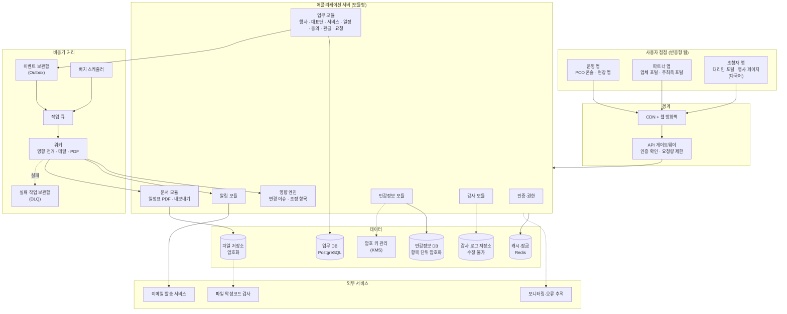
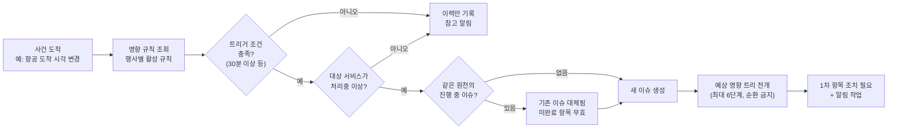

# MICE 해외 VIP 초청자 관리 솔루션 — 시스템 구조·기능 명세서 v0.2

> 업무·데이터 분석서 v0.4, UX/IA 설계서 v0.3을 기준으로 작성했습니다. P(프로세스), BR(업무 규칙), S(상태), IR(영향 규칙), 화면 ID(PCO-E01 등)는 앞선 문서의 번호를 그대로 참조합니다.

**진행 순서**: 1부 구조 설계 → 2부 API 명세 → 3부 배치 명세 → 4부 인터페이스 명세 → 5부 안정성 대비 → 6부 결정 사항

**변경 이력**

| 버전 | 내용 |
|---|---|
| v0.1 | 최초 작성 |
| v0.2 | 결정 사항 Q1~Q6 전부 기본안 확정 반영 |

**읽는 법 (비개발자용)**

| 용어 | 쉬운 설명 |
|---|---|
| 서버 / 백엔드 | 데이터를 저장하고 규칙을 실행하는 뒷단 프로그램 |
| 프론트엔드 | 사용자가 보는 화면 프로그램 |
| API | 화면(또는 다른 시스템)이 서버에 "이거 해줘"라고 요청하는 약속된 창구 |
| 배치 | 사람이 누르지 않아도 정해진 시간마다 자동으로 도는 작업 |
| 비동기 작업 / 큐 | 바로 끝낼 필요 없는 일을 줄 세워 두었다가 차례로 처리하는 방식 (메일 발송 등) |
| 인터페이스 | 우리 시스템과 외부 시스템(메일 발송 서비스 등)의 연결 |
| 멱등성 | 같은 요청이 실수로 두 번 와도 결과가 한 번 처리한 것과 같도록 보장하는 성질 |

---

# 1부. 구조 설계

## 1.1 아키텍처 원칙

| No | 원칙 | 의미 | 왜 이 제품에 필요한가 |
|---|---|---|---|
| A1 | **하나의 서버, 잘 나뉜 모듈** | MVP는 서버 하나(모듈형 단일 서버)로 만들되, 내부는 업무 영역별 모듈로 엄격히 분리 | 초기 개발 속도와 운영 단순성 확보. 트래픽이 커지면 모듈 단위로 떼어낼 수 있음 |
| A2 | **상태 변경은 서버가 판정** | 화면이 "확정으로 바꿔줘"라고 요청해도, 서버가 상태 규칙(S01~S14)을 검사해 허용 여부를 결정 | 잘못된 상태 전이는 곧 의전 사고 |
| A3 | **변경은 사건(이벤트)으로 기록하고 전파** | 데이터가 바뀌면 "무엇이 바뀌었다"는 사건을 남기고, 영향 엔진이 이를 받아 연쇄를 전개 | 변경 이슈 N차 연쇄(P11)의 기반 |
| A4 | **테넌트 격리는 DB 수준에서** | 모든 조회에 테넌트 조건이 자동으로 붙도록 DB 자체 기능(행 단위 보안)으로 강제 | 코드 실수 하나로 PCO 간 데이터가 섞이는 것을 원천 차단 |
| A5 | **민감정보는 따로, 암호화해서** | 🔒 정보는 별도 저장 영역에 항목 단위 암호화. 열람은 전용 API로만, 매번 기록 | 유출 범위 최소화, 파기 용이 |
| A6 | **외부 연결은 실패를 전제로** | 메일 발송 등 외부 서비스는 언젠가 실패한다고 가정하고 재시도·대체 경로를 설계 | 알림 실패 = 전파 실패 |
| A7 | **모든 자동 작업은 두 번 돌아도 안전하게** | 배치·큐 작업은 멱등하게 설계 | 중복 메일, 중복 이슈 방지 |
| A8 | **다국어·시간대는 기반 기능** | 화면 문구와 콘텐츠의 다국어, UTC 저장·현지 표시를 공통 모듈로 | UX/IA 1.13 |

## 1.2 전체 구성도



### 흐름으로 읽기: 항공편이 바뀌었을 때

1. 항공 업체가 파트너 앱에서 새 도착 시각을 저장 → API 게이트웨이가 로그인·요청량 확인
2. 서비스 모듈이 값을 저장하면서 **같은 트랜잭션 안에서** "항공 확정값 변경됨" 사건을 이벤트 보관함에 기록 (저장과 사건 기록이 따로 실패하는 일이 없음)
3. 이벤트 보관함의 사건이 작업 큐로 넘어감
4. 워커가 영향 엔진을 실행 → 영향 규칙(IR-02~04)에 따라 변경 이슈와 조정 항목 생성
5. 조정 항목마다 알림 작업이 큐에 들어가고, 알림 모듈이 수송·공항 의전·호텔 업체에 메일과 인앱 알림 발송
6. 메일 발송이 실패하면 재시도, 끝내 실패하면 실패 작업 보관함으로 이동하고 PCO 화면에 "알림 실패" 표시

## 1.3 프론트엔드 구성

6개 접점을 **3개의 웹 앱**으로 묶습니다. 사용자 성격과 보안 수준이 비슷한 접점끼리 묶었습니다.

| 앱 | 포함 접점 | 묶은 이유 | 특징 |
|---|---|---|---|
| 운영 앱 | PCO 콘솔, 현장 앱 | 둘 다 PCO 직원이 사용. 현장 앱은 PCO 콘솔의 모바일 전용 화면 묶음 | 기능 가장 많음. 현장 화면은 홈 화면 추가(PWA) 지원 |
| 파트너 앱 | 업체 포털, 주최측 포털 | 외부 조직 계정. 조회 범위가 제한됨 | 여러 PCO의 행사를 가로지름 (업체) |
| 초청자 앱 | 대리인 포털, 행사 페이지 진입점 | **외부 공개**, 다국어 필수, 가장 불특정한 사용자 | 가장 엄격한 보안·요청량 제한, 모바일 우선 |

> 초청자 앱을 따로 떼는 가장 큰 이유는 **보안 경계**입니다. 인터넷에 공개되는 입구와 PCO 내부 도구가 같은 앱이면, 공개 입구의 취약점이 내부 도구로 번질 수 있습니다.

## 1.4 서버 모듈 구성

분석서의 데이터 영역(A~I)을 서버 모듈로 옮겼습니다. 모듈끼리는 서로의 DB 테이블을 직접 건드리지 않고, 정해진 내부 창구나 사건(이벤트)으로만 소통합니다.

| 모듈 | 책임 | 관련 엔티티 | 발행하는 주요 사건 |
|---|---|---|---|
| `iam` 인증·권한 | 로그인, OTP, 토큰, 역할·범위 판정 | user, tenant_member, vendor_member, event_member, delegation_proxy | `user.deactivated`, `access.revoked` |
| `org` 조직 | 테넌트, 업체, 즐겨찾기, 템플릿 | tenant, vendor, tenant_vendor_favorite | `vendor.invited` |
| `event` 행사 | 행사, 설정, 참여 업체, 의전 등급, 지원 정책, 영향 규칙, 입력 항목 설정 | event, event_vendor, protocol_level, support_policy, impact_rule | `event.status_changed`, `support_policy.changed` |
| `delegation` 초청 | 대표단, 참가자, 대리인, 참가자 관계, 지원 판정 | delegation, participant, participant_relation | `participant.added/removed`, `delegation.status_changed`, `support.decision_changed` |
| `sensitive` 민감정보 | 🔒 저장·암호화·열람·파기 | participant_sensitive, file(여권 사본) | `sensitive.viewed`, `sensitive.purged` |
| `consent` 동의 | 동의서 버전, 동의 기록, 재동의 | consent_policy, consent_item, consent_record | `consent.withdrawn` |
| `service` 서비스 | 서비스 항목, 요청·확정 데이터, 상태 전이 | service_item, flight_*, lodging_*, transfer_*, airport_service, dietary | `service.request_changed`, `service.fulfillment_changed`, `service.status_changed` |
| `program` 일정 | 하위 행사, 참석, 자체 일정, 충돌 검사 | program, program_attendance | `program.confirmed`, `program.changed`, `attendance.changed` |
| `impact` 변경 관리 | 영향 규칙 평가, 이슈·조정 항목 생성·전이·무효화 | change_issue, adjustment_item, change_log | `adjustment.action_required`, `issue.closed` |
| `notify` 알림 | 템플릿 렌더링(다국어), 발송, 수신 확인, 재발송 | notification, notification_template | `notification.failed` |
| `document` 문서 | 일정표 생성·발행, PDF, 내보내기 | itinerary_issue | `itinerary.outdated` |
| `request` 요청 | 주최측 요청 | host_request | - |
| `reimburse` 환급 | 환급 청구 | reimbursement_claim | - |
| `retention` 보관·파기 | 정산 후 접근 차단, 파기, 예외 보관 | retention_exception, purge_log | `event.purged` |
| `audit` 감사 | 변경 이력, 접근 기록 (모든 모듈이 사용) | change_log, access_log | - |
| `platform` 공통 | 다국어, 시간대, 코드 테이블, 파일 | code, file_attachment | - |

## 1.5 핵심 설계: 영향 엔진

변경 이슈 N차 연쇄(분석서 P11)를 실제로 돌리는 부분입니다. 이 제품의 기술적 핵심이므로 따로 설명합니다.



| 설계 요소 | 내용 |
|---|---|
| 입력 | 서비스·일정·참가자 모듈이 발행한 사건 |
| 규칙 평가 | 사건 종류와 바뀐 필드로 영향 규칙을 찾고, 트리거 조건(예: 30분 이상 변경)을 검사 |
| 대상 찾기 | 규칙의 대상 선택 조건(같은 대표단, 같은 방향, 원천 서비스 연결 등)으로 영향받는 서비스 항목 조회 |
| 트리 전개 | 대상마다 조정 항목 생성. 하위 규칙을 재귀 적용해 `대기` 상태로 미리 펼침 |
| 순환 방지 | 규칙 저장 시 그래프 검사로 순환 금지 + 실행 시 최대 깊이 6 |
| 하위 활성화 | 조정 항목 `완료` 사건 수신 시, `value_changed`에 따라 하위를 `조치 필요` 또는 `해당 없음`으로 |
| 중복 방지 | 같은 사건이 두 번 와도 이슈가 하나만 생기도록 사건 ID로 처리 여부 기록 (5부 5.5) |
| 순서 보장 | **같은 대표단의 사건은 한 줄로 차례대로** 처리 (대표단 ID 기준 순서 보장 큐). 다른 대표단끼리는 동시에 처리 |

> "같은 대표단은 차례대로"가 중요한 이유: 대리인이 도착지를 1분 사이에 두 번 바꾸면, 두 사건이 동시에 처리될 경우 이슈 두 개가 서로를 대체하며 꼬일 수 있습니다.

## 1.6 멀티테넌트와 권한 판정 구조

### 테넌트 격리

| 층 | 방식 |
|---|---|
| 데이터 | 모든 행사 관련 테이블에 `tenant_id`. DB의 행 단위 보안 정책으로 현재 요청의 테넌트 외 행은 조회·수정 불가 |
| 요청 | 로그인 토큰에서 테넌트를 꺼내 요청마다 DB 세션에 설정. 화면이 보낸 테넌트 값은 믿지 않음 |
| 예외 | 업체(`vendor`)는 플랫폼 레벨. 업체의 행사 데이터 접근은 `event_vendor` 연결을 통해서만 |
| 파일 | 파일 저장 경로에 테넌트 구분, 파일 접근은 짧은 유효시간의 서명된 링크로만 |

### 권한 판정: 네 단계 확인

모든 요청은 아래 네 단계를 차례로 통과해야 합니다.

| 단계 | 질문 | 예 |
|---|---|---|
| 1. 역할 | 이 사람의 역할이 이 행동을 할 수 있나? | 업체는 대표단을 만들 수 없다 |
| 2. 범위 | 이 데이터가 이 사람의 범위 안에 있나? | 대리인은 자기 대표단만, 업체는 담당 서비스 유형만 |
| 3. 상태 | 지금 데이터 상태에서 이 행동이 허용되나? | 정산 완료된 행사는 수정 불가 |
| 4. 필드 | 응답에 포함할 수 있는 필드인가? | 식음 업체에게는 종교 대신 식이 코드만 |

역할 목록은 분석서 2.5 권한 매트릭스를 따르며, 코드로는 아래처럼 정의합니다.

| 역할 코드 | 역할 | 범위 단위 |
|---|---|---|
| `PLATFORM_ADMIN` | 솔루션 운영사 | 전체 (🔒 열람 불가) |
| `PCO_ADMIN` | PCO 관리자 | 테넌트 |
| `PCO_MANAGER` | PCO 초청 담당자 | 행사 (+ 담당 대표단) |
| `PCO_FIELD` | 현장 스태프 | 행사 (조회 전용) |
| `HOST_VIEWER` | 주최측 | 행사 (조회 + 요청) |
| `VENDOR_ADMIN` / `VENDOR_STAFF` | 업체 관리자 / 직원 | 업체 → 참여 행사 → 담당 서비스 유형 |
| `PROXY` | 대리인 | 배정된 대표단 |

> 솔루션 운영사(우리)도 🔒 민감정보는 볼 수 없게 합니다. 고객사(PCO)에게 "운영사도 못 본다"고 말할 수 있어야 영업과 보안 심사에서 유리합니다.

## 1.7 데이터 저장 구조

| 저장소 | 담는 것 | 보안 | 백업 |
|---|---|---|---|
| 업무 DB | 🔒 외 모든 업무 데이터 | 저장 시 암호화, 행 단위 보안 | 시점 복구(5분 단위), 일 1회 스냅샷 |
| 민감정보 DB | 여권, 건강, 종교, 접근성 | **항목 단위 암호화** (행사별 암호 키). 업무 DB와 분리 | 동일. 단 파기된 데이터는 백업에서도 보관 기간 후 소멸 |
| 파일 저장소 | 여권 사본, 환급 증빙, 일정표 PDF, 내보내기 파일 | 암호화 저장, 서명된 링크로만 접근, 업로드 시 악성코드 검사 | 버전 보관 |
| 캐시 | 세션, 요청량 카운터, 작업 잠금, 자주 쓰는 코드 테이블 | 민감정보 저장 금지 | 불필요 (날아가도 재생성) |
| 감사 로그 저장소 | 변경 이력, 민감정보 접근 기록 | **추가만 가능, 수정·삭제 불가** | 장기 보관 |

### 행사별 암호 키를 쓰는 이유

민감정보를 **행사마다 다른 키**로 암호화하면, 파기할 때 데이터를 하나하나 지우는 것에 더해 **그 행사의 키 자체를 폐기**할 수 있습니다. 키가 없으면 백업에 남은 암호문도 복구할 수 없으므로 "확실한 파기"(문제 정의 단계 요구사항)를 기술적으로 보장합니다.

## 1.8 환경과 배포

| 환경 | 용도 | 데이터 |
|---|---|---|
| 개발 | 개발자 작업 | 가짜 데이터만 |
| 검증 (스테이징) | 출시 전 확인, PCO 시연 | 가짜 데이터만. **실제 개인정보 복사 금지** |
| 운영 | 실제 서비스 | 실제 데이터 |

| 항목 | 방식 |
|---|---|
| 배포 | 자동 배포. 운영 반영 전 검증 환경 통과 필수 |
| 무중단 | 새 버전을 띄운 뒤 트래픽을 옮기는 방식. 행사 진행 중에도 배포 가능해야 함 |
| **행사 기간 배포 규칙** | 배포는 계속하되, 행사 진행 중인 테넌트에 영향이 큰 변경은 **기능 켜기/끄기**로 해당 테넌트만 행사 종료 후 적용 (Q4 확정) |
| DB 구조 변경 | 기존 버전과 새 버전이 동시에 동작 가능한 방식으로만 (5부 5.2) |

## 1.9 권장 기술 스택

개발팀이 정해지면 바뀔 수 있는 **권장안**입니다. 선택 기준은 "국내 개발 인력 수급이 쉽고, 위 구조를 무리 없이 구현할 수 있는가"입니다.

| 영역 | 권장 | 대안 |
|---|---|---|
| 프론트엔드 | React 기반 (Next.js), TypeScript, **Tailwind CSS + shadcn/ui** (D-UI-01 확정) | - |
| 백엔드 | TypeScript (NestJS) 모듈형 단일 서버 | Java (Spring Boot) |
| DB | PostgreSQL | - (행 단위 보안 기능 때문에 권장) |
| 캐시·잠금 | Redis | - |
| 작업 큐 | 클라우드 관리형 큐 (예: AWS SQS) | Redis 기반 큐 |
| 파일 | 클라우드 객체 저장소 (예: S3) | - |
| 암호 키 | 클라우드 키 관리 서비스 (예: AWS KMS) | - |
| 이메일 | 대량 발송 서비스 (예: Amazon SES) | SendGrid 등 |
| 인프라 | 국내 리전 일반 상용 클라우드 (Q1 확정). 공공 인증(CSAP) 요구 고객이 확인되면 전환 계획 수립 | 공공 인증 클라우드 |
| 모니터링 | 클라우드 모니터링 + 오류 추적 도구 (예: Sentry) | - |

---

# 2부. API 명세

## 2.1 공통 규약

### 주소 체계

API는 **사용자 접점별 입구**를 나눕니다. 같은 데이터라도 입구가 다르면 권한 범위와 응답 필드가 달라집니다. 입구를 나누면 "업체용 API에서 실수로 여권번호가 나가는" 사고를 구조적으로 막기 쉽습니다.

| 입구 | 주소 | 사용 앱 | 사용자 |
|---|---|---|---|
| 콘솔 | `/api/v1/console/...` | 운영 앱 | PCO 관리자·담당자 |
| 현장 | `/api/v1/field/...` | 운영 앱 (현장 화면) | 현장 스태프 |
| 업체 | `/api/v1/vendor/...` | 파트너 앱 | 업체 |
| 주최측 | `/api/v1/host/...` | 파트너 앱 | 주최측 |
| 포털 | `/api/v1/portal/...` | 초청자 앱 | 대리인 |
| 공개 | `/api/v1/public/...` | 초청자 앱 | 비로그인 (행사 페이지) |
| 인증 | `/api/v1/auth/...` | 전체 | 전체 |
| 플랫폼 | `/api/v1/admin/...` | 내부 도구 | 운영사 |

### 요청·응답 공통 규칙

| 항목 | 규칙 |
|---|---|
| 형식 | JSON. 파일은 직접 올리지 않고 **업로드용 서명 링크**를 받아 파일 저장소로 직접 업로드 |
| 인증 | `Authorization: Bearer {액세스 토큰}` |
| 테넌트 | 토큰에서 판정. 요청 본문의 테넌트 값은 무시 |
| 언어 | `Accept-Language: ko / en / ja`. 오류 메시지와 다국어 콘텐츠를 해당 언어로 반환 |
| 일시 | 저장·전송은 UTC (`2026-10-14T10:30:00Z`). 항공 시각은 현지 시각 + 시간대 함께 (`"local": "2026-10-14T19:30", "tz": "Asia/Seoul"`) |
| 요청 추적 | 모든 응답에 `X-Request-Id`. 오류 문의 시 이 값으로 추적 |
| 중복 방지 | 생성·상태 변경 요청은 `Idempotency-Key` 헤더 필수 (5부 5.5) |
| 동시 수정 | 수정 요청은 조회 때 받은 `version` 값을 함께 보냄. 그사이 다른 사람이 수정했으면 `409` 반환 (UX 3.1 동시 수정 충돌) |
| 목록 | 커서 방식 페이지네이션 (`?cursor=...&limit=50`, 최대 200). 필터·정렬은 쿼리로 |
| 상태 변경 | **상태 값을 직접 수정하지 않고 "행동" API를 호출** (아래 설명) |

### 상태 변경은 "행동" API로

`PATCH /services/123 { "status": "CONFIRMED" }`처럼 상태 값을 직접 바꾸게 하면, 허용되지 않은 전이(예: `요청 전` → `안내 완료`)를 막기 어렵습니다. 그래서 상태는 **행동을 요청하는 API**로만 바뀝니다.

```
POST /api/v1/vendor/service-items/{id}/actions/start      (착수 → 처리중)
POST /api/v1/vendor/service-items/{id}/actions/confirm    (확정 등록 → 확정)
POST /api/v1/console/delegations/{id}/actions/confirm     (대표단 확정)
```

서버는 행동을 받으면 분석서의 상태 정의(S01~S14)에 따라 **현재 상태에서 그 행동이 허용되는지** 검사하고, 허용되지 않으면 `409 INVALID_STATE_TRANSITION`을 반환합니다.

### 오류 응답 형식

```json
{
  "error": {
    "code": "INVALID_STATE_TRANSITION",
    "message": "확정된 서비스는 착수 처리할 수 없습니다.",
    "details": { "current": "CONFIRMED", "action": "start" },
    "requestId": "req_8f2a91"
  }
}
```

| HTTP | 코드 | 의미 | 화면 대응 |
|---|---|---|---|
| 400 | `VALIDATION_FAILED` | 입력값 오류. `details`에 필드별 사유 | 해당 필드에 오류 표시 |
| 401 | `TOKEN_EXPIRED` / `UNAUTHENTICATED` | 로그인 만료 / 미로그인 | 5부 5.4 재인증 흐름 |
| 403 | `FORBIDDEN` | 권한 없음 | 권한 없음 화면 |
| 403 | `EVENT_LOCKED` | 정산 완료 등으로 잠긴 행사 | 읽기 전용 배너 |
| 404 | `NOT_FOUND` | 없음 **또는 볼 권한 없음** (존재 비노출 원칙) | 없음 화면 |
| 409 | `VERSION_CONFLICT` | 동시 수정 충돌 | 변경 비교 + 선택 |
| 409 | `INVALID_STATE_TRANSITION` | 허용되지 않는 상태 변경 | 안내 후 새로고침 |
| 409 | `IDEMPOTENCY_CONFLICT` | 같은 중복 방지 키에 다른 내용 | 개발 오류로 기록 |
| 422 | `BUSINESS_RULE_VIOLATION` | 업무 규칙 위반 (예: 지원 한도 초과) | 규칙 안내 |
| 429 | `RATE_LIMITED` | 요청 과다 | `Retry-After` 이후 재시도 |
| 500 | `INTERNAL_ERROR` | 서버 오류 | 오류 화면 + 요청 ID |
| 503 | `SERVICE_UNAVAILABLE` | 점검·과부하 | 잠시 후 재시도 안내 |

> 권한이 없는 데이터에 `403`이 아니라 `404`를 주는 이유: `403`은 "그런 데이터가 있긴 하다"는 사실을 알려줍니다. 비공개 양자 면담의 존재 자체를 숨겨야 하므로 `404`로 통일합니다 (UX 원칙 U5).

## 2.2 API 목록

전체 API를 입구별로 정리했습니다. **권한**은 1.6의 역할 코드, **화면**은 UX/IA 설계서의 화면 ID입니다.

### 2.2.1 인증 (`/auth`)

| 메서드 | 경로 | 기능 | 사용자 | 화면 |
|---|---|---|---|---|
| POST | `/auth/login` | 이메일·비밀번호 로그인 | PCO, 업체, 주최측 | 로그인 |
| POST | `/auth/otp/request` | 대리인 인증번호 요청 (초청 링크 토큰 또는 초청 코드 + 이메일) | 대리인 | PB-01, PX-01 |
| POST | `/auth/otp/verify` | 인증번호 확인 → 토큰 발급 | 대리인 | PX-01 |
| POST | `/auth/token/refresh` | 토큰 갱신 | 전체 | - |
| POST | `/auth/logout` | 로그아웃 (갱신 토큰 폐기) | 전체 | - |
| POST | `/auth/step-up` | 민감 작업 전 재인증 | PCO | 🔒 열람 |
| POST | `/auth/password/reset` | 비밀번호 재설정 메일 | PCO, 업체, 주최측 | - |
| GET | `/auth/me` | 내 정보·역할·범위 | 전체 | 전역 |

### 2.2.2 콘솔 (`/console`) — PCO

**조직·템플릿**

| 메서드 | 경로 | 기능 | 권한 | 화면 |
|---|---|---|---|---|
| GET/POST | `/console/events` | 행사 목록 / 생성 | ADMIN, MANAGER / ADMIN | PCO-T01 |
| GET/POST | `/console/vendors/favorites` | 즐겨찾기 업체 조회 / 추가 | ADMIN | PCO-T02 |
| GET | `/console/vendors/search?q=` | 플랫폼 업체 검색 | ADMIN | PCO-T02 |
| POST | `/console/vendors/invitations` | 미가입 업체 초대 | ADMIN | PCO-T02 |
| GET/PUT | `/console/templates/{type}` | 템플릿 (의전 등급·지원 정책·동의서·알림·영향 규칙) | ADMIN | PCO-T03 |
| GET/POST/PATCH | `/console/members` | 직원 조회·초대·역할 변경·비활성화 | ADMIN | PCO-T04 |

**행사 설정**

| 메서드 | 경로 | 기능 | 화면 |
|---|---|---|---|
| GET/PATCH | `/console/events/{eventId}` | 행사 기본 정보 | PCO-E14 |
| POST | `/console/events/{eventId}/actions/{start-inviting \| cancel \| settle}` | 행사 상태 행동 | PCO-E14, E15 |
| GET/POST/DELETE | `/console/events/{eventId}/vendors` | 참여 업체·담당 서비스 유형 | PCO-E14 |
| GET/PUT | `/console/events/{eventId}/protocol-levels` | 의전 등급 체계 | PCO-E14 |
| GET/PUT | `/console/events/{eventId}/support-policies` | 지원 정책 | PCO-E14 |
| GET/PUT | `/console/events/{eventId}/impact-rules` | 영향 규칙 (저장 시 순환 검사) | PCO-E14 |
| GET/PUT | `/console/events/{eventId}/field-config` | 입력 항목 필수/선택/숨김 | PCO-E14 |
| GET/POST | `/console/events/{eventId}/consent-policies` | 동의서 조회 / 새 버전 게시 | PCO-E14 |
| GET/PATCH | `/console/events/{eventId}/settings` | 마감일, 독촉 시점, 긴급도 기준, 언어 | PCO-E14 |
| GET | `/console/events/{eventId}/translation-gaps` | 번역 누락 목록 | PCO-E14 |
| GET/POST | `/console/events/{eventId}/members` | 주최측·현장 스태프 초대 | PCO-E14 |

**홈·대표단·참가자**

| 메서드 | 경로 | 기능 | 화면 |
|---|---|---|---|
| GET | `/console/events/{eventId}/home` | 홈 요약 (할 일, 초청 현황, 72시간 일정, 서비스 진행). `?mine=true` 내 담당만 | PCO-E01 |
| GET/POST | `/console/events/{eventId}/delegations` | 대표단 목록 (필터: 상태·완결률·국가·담당자) / 생성 | PCO-E04 |
| GET/PATCH | `/console/delegations/{id}` | 대표단 360 조회 / 수정 | PCO-E05 |
| GET | `/console/delegations/{id}/matrix` | 참가자 × 서비스 매트릭스 | PCO-E05 |
| GET | `/console/delegations/{id}/missing-items` | 필수 누락 항목 (참가자별) | PCO-E05 |
| POST | `/console/delegations/{id}/actions/{invite \| remind \| confirm \| request-revision \| withdraw}` | 초청 상태 행동 | PCO-E05, E10 |
| POST | `/console/delegations/bulk-actions` | 일괄 발송·독촉·담당 지정 | PCO-E04 |
| GET/POST/DELETE | `/console/delegations/{id}/proxies` | 대리인 조회·추가·해제, 추가 요청 승인 | PCO-E05 |
| GET/POST/PATCH | `/console/delegations/{id}/participants` | 참가자 | PCO-E06 |
| PUT | `/console/participants/{id}/support-overrides` | 지원 예외 지정 (사유 필수) | PCO-E06 |
| GET/POST/DELETE | `/console/events/{eventId}/participant-relations` | 참가자 간 관계 | PCO-E06 |
| GET | `/console/delegations/{id}/timeline` | 활동 기록 | PCO-E05 |

**🔒 민감정보** — 별도 모듈, 모든 호출이 접근 기록에 남음

| 메서드 | 경로 | 기능 | 비고 |
|---|---|---|---|
| GET | `/console/participants/{id}/sensitive` | 가림 처리된 요약 (`●●●●1234`, "의료 사항 있음") | 기록 안 남음 (원본 아님) |
| POST | `/console/participants/{id}/sensitive/reveal` | 특정 필드 원본 열람. 본문에 필드 목록 | 접근 기록. 사유는 선택 (Q6 확정: 여권 사본 다운로드·기관 명단 내보내기만 필수) |
| PATCH | `/console/participants/{id}/sensitive` | 수정 | 변경 기록 (값 대신 "변경됨") |
| POST | `/console/participants/{id}/sensitive/files/{fileId}/download-url` | 여권 사본 열람용 1분 유효 링크 | 접근 기록 |
| PUT | `/console/participants/{id}/field-share` | 의료 사항 현장 공유 지정 | - |

**서비스·일정**

| 메서드 | 경로 | 기능 | 화면 |
|---|---|---|---|
| GET | `/console/events/{eventId}/service-items` | 서비스 현황 (필터: 유형·상태·업체·지원 방식) | PCO-E07 |
| GET/PATCH | `/console/service-items/{id}` | 서비스 상세 (요청 + 확정 + 이력) | PCO-E07 |
| POST | `/console/service-items/{id}/actions/correction-request` | 업체에 정정 요청 (조정 항목 생성) | PCO-E07 |
| GET/POST | `/console/events/{eventId}/programs` | 하위 행사 목록(캘린더·목록) / 생성 | PCO-E08 |
| GET/PATCH | `/console/programs/{id}` | 하위 행사 상세 / 수정 | PCO-E09 |
| POST | `/console/programs/{id}/actions/{confirm \| cancel}` | 가안→확정, 취소 | PCO-E09 |
| POST | `/console/programs/{id}/actions/adjust-request` | 자체 일정 조정 요청 | PCO-E09 |
| GET/PUT | `/console/programs/{id}/attendance` | 참석자·역할 | PCO-E09 |
| GET | `/console/events/{eventId}/conflicts` | 일정 충돌 목록 | PCO-E08 |

**변경 이슈**

| 메서드 | 경로 | 기능 | 화면 |
|---|---|---|---|
| GET | `/console/events/{eventId}/change-issues` | 이슈 보드 (기본: 미종결, 긴급순) | PCO-E02 |
| GET | `/console/change-issues/{id}` | 이슈 상세 + 조정 항목 트리 | PCO-E03 |
| POST | `/console/change-issues/{id}/actions/force-close` | 강제 종결 (사유 필수) | PCO-E03 |
| POST | `/console/change-issues/{id}/adjustments` | 조정 항목 수동 추가 | PCO-E03 |
| POST | `/console/adjustments/{id}/actions/{decide \| not-applicable \| revert-na \| remind \| reassign}` | 판단 결정, 해당 없음, 되돌리기, 재알림, 담당 변경 | PCO-E03 |
| GET | `/console/adjustments/{id}/decision-preview?option=` | 판단 선택지별 다음 연쇄 미리보기 | PCO-E03 |

**커뮤니케이션·기타**

| 메서드 | 경로 | 기능 | 화면 |
|---|---|---|---|
| GET | `/console/events/{eventId}/notifications` | 발송 이력 (필터: 실패) | PCO-E10 |
| POST | `/console/notifications/{id}/actions/resend` | 재발송 | PCO-E10 |
| GET | `/console/events/{eventId}/itineraries?status=outdated` | 재발행 필요 목록 | PCO-E13 |
| GET | `/console/delegations/{id}/itinerary/preview` | 일정표 미리보기 | PCO-E13 |
| POST | `/console/itineraries/actions/publish` | 일정표 발행 (일괄 가능) | PCO-E13 |
| GET/POST | `/console/events/{eventId}/host-requests` + `/{id}/actions/{accept \| reject \| complete}` | 주최측 요청 처리 | PCO-E11 |
| GET/POST | `/console/events/{eventId}/reimbursements` + `/{id}/actions/{approve \| reject \| mark-paid}` | 환급 처리 | PCO-E12 |
| GET | `/console/events/{eventId}/settlement-check` | 정산 전 점검 (미종결 이슈, 미처리 환급) | PCO-E15 |
| GET/POST | `/console/events/{eventId}/retention-exceptions` | 예외 보관 지정 | PCO-E15 |
| POST | `/console/events/{eventId}/exports` | 내보내기 요청 (비동기, 완료 시 알림) | PCO-E17 |
| GET | `/console/events/{eventId}/audit-logs` | 감사 이력 | PCO-E16 |

### 2.2.3 포털 (`/portal`) — 대리인

모든 경로는 토큰의 대리인 범위(배정된 대표단)로 제한됩니다.

| 메서드 | 경로 | 기능 | 화면 |
|---|---|---|---|
| GET | `/portal/delegations` | 내가 맡은 대표단 목록 | PX-02 |
| GET | `/portal/delegations/{id}/hub` | 체크리스트 허브 (섹션별 남은 필수 개수, 다음 빈 항목, 마감) | PX-03 |
| GET | `/portal/delegations/{id}/consent` + POST `/consent` | 현재 동의서 / 동의 제출 | PX-04 |
| POST | `/portal/delegations/{id}/rsvp` | 참석 회신 | PX-05 |
| GET/POST/PATCH/DELETE | `/portal/delegations/{id}/participants` | 참가자 (지원 판정 결과 포함 응답) | PX-06 |
| PUT | `/portal/delegations/{id}/support-designations` | 한도 초과 시 지원 대상 지정 | PX-06 |
| PATCH | `/portal/participants/{id}` | 참가자 기본 정보 (자동 저장용, 부분 수정) | PX-07 |
| PUT | `/portal/participants/{id}/sensitive` | 🔒 민감정보 입력 (대리인은 자기가 입력한 값 조회 가능) | PX-07 |
| POST | `/portal/files/upload-url` | 여권 사본·증빙 업로드 링크 | PX-07, PX-14 |
| GET/PUT | `/portal/delegations/{id}/flights` | 항공 (지원: 여정 요청 / 자비·환급: 항공편 입력) | PX-08 |
| POST | `/portal/delegations/{id}/flights/actions/submit` | 항공 요청 제출 (서비스별 제출) | PX-08 |
| POST | `/portal/delegations/{id}/flights/actions/change-request` | 확정 후 변경 요청 | PX-08 |
| GET/PUT + submit | `/portal/delegations/{id}/lodging` | 숙박 | PX-09 |
| GET | `/portal/delegations/{id}/programs` | 공개된 하위 행사 + 자체 일정 | PX-10 |
| POST | `/portal/programs/{id}/rsvp` | 하위 행사 참석 회신 | PX-10 |
| POST/PATCH/DELETE | `/portal/delegations/{id}/own-programs` | 자체 일정 등록·수정·삭제 (응답에 충돌·차량 지원 판정 포함) | PX-11 |
| POST | `/portal/delegations/{id}/own-programs/validate` | 저장 전 충돌·늦은 등록 검사 | PX-11 |
| GET/PUT | `/portal/delegations/{id}/dietary` | 식이·특별 요청 | PX-12 |
| POST | `/portal/delegations/{id}/actions/submit` | 대표단 전체 제출 (누락 요약 검증) | PX-03 |
| GET | `/portal/delegations/{id}/itinerary` | 최신 일정표 (`?format=pdf`) | PX-13 |
| GET/POST | `/portal/delegations/{id}/reimbursements` | 환급 청구 | PX-14 |
| GET/POST | `/portal/notifications` + `/{id}/actions/read` | 알림 | PX-15 |
| POST | `/portal/delegations/{id}/proxy-requests` | 대리인 추가 요청 | PX-16 |
| PATCH | `/portal/me/preferences` | 언어 등 개인 설정 | 전역 |

### 2.2.4 업체 (`/vendor`)

| 메서드 | 경로 | 기능 | 화면 |
|---|---|---|---|
| GET | `/vendor/inbox` | 통합 할 일 (모든 참여 행사, 긴급순) | VD-03 |
| GET | `/vendor/projects` | 참여 행사 목록 (PCO별, 종료된 행사 구분) | VD-02 |
| GET | `/vendor/projects/{eventId}/summary` | 담당 서비스 현황 | VD-04 |
| GET | `/vendor/projects/{eventId}/service-items` | 담당 서비스 목록 (필터: 상태) | VD-05 |
| GET | `/vendor/service-items/{id}` | 요청 + 확정 + 이력 (담당 필드만) | VD-06 |
| POST | `/vendor/service-items/{id}/actions/start` | 착수 | VD-06 |
| PUT | `/vendor/service-items/{id}/fulfillment` | 확정 정보 저장 (항공 구간, 객실, 배차 등) | VD-06 |
| POST | `/vendor/service-items/{id}/actions/confirm` | 확정 | VD-06 |
| POST | `/vendor/service-items/{id}/actions/cancel-confirm` | 취소 처리 확인 | VD-06 |
| GET | `/vendor/adjustments/{id}` | 조정 항목 (변경 전/후) | VD-07 |
| POST | `/vendor/adjustments/{id}/actions/{acknowledge \| complete}` | 확인 / 반영 완료 (무효 항목의 "작업 중지 확인" 포함) | VD-07 |
| POST | `/vendor/service-items/bulk-actions/start` | 일괄 착수 | VD-05 |
| POST | `/vendor/imports` | 엑셀 업로드 [P2] | VD-09 |
| GET/POST | `/vendor/members` | 직원 관리 | VD-08 |

### 2.2.5 주최측 (`/host`)

| 메서드 | 경로 | 기능 | 화면 |
|---|---|---|---|
| GET | `/host/events/{eventId}/dashboard` | 대시보드 | HO-01 |
| GET | `/host/events/{eventId}/delegations` + `/{id}` | 대표단 현황 (🔒 필드 없음) | HO-02 |
| GET | `/host/events/{eventId}/programs` | 일정 (비공개 제외) | HO-03 |
| GET/POST | `/host/events/{eventId}/requests` | 요청 목록 / 작성 | HO-04 |

### 2.2.6 현장 (`/field`)

| 메서드 | 경로 | 기능 | 화면 |
|---|---|---|---|
| GET | `/field/events/{eventId}/today?date=` | 오늘 타임라인 (도착·출국·일정, 관련 미종결 이슈 표시) | FS-01 |
| GET | `/field/events/{eventId}/delegations?q=` + `/{id}/card` | 대표단 검색 / 카드 | FS-02 |
| GET | `/field/events/{eventId}/urgent` | 오늘 실행 예정 미종결 이슈 | FS-03 |
| GET | `/field/events/{eventId}/vehicles?date=` | 차량별 배차 | FS-04 |
| GET | `/field/participants/{id}/medical-note` | 현장 공유 지정된 의료 사항만 (접근 기록) | FS-02 |

### 2.2.7 공개 (`/public`)

| 메서드 | 경로 | 기능 | 비고 |
|---|---|---|---|
| GET | `/public/events/{slug}` | 행사 페이지 기본 정보 (다국어) | 캐시 가능 |
| POST | `/public/events/{slug}/invite-code/verify` | 초청 코드 확인 → OTP 단계로 | **강한 요청량 제한** (5부 5.6) |

## 2.3 핵심 API 상세

전체 API 중 설계가 까다로운 네 개를 예시로 상세히 적습니다. 나머지 API도 같은 형식으로 개발 단계에서 작성합니다.

### API-01. 항공 확정 등록 (업체)

`PUT /api/v1/vendor/service-items/{id}/fulfillment` → `POST .../actions/confirm`

**요청**

```json
{
  "version": 7,
  "flight": {
    "segments": [
      {
        "direction": "INBOUND", "seq": 1,
        "flightNo": "VN416", "cabinClass": "BUSINESS",
        "dep": { "airport": "HAN", "local": "2026-10-14T11:20", "tz": "Asia/Ho_Chi_Minh" },
        "arr": { "airport": "GMP", "local": "2026-10-14T19:30", "tz": "Asia/Seoul" },
        "pnr": "X7K2LM", "ticketStatus": "TICKETED"
      }
    ],
    "changeFee": { "amount": 150000, "currency": "KRW" }
  }
}
```

**서버 처리 순서**

| 순서 | 처리 | 실패 시 |
|---|---|---|
| 1 | 권한: 업체가 이 행사의 항공 담당인가, 이 대표단이 담당 범위인가 | 404 |
| 2 | 상태: 서비스가 `처리중` 또는 `변경 처리중`인가 | 409 INVALID_STATE_TRANSITION |
| 3 | 버전 확인 | 409 VERSION_CONFLICT |
| 4 | 검증: 도착 > 출발, 공항 코드 유효, 입국 최종 구간 존재 | 400 |
| 5 | 이전 확정값을 변경 이력에 기록 → 새 값 저장 → 최종 도착 구간 재계산 | - |
| 6 | 같은 트랜잭션에서 `service.fulfillment_changed` 사건 기록 (바뀐 필드 목록 포함) | 전체 취소 |
| 7 | 응답 반환. 영향 전개는 비동기로 진행 | - |

**응답** `200`

```json
{
  "id": "svc_123", "status": "CONFIRMED", "version": 8,
  "impact": { "pending": true, "message": "관련 서비스 조정을 준비 중입니다." }
}
```

### API-02. 조정 항목 반영 완료 (업체)

`POST /api/v1/vendor/adjustments/{id}/actions/complete`

**요청**

```json
{
  "valueChanged": true,
  "resolutionNote": "18:30 김포 출발 차량으로 재배차",
  "fulfillmentVersion": 3
}
```

| 순서 | 처리 |
|---|---|
| 1 | 권한·상태 검사: 항목이 `처리중`이고 이 업체 담당인가. `무효`면 409 + "이 요청은 취소되었습니다" |
| 2 | `valueChanged: true`인데 연결 서비스의 확정값이 실제로 안 바뀌었으면 422 (배차 정보를 먼저 저장하라는 안내) |
| 3 | 항목 `완료` 처리 → `adjustment.completed` 사건 |
| 4 | 영향 엔진이 하위 항목 활성화 (`조치 필요` 또는 `해당 없음`) |
| 5 | 이슈 종결 조건 검사 → 모두 종료면 이슈 `종결` |

### API-03. 대리인 항공 입력 (지원 방식에 따라 다른 동작)

`PUT /api/v1/portal/delegations/{id}/flights`

같은 API가 참가자별 지원 방식에 따라 **받는 데이터가 다릅니다**.

| 지원 방식 | 받는 데이터 | 저장 결과 |
|---|---|---|
| 지원 | `request` (출발 도시, 도착 공항, 희망일, 귀국 정보) | 요청 데이터 저장. 제출 시 `요청됨` |
| 선결제 후 환급, 자비·직접 예약 | `segments` (항공편) | 확정 데이터 저장, 즉시 `확정` (분석서 S04) |
| 미제공 | `segments` 선택 입력 | 픽업용 참고 정보로만 저장 |

**요청 (참가자 2명, 지원 1명 + 자비 1명)**

```json
{
  "items": [
    { "participantId": "p_1", "request": {
        "inboundOriginCity": "HAN", "inboundDestAirport": "ICN",
        "inboundPreferredDate": "2026-10-14", "outboundPreferredDate": "2026-10-18",
        "outboundOriginAirport": "ICN", "outboundDestCity": "SGN" } },
    { "participantId": "p_4", "segments": [ { "direction": "INBOUND", "seq": 1, "flightNo": "VN416", "...": "..." } ] }
  ]
}
```

**응답**: 참가자별 저장 결과 + 허브 갱신값 (남은 필수 개수). 한 참가자 검증 실패가 다른 참가자 저장을 막지 않도록 **참가자 단위 결과**를 반환합니다.

### API-04. 민감정보 열람 (PCO)

`POST /api/v1/console/participants/{id}/sensitive/reveal`

```json
{ "fields": ["passportNo", "passportExpiry"], "reason": "항공권 발권 정보 확인" }
```

| 순서 | 처리 |
|---|---|
| 1 | 역할 확인: `PCO_MANAGER` 이상 |
| 2 | 최근 재인증 확인: 마지막 인증 후 15분 초과면 401 `STEP_UP_REQUIRED` → 화면이 재인증 요청 |
| 3 | 행사 상태 확인: 파기 완료면 410 `PURGED` |
| 4 | 행사별 키로 복호화 |
| 5 | **접근 기록을 먼저 저장하고**, 저장이 성공해야 응답 (기록 없는 열람 금지) |
| 6 | 응답 헤더에 캐시 금지 지시 |

## 2.4 실시간 갱신

변경 이슈 보드처럼 여러 사람이 동시에 보는 화면은 새로고침 없이 갱신되어야 합니다.

| 방식 | 적용 |
|---|---|
| 서버 → 화면 실시간 알림 (서버 전송 이벤트) | PCO 홈, 이슈 보드, 이슈 상세, 업체 통합 할 일, 알림 센터 |
| 주기적 재조회 (60초) | 현장 앱 (모바일 네트워크 절약), 주최측 대시보드 |
| 갱신 없음 | 대리인 입력 화면 (입력 중 화면이 바뀌면 혼란) — 대신 저장 시 버전 충돌로 감지 |

실시간 알림에는 **데이터 자체를 싣지 않고 "무엇이 바뀌었는지"만** 보냅니다. 화면은 그 신호를 받아 권한 검사를 거친 API로 다시 조회합니다. 실시간 채널로 민감정보나 권한 밖 데이터가 새는 것을 막기 위함입니다.

---

# 3부. 배치 명세

## 3.1 자동 작업의 두 종류

| 종류 | 언제 실행 | 예 |
|---|---|---|
| **배치** | 정해진 시각·주기마다 | 매일 새벽 파기, 5분마다 기한 초과 감시 |
| **비동기 작업** | 사건이 생길 때마다 즉시 (큐 경유) | 변경 발생 → 영향 전개, 알림 발송, PDF 생성 |

## 3.2 공통 규칙

모든 배치에 적용됩니다.

| 규칙 | 내용 |
|---|---|
| 단독 실행 보장 | 같은 배치가 두 서버에서 동시에 돌지 않도록 **실행 잠금**. 잠금은 최대 실행 시간이 지나면 자동 해제 |
| 멱등성 | 중간에 멈췄다가 다시 돌아도 같은 결과. 예: 독촉 메일은 "이 대표단에 D-3 독촉을 보냈는가" 기록을 보고 판단 |
| 시간대 | 행사별 기준 시간대로 날짜 판정. "D-3 오전 9시 독촉"은 행사 시간대 기준 |
| 작은 단위 처리 | 대상을 묶음(예: 100건)으로 나눠 처리하고, 묶음마다 진행 위치 기록. 실패 시 그 묶음부터 재개 |
| 실행 기록 | 시작·종료 시각, 처리 건수, 실패 건수, 오류 요약을 저장. 운영자 화면에서 조회 |
| 실패 알림 | 실패 또는 평소보다 3배 이상 오래 걸리면 운영자에게 알림 |
| 수동 재실행 | 운영자가 특정 행사·기간을 지정해 다시 돌릴 수 있음 |
| 정산 완료·파기 행사 제외 | 접근 차단 이후 행사에는 독촉·재알림 배치가 돌지 않음 |

## 3.3 배치 목록

| ID | 배치 | 주기 | 하는 일 | 관련 규칙 | 실패 시 영향 |
|---|---|---|---|---|---|
| B01 | 조정 항목 기한 감시 | **5분** | `조치 필요` 항목이 기한(기본 2시간, 긴급 30분)을 넘으면 재알림, 한 번 더 넘으면 PCO에 에스컬레이션 | BR-11-4 | **높음** — 전파 누락 |
| B02 | 긴급도 재계산 | 10분 | 서비스 실행 시각까지 남은 시간으로 조정 항목·이슈 긴급도 갱신 | BR-11-3 | 높음 |
| B03 | 초청 독촉 발송 | 매시 정각 | 행사 시간대 기준 D-7·D-3·D-1 오전 9시가 된 행사의 미제출 대표단에 독촉 (누락 항목 포함) | BR-04-4 | 중간 |
| B04 | 자비 항공 미입력 감시 | 매일 09:00 (행사 시간대) | 입국 D-7 대리인 독촉, D-3 PCO 경고 | BR-06-6 | 높음 — 픽업 누락 |
| B05 | 여권 만료 점검 | 매일 03:00 | 행사 종료일 + 6개월 이내 만료 여권 → PCO·대리인 경고 | BR-05-2 | 중간 |
| B06 | 행사 상태 자동 전이 | 매시 5분 | 시작일 도래 → `행사 진행`, 종료일 경과 → `종료` (행사 시간대 자정 기준) | S01 | 중간 |
| B07 | 하위 행사 자동 종료 | 15분 | 종료 시각 경과한 확정 하위 행사 → `종료` | S12 | 낮음 |
| B08 | 정산 리마인더·자동 정산 | 매일 10:00 | 종료 후 30일부터 매주 PCO 리마인더, 90일 경과 시 자동 정산 완료 → 접근 차단 | BR-15-2 | 중간 |
| B09 | 파기 사전 안내 | 매일 10:00 | 파기 7일 전 PCO에 안내 (예외 보관 지정 마지막 기회) | S10 | 중간 |
| B10 | **개인정보 파기** | 매일 02:00 | 보관 기간 지난 행사의 개인정보 파기 + 행사 암호 키 폐기 예약 + 파기 기록 | BR-15-3~4 | **높음** — 법적 의무 |
| B11 | 예외 보관 만료 파기 | 매일 02:30 | 예외 보관 기간 끝난 항목 파기 | BR-15-5 | 높음 |
| B12 | 재동의 필요 감시 | 동의서 게시 시 + 매일 | 새 동의서 버전 게시 후 미재동의 대리인에게 안내 | S11 | 낮음 |
| B13 | 일정표 재발행 필요 감지 | 30분 | 발행 후 내용이 바뀐 대표단 → "재발행 필요" 표시, 이슈 종결 대표단은 PCO에 재발행 제안 | BR-13 | 중간 |
| B14 | **데이터 정합성 점검** | 매일 04:00 | 5부 5.4의 정합성 규칙 검사 → 위반 목록을 운영자·PCO 리포트로 | 5.4 | 중간 |
| B15 | 번역 누락 점검 | 매일 05:00 | 초청 진행 행사의 콘텐츠 번역 누락 집계 | UX 1.13 | 낮음 |
| B16 | 메일 발송 결과 대사 | 매시 | 메일 서비스의 반송·실패 기록과 우리 알림 상태를 맞춰봄 (수신 알림을 놓친 경우 대비) | 4부 IF-01 | 중간 |
| B17 | 초대 링크 만료 정리 | 매일 | 만료된 초대 링크·OTP·업로드 링크 정리 | 5.3 | 낮음 |
| B18 | 감사 로그 보관 이동 | 매월 | 오래된 감사 로그를 저비용 보관소로 이동 (삭제 아님) | - | 낮음 |
| B19 | 백업 복구 검증 | 매주 | 최신 백업을 검증 환경에 실제 복구해보고 결과 기록 | 5.8 | 중간 |
| B20 | 실패 작업 보관함 점검 | 15분 | 실패 작업 보관함(DLQ)에 쌓인 건수가 기준을 넘으면 운영자 알림 | 5.8 | 높음 |

### B10 개인정보 파기 상세

가장 신중해야 하는 배치이므로 상세히 정의합니다.

| 단계 | 처리 | 안전장치 |
|---|---|---|
| 1 | 대상 선정: `정산 완료` + 보관 기간 경과 행사 | 대상 목록을 먼저 기록 |
| 2 | 예외 보관 항목 분리: 예외 지정 + 유효 동의가 있는 항목만 별도 보관 영역으로 복사 | 복사 검증 후 다음 단계 |
| 3 | 민감정보 DB의 해당 행사 데이터 삭제 | - |
| 4 | 업무 DB의 개인 식별 필드를 비식별 값으로 교체 (이름 → "참가자 #12", 이메일·전화 → 삭제). 통계용 필드(국가, 유형)는 유지 | - |
| 5 | 파일 저장소의 여권 사본·환급 증빙·일정표 PDF 삭제 | - |
| 6 | 행사 암호 키 **폐기 예약** (클라우드 키 서비스의 유예 기간 후 영구 삭제) | 유예 기간 중에는 취소 가능 |
| 7 | 파기 기록 저장 (대상, 건수, 일시, 방식) → PCO에 완료 알림 | 기록은 영구 보관 |
| 8 | 행사 상태 `파기 완료` | - |

> 백업에 남은 데이터: 백업 보관 기간(예: 35일)이 지나면 자연 소멸하고, 그 전이라도 **행사 키가 폐기되면 백업 속 민감정보 암호문은 복구 불가**합니다. 이 두 가지로 "확실한 파기"를 설명할 수 있습니다.

## 3.4 비동기 작업 목록

| ID | 작업 | 시작 계기 | 하는 일 | 순서 보장 | 재시도 |
|---|---|---|---|---|---|
| W01 | **영향 전개** | 서비스·일정·참가자 변경 사건 | 변경 이슈·조정 항목 생성, 하위 활성화, 무효화 | **대표단 단위 순서 보장** | 5회 (1초→1분 간격 증가) 후 DLQ + 운영자 알림 |
| W02 | 알림 생성 | 조정 항목 상태 변경, 초청, 확정 등 | 수신자 결정, 언어 선택, 템플릿 렌더링, 알림 기록 생성 | 불필요 | 5회 |
| W03 | 메일 발송 | 알림 생성 | 메일 서비스 호출 | 불필요 | 8회 (최대 2시간 간격) 후 실패 처리 → PCO 화면 표시 |
| W04 | 지원 여부 재판정 | 참가자 추가·삭제·유형 변경, 정책 변경, 지원 대상 지정 | 서비스별 지원 방식 재계산 → 바뀌면 IR-12 사건 | 대표단 단위 | 5회 |
| W05 | 수송 요청 자동 생성 | 항공 확정, 하위 행사 확정, 참석 확정 | 수송 서비스 항목 생성·갱신 | 대표단 단위 | 5회 |
| W06 | 일정표 PDF 생성 | 일정표 발행 | 대표단 언어별 PDF 생성 → 저장 → 메일 | 불필요 | 3회 |
| W07 | 내보내기 파일 생성 | 내보내기 요청 | 엑셀·CSV 생성 → 1시간 유효 링크 → 완료 알림 | 불필요 | 3회 |
| W08 | 업로드 파일 검사 | 파일 업로드 완료 | 악성코드 검사, 형식·용량 검사 → 통과 시 사용 가능 표시 | 불필요 | 3회. 실패 시 파일 격리 |
| W09 | 실시간 신호 발송 | 이슈·항목·알림 변경 | 해당 화면 사용자에게 "갱신하세요" 신호 | 불필요 | 재시도 없음 (다음 조회로 보정) |
| W10 | 접근 차단 처리 | 행사 정산 완료, 업체 제외, 대리인 해제, 직원 비활성화 | 관련 토큰 무효화, 세션 종료 | 불필요 | 5회 + 실패 시 운영자 알림 |
| W11 | 엑셀 가져오기 [P2] | 업로드 | 검증 → 미리보기 → 확정 시 반영 (화면 입력과 동일하게 이력·사건 생성) | 대표단 단위 | - |

---

# 4부. 인터페이스 명세

외부 시스템과의 연결입니다. MVP는 외부 연결을 최소화하고, 고도화에서 늘립니다.

## 4.1 인터페이스 목록

| ID | 대상 | 방향 | 목적 | 범위 |
|---|---|---|---|---|
| IF-01 | 이메일 발송 서비스 | 보냄 + 결과 받음 | 초청, 알림, 독촉, 일정표 | MVP |
| IF-02 | 파일 저장소 | 양방향 | 여권 사본, 증빙, PDF, 내보내기 | MVP |
| IF-03 | 암호 키 관리 서비스 | 호출 | 민감정보 암·복호화 키, 키 폐기 | MVP |
| IF-04 | 악성코드 검사 | 호출 | 업로드 파일 검사 | MVP |
| IF-05 | 공항·도시 코드 기준 정보 | 가져옴 | 공항 코드, 도시, 시간대 | MVP (정적 데이터, 분기 갱신) |
| IF-06 | 모니터링·오류 추적 | 보냄 | 장애 감지, 오류 수집 | MVP |
| IF-07 | 엑셀 가져오기·내보내기 양식 | 파일 | 업체 확정 정보 업로드, 기관 제출 명단 | 내보내기 MVP / 가져오기 P2 |
| IF-08 | 항공편 실시간 정보 | 가져옴 | 지연·결항 자동 감지 → 변경 이슈 | P2 (Q3 확정) |
| IF-09 | 문자·메신저 | 보냄 | 긴급 알림 (국내: 알림톡 / 해외: WhatsApp 등) | P2 (Q5 확정) |
| IF-10 | 지도·경로 | 호출 | 장소 주소, 이동 시간 기반 충돌 감지 | P2 |
| IF-11 | 기업 로그인 연동 (SSO) | 인증 | 대형 PCO의 사내 계정 로그인 | P2 |
| IF-12 | 결제 | 양방향 | 자비·예약 대행 결제 | P2 |
| IF-13 | 공개 API / 웹훅 | 제공 | PCO·업체의 자체 시스템 연동 | P2 |

## 4.2 MVP 인터페이스 상세

### IF-01 이메일 발송

| 항목 | 내용 |
|---|---|
| 보내는 방식 | 알림 모듈 → 큐 → 메일 발송 워커(W03) → 메일 서비스 API |
| 보내는 데이터 | 받는 주소, 제목, 본문(HTML + 텍스트), 발송 식별자, 태그(행사·알림 종류) |
| **보내지 않는 데이터** | 🔒 민감정보, 예약번호 외 결제 정보. 본문에는 "로그인해서 확인하세요" 링크 |
| 발신 주소 | 플랫폼 공용 발신 주소 + 표시 이름은 PCO 회사명 (예: "○○PCO via 서비스명") |
| 받는 결과 | 메일 서비스가 우리에게 **발송 결과를 통보**: 전달됨, 반송(영구/일시), 스팸 신고, 열람 |
| 결과 처리 | 영구 반송 → 알림 `실패` + PCO 화면 표시 + 대표단이면 초청 상태 `발송 실패`. 일시 반송 → 재시도 |
| 요청량 | 메일 서비스의 초당 발송 한도 안에서 큐가 속도 조절 (5.6) |
| 장애 시 | 메일 서비스 장애 → 큐에 쌓아두고 복구 후 발송. 인앱 알림은 계속 작동. 30분 이상 장애면 PCO 화면에 "메일 발송 지연 중" 배너 |
| 발신 신뢰도 | 발신 도메인 인증 설정(SPF·DKIM·DMARC) 필수 — 해외 기관 메일 서버에서 스팸 처리되지 않도록 |

### IF-02 파일 저장소

| 항목 | 내용 |
|---|---|
| 업로드 | 화면이 서버에 업로드 링크 요청 → 서버가 **5분 유효, 용량·형식 제한 걸린** 링크 발급 → 화면이 저장소로 직접 업로드 → 완료 통보 → 검사(W08) |
| 다운로드 | 서버가 권한 확인 후 **1분 유효** 링크 발급. 🔒 파일은 매 발급마다 접근 기록 |
| 허용 형식 | 여권 사본: JPG, PNG, PDF / 최대 10MB. 환급 증빙: JPG, PNG, PDF / 최대 10MB, 5개 |
| 저장 경로 | `{테넌트}/{행사}/{분류}/{파일ID}` — 파일 이름은 무작위 ID (원래 이름은 DB에만) |

### IF-03 암호 키 관리

| 항목 | 내용 |
|---|---|
| 키 구조 | 행사마다 데이터 키 1개. 데이터 키는 상위 키로 다시 암호화해 보관 (봉투 암호화) |
| 사용 | 민감정보 저장·열람 시에만 호출. 복호화된 키는 메모리에서 짧게만 사용 |
| 폐기 | 파기 배치(B10)가 행사 키 폐기 예약 → 유예 기간 후 영구 삭제 |
| 장애 시 | 키 서비스 장애 → 민감정보 저장·열람만 실패 (`503`), 나머지 기능은 정상 |

### IF-05 공항·도시 코드

| 항목 | 내용 |
|---|---|
| 데이터 | 공항 코드(IATA), 공항명(다국어), 도시, 국가, 시간대 |
| 갱신 | 분기 1회 운영자가 갱신. 없는 공항은 PCO가 요청 → 운영자 추가 |
| 쓰임 | 항공 입력 자동완성, 시각의 시간대 판정 (UX 원칙 U7) |

### IF-07 내보내기 양식

| 양식 | 내용 | 대상 |
|---|---|---|
| 기관 제출 명단 | 성명(영문), 국적, 직함, 여권번호, 입국 편명·일시 — 🔒 포함, 사유 입력 + 접근 기록 | 외교부·경호기관 제출용 |
| 대표단 현황 | 대표단별 상태, 완결률, 인원 | 내부 보고 |
| 서비스별 명단 | 항공·숙박·수송 확정 현황 | 업체 공유, 현장 출력 |
| 업체 업로드 템플릿 [P2] | 업체별 확정 정보 입력 양식 | 업체 |

> 기관 제출 양식은 기관마다 다를 수 있어, **열 구성을 PCO가 선택·저장하는 방식**으로 만듭니다.

---

# 5부. 안정성 대비

요청하신 7개 영역별로 **무엇이 잘못될 수 있고, 어떻게 막고, 어떻게 알아채고, 어떻게 대응하는지** 정리합니다.

## 5.1 사용자·권한 관리

| 위험 | 예방 설계 | 감지 | 대응 |
|---|---|---|---|
| 퇴사자·계약 종료 업체가 계속 접속 | 직원 비활성화·업체 제외·정산 완료 시 **즉시 토큰 무효화**(W10). 액세스 토큰 수명 15분 | 비활성 계정 로그인 시도 기록 | 자동 차단 |
| 권한 변경이 늦게 반영 | 토큰에 "권한 버전"을 넣고, 권한이 바뀌면 버전 증가 → 이전 버전 토큰은 거부 | - | 재로그인 없이 새 토큰 자동 갱신 |
| 대리인이 다른 대표단 데이터 접근 | 모든 포털 API가 토큰의 대표단 범위로 조회 조건 강제 + DB 행 단위 보안 이중 방어 | 범위 밖 접근 시도 기록 | 404 + 반복 시 보안 알림 |
| 권한 규칙 누락 (개발 실수) | 권한 매트릭스(분석서 2.5)를 **자동 테스트로 변환**: 역할 × API 조합 전부를 출시 전 검사 | 테스트 실패 시 배포 중단 | - |
| 관리자 계정 한 명뿐인데 퇴사 | 테넌트당 관리자 **최소 2명** 권장 경고, 마지막 관리자 비활성화 금지 | - | 운영사 본인 확인 후 복구 절차 |
| 민감정보 과다 열람 | 열람마다 기록 + 재인증 15분 | 한 사람이 1시간 내 50건 이상 열람 시 PCO 관리자에 알림 | 관리자 검토 |
| 운영사 직원의 데이터 접근 | 운영사 계정은 🔒 열람 불가. 고객 데이터 조회는 PCO 승인 + 기간 제한 | 모든 운영사 접근 기록 | PCO에 접근 이력 공개 |

## 5.2 API 변경

| 위험 | 예방 설계 | 대응 |
|---|---|---|
| 서버를 바꿨는데 사용자 화면이 옛 버전 | 화면과 서버는 함께 배포하되, **서버는 직전 버전 화면의 요청도 처리**할 수 있게 유지 (한 버전 뒤까지 호환) | 옛 화면이 감지되면 "새 버전이 있습니다 [새로고침]" 안내 (입력 중이면 저장 후) |
| 기존 필드를 바꿔서 화면 오류 | 변경 규칙: 필드 **추가는 자유, 이름 변경·삭제는 금지**. 꼭 필요하면 새 필드 추가 → 화면 전환 → 다음 버전에서 옛 필드 제거 | - |
| 큰 구조 변경 | 주소 버전 올림 (`/v1` → `/v2`). 두 버전 병행 기간 | P2 공개 API는 **최소 6개월 사전 공지** 후 종료 |
| DB 구조 변경 중 장애 | "확장 → 전환 → 정리" 3단계: 새 열 추가(옛 코드도 동작) → 새 코드 배포 → 옛 열 제거는 다음 배포 | 문제 시 코드만 이전 버전으로 되돌려도 동작 |
| 외부 서비스(메일 등) API 변경 | 외부 연결은 **연결 모듈 한 곳**에서만 호출하도록 격리 | 해당 모듈만 수정 |
| 문서와 실제 API 불일치 | API 명세를 코드에서 자동 생성 + 명세 기준 계약 테스트 | 불일치 시 배포 중단 |

## 5.3 인증 만료

| 상황 | 설계 | 사용자 경험 |
|---|---|---|
| 액세스 토큰 만료 (15분) | 화면이 갱신 토큰으로 **자동 재발급**. 사용자는 모름 | 끊김 없음 |
| 갱신 토큰 만료 (PCO 12시간 / 대리인 7일) | 재로그인 필요 | **현재 화면 위에 로그인 창**만 띄움. 로그인 후 원래 화면, 입력 내용 유지 |
| 입력 중 만료 | 대리인 입력은 필드마다 자동 저장. 저장 실패 분은 **브라우저 임시 보관** 후 재로그인 시 재전송 (🔒 필드는 임시 보관 제외 — 다시 입력 요청) | "로그인이 만료되어 다시 로그인해 주세요. 입력하신 내용은 저장되어 있습니다" |
| 갱신 토큰 탈취 | 갱신할 때마다 새 갱신 토큰 발급, **이미 쓴 토큰 재사용 감지 시 해당 사용자의 모든 세션 폐기** | 재로그인 |
| OTP 인증번호 | 유효 10분, 5회 틀리면 30분 잠금, 재요청은 1분 간격 | 남은 시도 횟수 표시 |
| 초청 링크 | 유효 30일, 1회 인증 후에는 링크 대신 이메일 OTP로 로그인 | 만료 시 "PCO에 재발송 요청" 버튼 → PCO 알림 |
| 민감 작업 재인증 | 🔒 열람·기관 명단 내보내기는 최근 15분 내 인증 필요 | 비밀번호 재입력 창 |
| 서명된 파일 링크 만료 | 업로드 5분, 다운로드 1분 | 만료 시 화면이 새 링크 자동 요청 |
| 외부 서비스 인증 정보 만료 | 메일 서비스 키 등은 비밀 저장소에 보관, **만료 30일 전 운영자 알림** | - |
| 행사 접근 차단 (정산 완료) | 차단 즉시 토큰의 해당 행사 범위 무효화 | "이 행사의 접근 기간이 끝났습니다" |

## 5.4 데이터 오류

### 예방

| 층 | 방식 |
|---|---|
| 입력 | 화면에서 즉시 검증 + **서버에서 반드시 재검증** (화면 검증은 우회 가능) |
| 형식 | 공항 코드는 기준 정보에서만 선택, 여권상 이름은 영문만, 날짜 역전 금지(귀국 < 입국), 시각은 시간대 필수 |
| 상태 | 상태 변경은 행동 API로만, 서버가 상태 규칙 검사 (2.1) |
| 동시 수정 | 버전 번호로 충돌 감지 (2.1) |
| 저장과 사건 | 데이터 저장과 사건 기록을 한 트랜잭션으로 (이벤트 보관함). "저장은 됐는데 연쇄가 안 됨" 방지 |
| 참조 | DB 외래 키, 삭제 대신 비활성 처리 (이력 보존) |

### 감지: 정합성 점검 규칙 (B14)

| 규칙 | 설명 |
|---|---|
| DI-01 | `확정` 항공 서비스인데 입국 최종 도착 구간이 없음 |
| DI-02 | 항공 확정된 지원 참가자인데 공항 픽업 수송 요청이 없음 |
| DI-03 | 수송 탑승 참가자가 취소 상태 |
| DI-04 | 객실 체크인 일시가 입국 도착보다 이틀 이상 앞섬 또는 체크아웃이 귀국 출발 이후 |
| DI-05 | 조정 항목이 모두 종료됐는데 이슈가 미종결 |
| DI-06 | 서비스가 `변경 처리중`인데 연결된 미종결 이슈가 없음 |
| DI-07 | 지원 한도를 넘는 지원 참가자 수 (예외 지정 제외) |
| DI-08 | 참석 확정된 하위 행사가 참가자 입국 전 또는 귀국 후 |
| DI-09 | 🔒 민감정보가 있는데 유효한 동의 기록이 없음 |
| DI-10 | 대기 상태로 24시간 이상 멈춘 조정 항목 (상위가 이미 종료) |

위반은 PCO 콘솔에 "데이터 점검 필요" 목록으로, 시스템 원인으로 보이는 위반(DI-05, 06, 10)은 운영자에게도 알립니다.

### 대응

| 상황 | 대응 |
|---|---|
| 사용자가 잘못 입력 | 변경 이력에서 **이전 값 보기** → 다시 수정 (수정도 이력에 남음) |
| 잘못된 값이 연쇄를 일으킴 | 원래 값으로 되돌리면 영향 엔진이 **되돌림 이슈** 생성. 원래 이슈는 강제 종결 사유 "입력 오류"로 연결 |
| 시스템 오류로 데이터 손상 | 5분 단위 시점 복구로 해당 행사 데이터만 별도 환경에 복구 → 비교 후 선택 반영 |
| 대량 오류 (엑셀 업로드 P2) | 가져오기는 **미리보기 → 확정** 2단계, 확정 후에도 해당 가져오기 작업 단위로 되돌리기 |

## 5.5 중복 실행

| 위험 | 예방 설계 |
|---|---|
| 버튼 두 번 클릭, 네트워크 재전송 | 생성·행동 API에 **중복 방지 키** 필수. 같은 키로 24시간 내 다시 오면 처음 결과를 그대로 반환하고 처리는 한 번만. 화면은 요청 중 버튼 비활성 |
| 같은 사건을 두 번 처리 (큐는 "최소 한 번" 전달) | 작업마다 **처리한 사건 ID 기록**. 이미 처리한 사건이면 건너뜀 |
| 같은 변경으로 이슈 두 개 | 영향 엔진은 사건 ID + 대상 서비스 조합으로 이슈 생성 여부 확인. 대표단 단위 순서 보장 (1.5) |
| 같은 메일 두 번 발송 | 알림마다 **중복 방지 식별자**(알림 종류 + 대상 + 기준 시점). 예: "대표단 A, D-3 독촉, 2026-10-12" 는 하루 한 번만 |
| 배치가 두 서버에서 동시 실행 | 실행 잠금 (3.2) |
| 배치가 중간에 죽고 재시작 | 묶음 단위 진행 위치 기록, 멱등 처리 (3.2) |
| 파기 배치 중복 | 파기 대상에 상태 기록, 이미 파기된 행사 건너뜀. 키 폐기 예약도 이미 예약됐으면 건너뜀 |
| 일정표 중복 발행 | 발행 요청을 대표단 단위로 잠금. 발행 중이면 두 번째 요청은 진행 중 작업에 합류 |

## 5.6 요청량 제한 (Rate Limit)

### 들어오는 요청 (우리 서버 보호)

| 대상 | 기준 | 한도 (초기값) | 초과 시 |
|---|---|---|---|
| 초청 코드 확인 (공개) | IP | **10회 / 10분** | 429 + 30분 차단. 반복 IP는 방화벽 차단 |
| OTP 요청 | 이메일 + IP | 1분 1회, 1시간 5회 | 429 + 남은 대기 시간 안내 |
| 로그인 | 계정 + IP | 10회 실패 / 15분 | 계정 15분 잠금 + 본인 알림 메일 |
| 일반 API | 사용자 | 600회 / 분 | 429 |
| 목록·검색 | 사용자 | 120회 / 분 | 429 |
| 내보내기·PDF | 사용자 | 10회 / 시간 | 429 |
| 🔒 열람 | 사용자 | 100회 / 시간 | 429 + 관리자 알림 |
| 테넌트 전체 | 테넌트 | 일반 API 합계 6,000회 / 분 | 429 (한 PCO가 다른 PCO 성능에 영향 주지 않도록) |

모든 429 응답에는 **언제 다시 시도할 수 있는지**(`Retry-After`)를 담고, 화면은 그 시간 뒤 자동 재시도하거나 안내합니다.

### 나가는 요청 (외부 서비스 한도 준수)

| 대상 | 방식 |
|---|---|
| 메일 서비스 | 메일 서비스가 허용하는 초당 발송량의 80%로 큐에서 속도 조절. 대량 초청(수백 건)은 자동 분할 발송 |
| 메일 우선순위 | 큐를 두 줄로: **긴급**(조정 항목, 긴급 변경) / **일반**(초청, 독촉, 일정표). 대량 독촉이 긴급 알림을 막지 않게 |
| 외부 429 응답 | 대기 시간을 점점 늘려 재시도 (1초 → 2초 → 4초…, 약간의 무작위 추가) |
| 수신 도메인 보호 | 같은 기관 도메인(예: 한 나라 외교부)에 짧은 시간 대량 발송 시 속도 조절 — 스팸 판정 예방 |

## 5.7 실행 실패

### 실패 처리 원칙

| 단계 | 방식 |
|---|---|
| 1. 재시도 | 일시적 실패(네트워크, 외부 서비스 일시 오류)는 **간격을 늘려가며 자동 재시도** |
| 2. 격리 | 정해진 횟수를 넘으면 **실패 작업 보관함(DLQ)**으로 옮겨 다른 작업을 막지 않음 |
| 3. 알림 | DLQ에 쌓이면 운영자 알림 (B20). **업무 영향이 있는 실패는 PCO 화면에도 표시** |
| 4. 재처리 | 원인 해결 후 운영자 화면에서 버튼으로 재처리 (멱등하므로 안전) |
| 5. 대체 경로 | 메일 실패 시 인앱 알림, 실시간 신호 실패 시 다음 조회로 보정 |

### 업무 영향이 큰 실패와 대응

| 실패 | 업무 영향 | 사용자에게 보이는 것 | 대응 |
|---|---|---|---|
| 영향 전개 실패 (W01) | **연쇄 누락 → 의전 사고 위험** | PCO 홈에 🔴 "변경 처리 오류 1건 — 수동 확인 필요" + 해당 변경 내용 | 운영자 즉시 알림. PCO는 이슈를 수동 생성할 수 있음 |
| 조정 항목 알림 메일 실패 | 업체가 모름 | 이슈 상세의 해당 항목에 "알림 실패" 표시 + [재발송] [전화번호] | 기한 감시(B01)가 계속 재알림 |
| 초청 메일 영구 반송 | 대리인 미접속 | 대표단 `발송 실패` | PCO가 이메일 수정 후 재발송 |
| 파기 배치 실패 | 법적 의무 지연 | PCO에 "파기 지연" 안내 | 운영자 최우선 처리, 24시간 내 재실행 |
| 일정표 PDF 실패 | 안내 지연 | 발행 목록에 "생성 실패" + [다시 시도] | 3회 자동 재시도 |
| 키 관리 서비스 장애 | 🔒 저장·열람 불가 | 해당 입력란에 "잠시 후 다시 시도" | 나머지 기능 정상 유지 |
| 서버 전체 장애 | 전 기능 중단 | 점검 안내 페이지 | 5.8 복구 목표 |

## 5.8 가용성과 복구 목표

| 항목 | 목표 (Q2 확정) |
|---|---|
| 가용성 | 월 99.9% (월 약 43분 이내 중단) |
| 복구 시간 (RTO) | 1시간 이내 |
| 데이터 손실 한도 (RPO) | 5분 이내 |
| 행사 진행 기간 | 해당 테넌트 행사 기간에는 **모니터링 강화 + 배포 자제** + 장애 시 30분 내 1차 대응 |
| 백업 검증 | 매주 실제 복구 테스트 (B19) |

## 5.9 모니터링 지표

| 지표 | 경고 기준 | 의미 |
|---|---|---|
| 영향 전개 지연 | 사건 발생 → 이슈 생성 1분 초과 | 연쇄가 느려짐 |
| 미확인 조정 항목 중 기한 초과 | 행사별 3건 이상 | 업체 응답 지연 |
| 메일 실패율 | 1시간 5% 초과 | 메일 서비스·주소 문제 |
| 큐 적체 | 긴급 큐 100건 또는 5분 이상 대기 | 처리 능력 부족 |
| DLQ 건수 | 1건 이상 (영향 전개), 10건 이상 (기타) | 반복 실패 |
| API 오류율 | 5분간 1% 초과 | 서버 문제 |
| 응답 시간 | 주요 API 1초 초과 (95% 기준) | 성능 저하 |
| 🔒 열람 급증 | 개인당 1시간 50건 | 이상 행동 |
| 초청 코드 실패 급증 | 전체 1분 100건 | 무차별 대입 시도 |

---

# 6부. 결정 사항

| No | 주제 | 결정 | 반영 위치 |
|---|---|---|---|
| Q1 | 클라우드 | 국내 리전 일반 상용 클라우드로 시작. 공공 인증 요구 확인 시 전환 계획 수립 | 1.9 |
| Q2 | 가용성·복구 | 월 99.9%, 복구 1시간, 데이터 손실 5분 이내 | 5.8 |
| Q3 | 항공편 실시간 정보 | 고도화 | IF-08 |
| Q4 | 행사 기간 배포 | 배포 지속, 영향 큰 변경은 테넌트별 기능 켜기/끄기로 행사 후 적용 | 1.8 |
| Q5 | 문자·메신저 | 고도화. MVP는 이메일 + 인앱 | IF-09 |
| Q6 | 민감정보 열람 사유 | 여권 사본 다운로드·기관 명단 내보내기만 사유 필수 | API-04, 5.1 |

## 6.1 열어둔 과제 (향후 확인)

| 과제 | 확인 시점 | 비고 |
|---|---|---|
| 공공기관 클라우드 보안 인증(CSAP) 필요 여부 | **첫 공공기관 주최 행사 영업 단계** | 필요 시 인프라 이전 비용과 일정이 크므로 조기 확인 권장 |
| 개인정보 보관 기간·국가별 규정 | 고도화 규정 논의 | 법률 검토 필요 (분석서 BR-15) |
| 환급 증빙의 회계상 보관 의무 | 고도화 규정 논의 | 파기 배치(B10) 예외 여부 |
| 기술 스택 최종 확정 | 개발 주체 선정 후 | 1.9는 권장안 |
