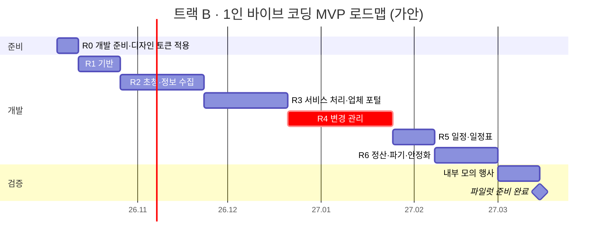

# 04. MVP 범위 및 개발 로드맵 v1.0 (확정)

> 이 문서는 최초 기획·설계 기준입니다. 현재 구현 범위와 이후 변경은 [현재 상태](current-status.md)를 확인하세요. 기획 확정은 전체 개발 완료를 뜻하지 않습니다.

> **검수 요청 문서입니다.** 앞선 세 문서(01 분석서, 02 UX/IA, 03 시스템 명세)에 흩어진 MVP/고도화 표시를 하나로 모으고, 개발 순서와 일정으로 정리했습니다. 문서 끝 **검수 체크리스트**에 따라 피드백 주시면 반영해 v0.2로 올리겠습니다.

**변경 이력**

| 버전 | 일자 | 내용 |
|---|---|---|
| v0.1 | 2026-09-23 | 최초 작성 (검수 요청) |
| v1.0 | 2026-09-23 | 2차 검수 통과 (R7 오늘 일정, R8 트랙 B 5.5개월, R9 고도화 대체 방식 모두 승인) → 확정 |
| v0.2 | 2026-09-23 | 1차 피드백 반영: **1인 바이브 코딩** 체제로 일정 재산정, 축소 후보 5개 고도화 이동, **트랙 A(오늘 포트폴리오) / 트랙 B(실제 개발)** 분리, 목업 대상 FS-01 → PX-08 교체 |

---

## 1. MVP 정의

### 1.1 MVP의 목표

> **PCO 초청 담당자 한 명이 엑셀 없이, 실제 행사 하나(VIP 대표단 20~50명 규모)를 처음부터 정산까지 운영할 수 있다.**

이 문장을 기준으로 기능을 넣고 뺐습니다. "이게 없으면 엑셀로 돌아가야 하는 기능"은 **최대한 모두 포함**하고, 대체 수단이 있는 기능 5개만 고도화로 넘겼습니다 (1.4).

### 1.2 MVP 성공 기준 (파일럿 행사 기준)

| 기준 | 목표 | 연결 KPI |
|---|---|---|
| 엑셀 병행 사용 | 파일럿 행사 중 **담당자의 엑셀 관리 0** (기관 제출용 내보내기는 예외) | 담당자 수작업 건수 |
| 의전 사고 | 시스템 원인 누락 0건 | North Star |
| 미종결 이슈 | 행사 시작 시점 0건 | 선행 KPI |
| 정보 완결률 | D-7 기준 80% 이상 | 선행 KPI |
| 업체 사용 | 참여 업체 전원이 시스템에서 확정 정보 입력 | 전파 추적 |
| 담당자 평가 | "다음 행사에도 쓰겠다" | PCO 재사용률 |

### 1.3 범위 한눈에 보기

| 영역 | MVP 포함 | MVP 단순형 (P1) | 고도화 (P2) |
|---|---|---|---|
| **기반** | 인증(로그인·OTP·재인증), 4단계 권한, 테넌트 격리, 감사 로그, 다국어 구조 + **한·영**, 시간대, 반응형 | - | **일본어**, SSO, 공개 API |
| **조직·행사 설정** | 테넌트·팀, 업체 즐겨찾기·초대, 행사 생성, 참여 업체, 의전 등급, 지원 정책, 동의서, 입력 항목 설정, 영향 규칙 기본값 | 템플릿 관리 (행사 복사로 대체 가능) | 행사 전체 지원 한도 |
| **초청·정보 수집** | 대표단·참가자·대리인, 초청 발송·독촉·반송, 대리인 포털 허브, 동의·재동의, 민감정보 수집, 지원 판정, 참가자 관계 | 대리인 추가 요청 | 엑셀 일괄 등록, 과거 초청자 재사용 |
| **서비스 처리** | 항공(요청·확정·자비), 숙박, 수송(자동 생성), 공항 의전, 식이 요구, 업체 포털(통합 할 일, 처리) | - | 통역, 동반자 프로그램 신청, 비자, 예약 대행 결제, 업체 엑셀 업로드 |
| **변경 관리** ⭐ | 영향 엔진, 변경 이슈 보드·상세, 조정 항목 흐름, 판단 항목, 정정 요청, 재알림·에스컬레이션, 무효화, 실시간 갱신 | - | 항공편 실시간 지연 감지 |
| **일정** | 하위 행사(가안·확정), 참석·역할, 공개 범위, 충돌 경고 | - | **대표단 자체 일정**, 좌석 배치, 외부 참석자 명단, 이동 시간 기반 충돌 |
| **안내** | 일정표 발행(PDF, 다국어), 이메일 알림, 인앱 알림 | - | 문자·메신저 |
| **주최측** | 주최측 요청을 **PCO가 대신 등록** (출처 = 주최측, 처리 이력 유지) | - | **주최측 포털** (대시보드·조회·직접 요청) |
| **현장** | 현장 스태프는 **PCO 콘솔 모바일 화면을 조회 전용 권한**으로 사용 | - | **현장 앱** (오늘 타임라인 등 4화면), 오프라인, 현장 체크 |
| **정산·보안** | 정산 점검, 정산 완료·접근 차단, 개인정보 파기, 예외 보관 | - | **환급 청구** (MVP는 PCO 메모로 관리), 국가별 규정 대응 |
| **보고** | 기관 제출 명단 내보내기 | 감사 이력 화면, 리포트 | 대시보드 고도화 |

### 1.4 MVP에서 명시적으로 제외하는 것

오해를 막기 위해 "안 하는 것"도 적어둡니다.

- 일반 참가자(비 VIP) 등록·관리
- 결제 처리 (환급은 기록만, 송금은 시스템 밖)
- 항공권 예약 시스템(GDS) 직접 연동 — 업체가 자기 시스템에서 예약하고 결과만 입력
- 좌석 배치도
- 한·영 외 언어 (일본어 포함)
- 앱스토어 설치형 앱

**1차 피드백으로 고도화로 이동한 기능** (고도화 1순위)

| 기능 | MVP 대체 방식 |
|---|---|
| 환급 청구 | 지원 방식 "선결제 후 환급" 코드는 유지, 청구·증빙은 PCO가 메모·파일로 관리 |
| 주최측 포털 | PCO가 주최측 요청을 대신 등록, 현황은 내보내기 파일로 보고 |
| 대표단 자체 일정 | 대리인이 메시지로 요청 → PCO가 하위 행사로 등록 |
| 일본어 | 한·영만. 다국어 구조는 그대로 두어 언어 파일 추가만으로 확장 |
| 현장 앱 | 현장 스태프는 PCO 콘솔 모바일 화면(조회 전용) 사용 |

---

## 2. 개발 로드맵

### 2.1 두 개의 트랙

1차 피드백으로 상황이 분명해졌습니다. **오늘 포트폴리오를 완성해야 하고**, 실제 개발은 **혼자 바이브 코딩**으로 진행합니다. 그래서 로드맵을 두 트랙으로 나눕니다.

| 트랙 | 목표 | 기간 | 도구 |
|---|---|---|---|
| **A. 포트폴리오** | 문제 정의부터 UI까지의 기획·설계 역량을 보여주는 결과물 | **오늘** | 이 대화 (Claude) |
| **B. 실제 개발** | 파일럿 행사에 쓸 수 있는 MVP | 약 5~6개월 | Claude Code |

트랙 A의 산출물(디자인 시안, 토큰)이 그대로 트랙 B의 출발점이 됩니다.

### 2.2 트랙 A: 오늘의 포트폴리오 일정

UI 디자인 4단계를 오늘 안에 압축해 진행합니다. 각 단계는 **검수 1회 + 수정 1회**를 기본으로 합니다.

| 순서 | 단계 | 산출물 | 검수 방식 |
|---|---|---|---|
| ① | MVP 범위·로드맵 | 이 문서 v0.2 | 체크리스트 |
| ② | 프레임 목업 | 핵심 7개 화면 흑백 와이어프레임 (데스크톱·모바일 전환, 클릭 가능) | 화면별 검수 포인트 |
| ③ | UI 의사결정 | 레이아웃·내비게이션·표/카드·상태 배지·폼·밀도 선택지 비교 → 결정 | 선택지 고르기 |
| ④ | 테마 선택 | 2~3개 테마를 같은 화면에 적용해 비교 | 고르기 + 조정 |
| ⑤ | **포트폴리오 완성** | 확정 테마를 입힌 고해상도 프로토타입 + 프로젝트 소개 페이지(문제 정의 → 설계 → 화면) | 최종 검수 |

> 시간이 부족하면 ③과 ④를 합쳐, **테마 시안 안에 UI 의사결정 선택지를 함께 보여주는 방식**으로 한 번에 검수받겠습니다.

### 2.3 트랙 B: 1인 바이브 코딩 개발 일정

#### 가정

| 항목 | 가정 |
|---|---|
| 인원 | 의뢰인 1인 (비개발자) + Claude Code |
| 방식 | 릴리스마다 Claude Code가 구현 → 의뢰인이 화면으로 검수 → 수정 반복 |
| 인프라 | 1인 운영이 가능하도록 **관리형 서비스 중심**으로 단순화 (2.5) |
| 작업 시간 | 주 20~30시간 |

#### 일정

| 릴리스 | 기간 | 핵심 내용 | 검수 시연 |
|---|---|---|---|
| R0 개발 준비 | 1주 | 저장소, 배포, DB, 디자인 토큰·기본 컴포넌트 | 빈 화면이 인터넷 주소로 열림 |
| R1 기반 | 2주 | 로그인·OTP, 4단계 권한, 테넌트·팀·업체 즐겨찾기, 행사 생성, 감사 로그, 한·영 다국어, 메일 발송, **이벤트 보관함** | 관리자 로그인 → 직원·업체 초대 → 행사 생성 |
| R2 초청·정보 수집 | 4주 | 의전 등급, 지원 정책, 동의서, 입력 항목 설정, 대표단·참가자·대리인, 초청·독촉, 대리인 포털 허브, 🔒 민감정보, 지원 판정 | 대리인이 휴대폰 영어 화면으로 정보 입력 → PCO가 완결률 확인 |
| R3 서비스 처리 | 4주 | 서비스 공통 틀, 항공·숙박·공항 의전·식이, 수송 자동 생성, 업체 포털, 대표단 360 매트릭스 | 항공 요청 → 업체 확정 → 수송 자동 생성 → 배차 |
| R4 변경 관리 ⭐ | 5주 | 영향 엔진, IR-01~12, 이슈 보드·상세·판단 항목, 조정 항목, 정정 요청, 재알림, 무효화, 실시간 갱신, 행사 홈 | 도착지 변경 → 4차 연쇄 → 재변경 시 무효화 |
| R5 일정·일정표 | 2주 | 하위 행사, 참석·역할, 공개 범위, 충돌 경고, IR-13~16, 일정표 PDF, 주최측 요청 대리 등록 | 면담 확정 → 수송 생성 → 시각 변경 연쇄 |
| R6 정산·안정화 | 3주 | 정산·접근 차단, 파기 배치, 예외 보관, 정합성 점검, 기관 명단 내보내기, 보안 점검, 권한 자동 테스트 | 정산 → 차단 → 파기 확인 |
| 모의 행사 | 2주 | 가상 행사 1건을 처음부터 끝까지 운영 | - |

> 총 **약 23주 (약 5.5개월)**, 2027년 3월 전후 파일럿 준비 완료. 바이브 코딩은 반복 작업이 빠른 대신 **검수에 드는 시간**이 병목이 되므로, 의뢰인의 검수 시간을 일정에 포함했습니다.

### 2.4 1인 바이브 코딩에서 특히 조심할 곳

AI가 만든 코드는 "겉으로는 잘 돌아가는데 규칙이 조용히 빠진" 경우가 가장 위험합니다. 이 제품에서 그런 일이 치명적인 곳은 세 군데입니다.

| 영역 | 위험 | 안전장치 |
|---|---|---|
| **권한·테넌트 격리** | 다른 PCO나 다른 대표단 데이터가 보임 | DB 행 단위 보안을 R1에서 먼저 깔고, 권한 매트릭스를 **자동 테스트로 변환**해 매 배포마다 실행 (03 §5.1) |
| **영향 엔진** | 연쇄가 조용히 누락 | 01 문서의 연쇄 사례(도착지 변경 5차 연쇄 등)를 **시나리오 테스트로 먼저 작성**하고 구현 |
| **민감정보·파기** | 암호화 누락, 파기 후 잔존 | 민감정보 모듈은 가장 단순하게, 파기 후 잔존 검사 테스트 필수 |

이 세 영역은 Claude Code에게 **테스트를 먼저 쓰게 하고, 테스트 통과 화면을 검수**하는 방식으로 진행합니다.

### 2.5 1인 운영을 위한 인프라 단순화 `[트랙 B 시작 시 결정]`

03 문서 §1.9의 권장 스택은 팀 개발 기준입니다. 1인 운영이라면 서버·큐·DB를 직접 관리하지 않는 **관리형 서비스 조합**이 현실적입니다. 국내 리전(D-SY-01)을 지원하는 서비스로 트랙 B 시작 시 확정합니다. 구조(모듈형 단일 서버, 이벤트 보관함, 행사별 암호화)는 그대로 유지합니다.

## 3. 위험과 조정 옵션

### 3.1 주요 위험

| 위험 | 영향 | 대응 |
|---|---|---|
| 영향 엔진 복잡도 과소평가 | R4 지연 → 전체 지연 | R1부터 영향 엔진 설계·프로토타입 병행, R4에 예비 기간 1주 포함 검토 |
| 업체가 시스템을 안 씀 | 전파 추적 불가 | 파일럿 전 주요 업체 2~3곳과 사전 테스트, 업체 화면 단순화 최우선 |
| 대리인 입력 이탈 | 완결률 저조 | R2 끝에 실제 비서 역할 사용성 테스트 |
| 파일럿 행사 확보 실패 | 검증 불가 | 로드맵 확정과 동시에 파일럿 PCO·행사 섭외 시작 |
| 다국어 번역 품질 | 해외 VIP 측 불신 | 일본어 원어민 검수 예산 확보 |

### 3.2 일정 축소 후보 → 반영 완료

1차 피드백으로 5개 후보(환급 청구, 주최측 포털, 대표단 자체 일정, 일본어, 현장 앱)를 모두 고도화로 이동했습니다 (1.4). 추가 축소는 하지 않습니다. 변경 관리, 대리인 포털, 업체 포털, 파기는 **축소 불가**입니다.

---

## 4. 이번 UI 디자인 단계 계획

지금 진행하는 UI 디자인 단계의 세부 계획입니다. 각 단계는 **검수 요청 → 피드백 → 수정**을 반복한 뒤 다음 단계로 넘어갑니다.

| 단계 | 산출물 | 검수 포인트 | 예상 반복 |
|---|---|---|---|
| **① MVP 범위·로드맵** | 이 문서 | 범위, 순서, 일정 가정 | 1~2회 |
| ② 프레임 목업 | 핵심 7개 화면의 흑백 와이어프레임 (데스크톱 + 모바일), 클릭 가능한 웹 페이지 | 정보 배치, 우선순위, 흐름. **색·글꼴은 보지 않음** | 2~4회 |
| ③ UI 의사결정 | 레이아웃 그리드, 내비게이션, 표/카드 패턴, 상태 배지, 폼 패턴, 정보 밀도, 글자 크기 체계 | 패턴 선택지 비교 후 결정 | 1~2회 |
| ④ 테마 선택 | 2~3개 테마 시안을 같은 화면에 적용해 비교 (색, 글꼴, 모서리, 다크 모드) | 브랜드 인상, 가독성 | 1~2회 |
| → 디자인 토큰 확정 | 색·글꼴·간격 값을 코드로 쓸 수 있는 형식으로 | - | - |

### 핵심 7개 화면 (② 프레임 목업 대상)

| ID | 화면 | 기기 |
|---|---|---|
| PCO-E01 | 행사 홈 | 데스크톱 + 모바일 |
| PCO-E02 | 변경 이슈 보드 | 데스크톱 + 모바일 |
| PCO-E03 | 변경 이슈 상세 | 데스크톱 + 모바일 |
| PCO-E05 | 대표단 360 | 데스크톱 + 모바일 |
| PX-03 | 대리인 홈 (체크리스트 허브) | **모바일 우선** + 데스크톱 |
| VD-03 | 업체 통합 할 일 (+ VD-07 처리) | 데스크톱 + 모바일 |
| PX-08 | 대리인 항공 (지원 요청 / 자비 입력 / 확정 확인) | **모바일 우선** + 데스크톱 |

> v0.2에서 현장 앱(FS-01)이 고도화로 빠져, **요청·확정 분리 개념을 가장 잘 보여주는 대리인 항공 화면(PX-08)**으로 교체했습니다.

---

## 5. 검수 체크리스트 (v0.2)

| No | 확인 항목 | 제 기본안 |
|---|---|---|
| **R7** | 2.2 **오늘 포트폴리오 일정**(①~⑤)이 괜찮나요? | 현재 계획대로 |
| **R8** | 2.3 트랙 B **약 5.5개월**이 받아들일 만한가요? | 동의 요청 |
| **R9** | 1.4 고도화 이동 5개의 **MVP 대체 방식**이 괜찮나요? | 현재 표대로 |

v0.1 체크리스트(R1~R6)의 답변은 검수 로그에 기록했습니다.
